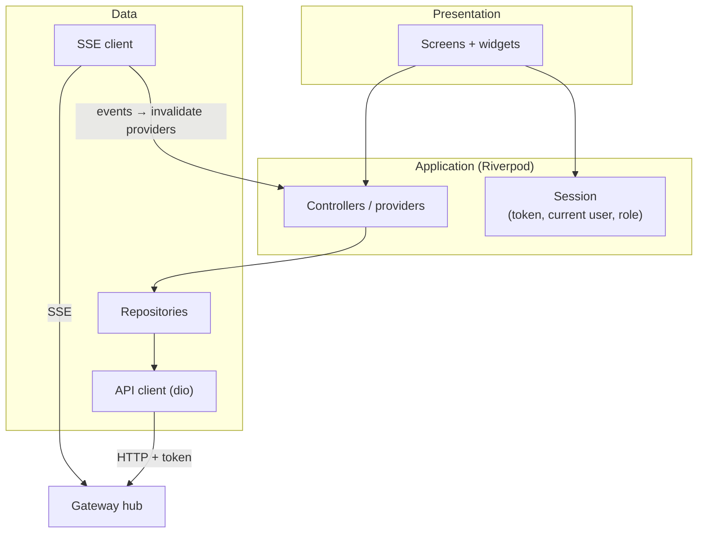
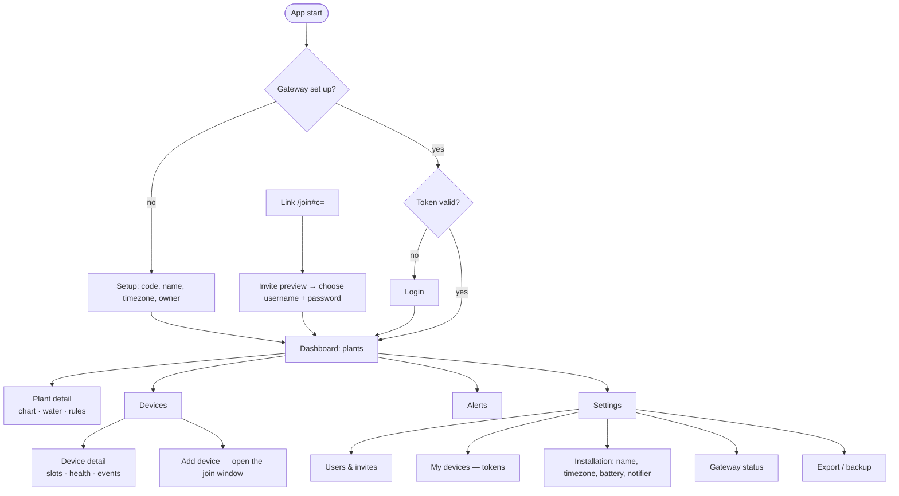
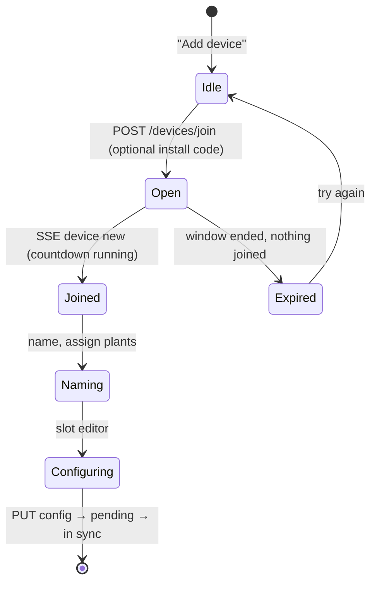

# App — Specification

The app is the only user interface of the system. It is a **Flutter web app served by the Gateway** and talks only to the Gateway's hub API on its own origin (`Gateway/specs.md` Part A §6). The same codebase is meant to become an Android/iOS app later. Responsibilities in the system: [`PROJECT.md`](../PROJECT.md) §4.3.

This file has two parts: **Part A** the app, **Part B** its design system. Build and run: [`readme.md`](readme.md).

---

# Part A — App

## 1. Platforms

| Platform | Status | Notes |
|---|---|---|
| **Web** (Chrome, Edge, Firefox, Safari, last 2 versions) | the target | Served by the Gateway at `http://<gateway>/` on the home network. Works on phones and desktops, can be added to the iOS/Android home screen. |
| Android 8+, iOS 15+ | later | Same code; adds finding the Gateway on the LAN through mDNS (§6.4) and secure token storage. No BLE is needed any more. |

Phones first; tablets and desktop browsers get a two-pane layout on wide screens (§9).

## 2. Technology

| Concern | Choice | Notes |
|---|---|---|
| Framework | Flutter (stable), Dart 3 | Web build is the product |
| State management | `flutter_riverpod`, hand-written providers | Invalidated on SSE events |
| Routing | `go_router` | Deep links `/join#c=<code>`, `/setup` |
| HTTP | `dio`, hand-written `ApiMoistureRepository`. *Planned:* a client generated from the hub's OpenAPI | |
| SSE | Own small client (`lib/data/api/sse*.dart`): `EventSource` on web, streamed `dio` response on mobile | Ticket-based (§6.2) |
| Charts | `fl_chart` | |
| UI | Material 3 plus own `lib/ui/` layer (Part B) | |
| i18n | `flutter_localizations`, `intl`, ARB files | German + English |
| Local storage | `shared_preferences` (web: browser storage) | The login token, theme, language, last used address on mobile. The token is not a password but gives access: on mobile it moves to secure storage. |
| LAN discovery | `multicast_dns` | **Mobile only, later**; the web app does not need it (§6.4) |
| QR display | *planned:* `qr_flutter` for invite links | |

No Firebase, Bluetooth or QR-scanner packages are needed any more.

**Offline-capable build.** The gateway may have no internet at all. The web build must therefore be self-contained: CanvasKit and fonts come from the Gateway's own origin, not from a CDN (build with `--no-web-resources-cdn`; **verify** the flag in the pinned Flutter version) and no Google Fonts requests are made.

## 3. Architecture



- **Screens never call the API directly**, only through controllers → repositories. Two repositories implement `MoistureRepository`: the real `ApiMoistureRepository` and an in-memory `FakeMoistureRepository` (demo data for development and tests).
- **There is one installation**, so there is no household switcher and no household scope. A single provider scope lives as long as the login.
- **The hub is the authority.** The app hides or disables actions the user's role does not allow (§8) but never relies on that for security.

## 4. Screens and navigation

Status: **built** (needs adapting to the new API), **new** or **planned**.



| Screen | Content | Min. role for actions | Status |
|---|---|---|---|
| **Setup** | Setup code from the gateway's log, installation name, timezone, owner username + password | — | new |
| **Login** | Username + password, "this device's name"; token stored on success | — | new |
| **Join (invite)** | Preview (role, installation name), username + password | — | new |
| **Dashboard** | Plant cards: current moisture, trend, reading age, battery, device state (online / sleeping / late / offline), pending commands. Banner "gateway can't reach Zigbee" when the hub reports it; empty state "add a device first" | viewer | built, adapt |
| **Plant detail** | Chart (24 h / 7 d / 30 d / 1 y), **Water now** (seconds picker within the pump's limits), command history, rules list + editor, rule executions ("why did / didn't it water?") | water, rules: member | built, adapt |
| **Devices** | List with status, battery, link quality, firmware, config sync state | viewer | built, adapt |
| **Add device** | Opens the join window (`POST /devices/join`) with an optional install code field and a countdown; the new device appears live and is named and configured right there | admin | new (replaces the BLE wizard) |
| **Device detail** | Slot editor (§10), wake interval and awake window, health chart, events, identify / service mode / reboot, remove | identify: member; rest: admin | built, adapt |
| **Alerts** | Open and closed alerts, acknowledge | ack: member | built, adapt |
| **Users & invites** | Users with roles; change role / remove; create invite → link + QR (copy, share); open invites with revoke | admin (admins: owner) | planned |
| **My devices** | The user's tokens (name, created, last used); revoke; change password | — | planned |
| **Installation** | Name, timezone, battery threshold; notifier settings (Telegram, planned); transfer ownership | owner | planned |
| **Gateway status** | Zigbee2MQTT and coordinator state, hub version, clock, database size, backup now | viewer; backup: admin | built (as Gateway screen), adapt |
| **Export / backup** | Start export, download ZIP | owner, reauth | planned |
| **Settings** | Theme, language, sign out; on the fake backend: demo role switch | — | built |

## 5. Authentication

The hub issues tokens; the app only stores and sends them (`Gateway/specs.md` Part A §5).

- **Start:** the app asks `GET /meta`. If the gateway is not set up it opens Setup; otherwise, without a valid token, Login. A stored token is validated with `GET /me`.
- **Token:** every request carries `Authorization: Bearer <token>`. A `401` that is not `reauth_required` clears the token and returns to Login.
- **Login:** username, password and a device name (pre-filled with the browser/platform, editable). The result token is stored.
- **Sensitive actions** (delete a device, change an admin, transfer ownership, export, reset): on `401 reauth_required` the app shows a password dialog, requests `POST /auth/reauth`, then retries the original request once. For known sensitive actions it asks *before* sending.
- **Sign out:** `POST /auth/logout`, clear the token and the provider scope.
- **My devices:** list and revoke tokens; changing the password logs out all other devices.
- **Plain HTTP:** over the LAN the token is not encrypted in transit (accepted for now; HTTPS arrives with remote access). The Login screen does not show this to the user, but the spec keeps it visible.

## 6. API access, errors and live updates

### 6.1 Requests

- On web the base URL is the page's own origin plus `/api/v1`; a `--dart-define=API_URL=…` overrides it for development against another host. On mobile (later) it comes from §6.4.
- Header `X-MC-App: web/<version>`; on `426 Upgrade Required` the app shows "please reload / update".
- Errors are RFC 9457 problem+json; the app maps the stable `type` to localized messages (`safety_limit`, `busy`, `device_not_ready`, `config_rev_conflict`, `reauth_required`, `slot_not_actuator`, …). Unknown types → generic message + `detail`.
- GETs are retried with backoff (max 3); writes are never retried automatically (except after re-authentication).
- `409 config_rev_conflict` in the slot editor → reload and show "someone else changed this device's configuration".

### 6.2 Live updates (SSE)

1. After login: `POST /events/ticket` → `GET /stream?ticket=…`.
2. Each event invalidates the matching providers (`reading` → plant + dashboard, `command` → command lists, `device`, `config`, `plant`, `rule`, `alert`, `installation`, `join`); `resync` invalidates everything.
3. Reconnect with exponential backoff (1 s → 30 s) and `Last-Event-ID`, with a new ticket each time.
4. A hidden browser tab may pause the stream; on becoming visible again the app reconnects and refreshes.

### 6.3 Unreachable hub

There is no offline cache: when the hub cannot be reached the app keeps what was loaded, greyed out with "can't reach the gateway — showing data from HH:MM", disables actions, and retries in the background. This is a **state**, never an uncaught exception: the repository turns network errors into `ApiProblem(ApiProblem.network)` and the connection banner (Part B §4) shows the state with a Retry button. Nothing blocks on startup. A global error handler (`FlutterError.onError`, `PlatformDispatcher.onError` in `bootstrap.dart`) logs unexpected errors instead of terminating.

### 6.4 Finding the gateway (mobile app, later)

The web app is opened at the gateway's address, so it needs no discovery (`http://moisture.local` resolves in the browser). A later mobile app must *find* the gateway, and the existing implementation is kept for that:

- The hub advertises `_moisture-api._tcp` over mDNS (`id`, auth mode and API path in TXT records; `Gateway/specs.md` §15.2).
- Resolution order: last used address (probe `GET /meta`, 1.5 s) → mDNS browse (5 s, each result verified by the probe, the remembered `id` wins) → manual entry. Background re-discovery with backoff while unreachable.
- States `searching` · `connected(url)` · `unreachable(lastUrl?)` · `choose(list)`, plus `fixed` for the web build (the address is the origin). The Server screen shows the current gateway, discovered ones, "Enter address…" and "Search again".
- Permissions: iOS `NSLocalNetworkUsageDescription` and `NSBonjourServices`; Android multicast permissions; cleartext HTTP is allowed for private-range addresses only.
- Implementation: `lib/data/discovery/`, `lib/core/api_endpoint.dart`, `lib/ui/connection_banner.dart`, `lib/features/settings/server_screen.dart`; unit-tested with a fake mDNS source and prober. Not done: the Android `MulticastLock`.

## 7. Asynchronous device actions in the UI

Devices sleep; nothing happens instantly. The UI makes that explicit:

- **Water now:** the command appears immediately as *Queued* with "device expected ~14:32" (from `next_expected_at`) and updates live: *Delivered / Running until … / Done / Failed (reason) / Expired / Cancelled*. A queued command can be cancelled ("best effort, may already have run").
- **Config changes:** the device shows *Pending (rev 8)* until it reports. *Rejected* shows the device's error (e.g. "GPIO 1 cannot drive this module") with a button to revert the form to the reported config.
- **Zigbee/gateway trouble:** a banner on all screens ("Zigbee is not running — data and commands are paused"); devices are not marked offline meanwhile.
- **Late / offline devices:** a status chip with "last seen 2 h ago" and the link quality.

## 8. Role-aware UI

The current role comes from `GET /me` (refreshed on `installation` events). A single `can(action)` helper (`lib/core/permissions.dart`) mirrors the matrix in [`PROJECT.md`](../PROJECT.md) §3.2: actions the user cannot perform are hidden (navigation entries) or disabled with a tooltip (buttons). A 403 shows "your role no longer allows this" and refreshes the role. Settings → Demo switches the role on the fake backend to try this out.

## 9. Design

Component library and palette: Part B.

- Material 3, light and dark theme (system default), one accent colour. Moisture uses a consistent dry → wet colour scale and is always shown with its number.
- Responsive: single column < 600 dp; list + detail two-pane ≥ 840 dp.
- Accessibility: semantic labels on icon buttons and chart summaries, touch targets ≥ 48 dp, text scaling up to 200 % without clipping, contrast ≥ 4.5:1.
- Localization: German and English (`l10n/app_de.arb`, `app_en.arb`); dates, times and numbers via `intl`; the installation timezone is used for everything shown about the plants (rules, quiet hours, charts).

## 10. Slot configuration editor

- Loads `GET /devices/{d}/config` (desired, reported, sync state, limits) and the board description `GET /meta/boards/{board}` (the logical ports of the device's PCB revision with the roles each supports, e.g. analog sensor or pump with deep-sleep hold; served by the hub from the board files of the PlantModule, so the app never duplicates board knowledge).
- Per slot: module picker, port picker (P1…Pn) filtered to ports that exist on this board, support the module and are not used by another slot, module options (calibration dry/wet, `active_high`, `max_run_s` ≤ hard limit, `min_pause_s`).
- Device-level fields: `wake_interval_s` (60–86400 s, default 600) and `awake_s` (2–60 s, default 5). The old "0 = never sleep" no longer exists; the 5-minute commissioning window after joining replaces it (`PlantModule/specs.md` Part A §6.4). The editor also shows when the change will take effect ("at the next check-in, about 14:32").
- Save = `PUT …/config` with `base_rev`; validation errors (422) show on the affected slot.
- **Planned:** the calibration wizard (capture *dry* and *wet* with `sensor_sample` while the device is in its commissioning window, review, save as a new revision). It needs the firmware command and a hub endpoint.

## 11. Adding a device (Zigbee join)

Replaces the BLE pairing wizard; nothing is paired from the phone and no secret is entered or shown.



- The page explains what to do on the device ("hold the button for 3 s, or power it up") and shows a countdown of the join window (default 2 minutes, `DELETE /devices/join` closes it early).
- With an install code the admin types or pastes the code from the label first; the label's QR can be scanned later (a camera scanner is not needed in the web app).
- A device that fails its interview is shown with the hub's error; the admin can remove it and try again.
- Only admins can open the window. The Zigbee network is open to joining only while the window is open.

## 12. Users, invites and sessions

- **Users & invites** (planned): list users with role badges; owner/admin can change roles and remove users within the rules of the role matrix; creating an invite shows the code **once** as link, QR (`qr_flutter`) and a copy button; open invites can be revoked.
- **Join:** the link `http://<gateway>/join#c=<code>` opens the Join screen (the part after `#` is not sent to any server); the user picks a username and password; the app stores the returned token and opens the dashboard.
- **My devices:** shows the user's tokens with last used time and a revoke button.

## 13. Notifications

The app shows alerts in the Alerts screen and as a badge; with the page open they arrive live over SSE. **Telegram** notifications are configured by the owner in Installation (bot token, chat id, "send test message"; planned, `Gateway/specs.md` §13). Web push and native push are out of scope until HTTPS and remote access exist.

## 14. Entry points, build and migration

| Entry point | Backend | Purpose |
|---|---|---|
| `lib/main_dev.dart` | In-memory `FakeMoistureRepository`: sample plants, devices, alerts; watering runs queued → delivered → running → done over seconds | UI development and demos |
| `lib/main.dart` (to become the hub entry point; today `main_local.dart`) | The real hub: same-origin API on web, `API_URL` for development | The product |
| mobile entry (later) | The hub found through mDNS (§6.4) | Android/iOS app |

**Build and serve:** `flutter build web --release` produces `App/build/web`, which the hub serves (`MC_WEB_DIR`); a dev stack that builds and serves it together with the hub is planned. The build must be self-contained (§2).

**Migration from the current code:**

- **Removed already:** the BLE pairing wizard, label scanner and protocol code, the `flutter_reactive_ble`, `mobile_scanner` and `cryptography` dependencies, BLE tests and permissions.
- **Remove:** the household switcher and household scoping, the `local` flavor naming.
- **Adapt:** `ApiMoistureRepository` to the new API (no `/households/{h}` prefix, token auth, `/stream` without a household), models (no households, memberships), the Gateway screen (Zigbee2MQTT status), device screens (join flow, awake window), permissions to the new role endpoint.
- **Add:** Setup, Login, Join, Users & invites, My devices, Installation screens; the "Add device" join screen; a build that does not use a CDN.
- **Keep:** dashboard, plant detail, rules, alerts, charts, design system, SSE client, connection banner and state handling, mDNS discovery (for mobile later), localization.

## 15. Code layout (target)

```
App/
├── pubspec.yaml · l10n.yaml · analysis_options.yaml
├── lib/
│   ├── main.dart · main_dev.dart                  # hub entry point and fake-backend entry point
│   ├── app/                 # app.dart, bootstrap.dart, router.dart, theme/ (Part B)
│   ├── ui/                  # shared components (Part B §4)
│   ├── core/                # session (token), permissions, live_updates, format, settings, api_endpoint (mobile)
│   ├── data/
│   │   ├── api/             # SSE client
│   │   ├── discovery/       # mDNS browse, probe (mobile, later)
│   │   ├── repositories/    # moisture_repository, api_ (Dio), fake_
│   │   └── api_problem.dart · models.dart
│   ├── features/            # auth (setup, login, join, tokens) · dashboard · plants · devices (incl. add/join) · alerts · users · installation · settings
│   └── l10n/                # generated localizations
├── l10n/                    # app_de.arb, app_en.arb
├── design/ · tool/          # Material theme export, colour-scheme generator
└── test/
```

## 16. Testing

| Level | What |
|---|---|
| Unit / widget (exist) | Fake repository, API repository (HTTP mocked), permissions, theme, gateway screen, discovery (kept for mobile). |
| To adapt / add | Token handling and `401` flows (login redirect, reauth dialog), setup and invite flows, join-window screen with SSE events, config editor with the awake window, role-based widget tests (viewer sees no water button), SSE reconnect/resync, golden tests for `lib/ui/` (`alchemist`). |
| Integration (manual) | The app against the real hub with a Zigbee2MQTT simulator (dev stack planned). An automated browser test is planned. |
| On hardware | Joining and configuring a real PlantModule from the web app. |

## 17. Open points

- The build and serve setup of Flutter web without a CDN (**verify** flags; also check `go_router` URL strategy when served from the hub root).
- Generated API client from the hub's OpenAPI.
- Which parts of the Gateway status screen the hub can fill (Zigbee2MQTT state, coordinator info).
- Calibration wizard and the `sensor_sample` flow; display of the awake window and "device expected" times.
- Telegram settings UI and message format.
- Mobile app: secure token storage, discovery on real networks, the Android `MulticastLock`.
- Offline cache of the last loaded data, if it turns out to be useful.
- Home-screen widgets for "plants that need attention" (mobile, later).


---

# Part B — Design system

Defines the UI component library and the colour palette. General rules (Material 3, responsive breakpoints, accessibility, localization) are in Part A §9; this part makes them concrete.

## 1. Component library

| Concern | Choice | Notes |
|---|---|---|
| Base components | **Material 3** (`useMaterial3: true`) | Native feel on Android, good accessibility defaults, light/dark from one `ColorScheme` |
| Own components | **`lib/ui/`**: thin layer of app-specific widgets built on Material | Screens use these instead of styling Material widgets ad hoc (§4) |
| Component catalog | *Planned:* **Widgetbook** in `App/widgetbook/` (not created yet), with use cases for light/dark, DE/EN, text scale 100 %/200 % and phone/tablet | |
| Golden tests | *Planned:* `alchemist` for `lib/ui/` components in both themes | |

Rejected: `shadcn_ui` / `forui`: nice on web, but non-native on Android/iOS and a second styling system next to Material.

## 2. Colour palette

All colours live in code in `lib/app/theme/` (`color_scheme.dart`, `app_colors.dart` with the two extensions, `tokens.dart`, `app_theme.dart`) — **no hex values in feature code**. Material roles come from `Theme.of(context).colorScheme`, app-specific colours from `ThemeExtension`s (§2.3, §2.4).

### 2.1 Material colour scheme — from Material Theme Builder

**Source of truth:** [`design/material-theme.json`](design/material-theme.json), exported from [Material Theme Builder](https://material-foundation.github.io/material-theme-builder/) (seed `#2D391C`, "Moss"). To change the palette, re-export from the builder and overwrite that file — never edit single roles by hand.

The app uses the **exported schemes as-is**, not `ColorScheme.fromSeed(...)`: `fromSeed` with the same seed produces slightly different values than the builder's custom export. `lib/app/theme/color_scheme.dart` is generated from the JSON (`dart run tool/gen_color_scheme.dart`) and contains six `ColorScheme`s:

| Scheme | Selected when |
|---|---|
| `light` / `dark` | Default, following the system brightness (or the user's choice in account settings) |
| `light-medium-contrast` / `dark-medium-contrast` | Not used in v1 |
| `light-high-contrast` / `dark-high-contrast` | `MediaQuery.highContrastOf(context)` is true (iOS "Increase contrast", Android high-contrast text) → `MaterialApp.highContrastTheme` / `highContrastDarkTheme` |

Key roles (from the export, `light` / `dark`):

| Role | Light | Dark | Use |
|---|---|---|---|
| `primary` / `onPrimary` | `#4D662A` / `#FFFFFF` | `#B3D088` / `#213600` | The one accent (Part A §9): primary buttons ("Water now"), selection, FAB |
| `primaryContainer` | `#CFEDA2` | `#364E14` | Selected plant card, active tab indicator |
| `secondary` / `secondaryContainer` | `#586249` / `#DCE7C7` | `#C0CBAC` / `#414A33` | Filter chips, tonal buttons |
| `tertiary` / `tertiaryContainer` | `#386662` / `#BCECE6` | `#A0D0CA` / `#1F4E4A` | Secondary chart series, info accents |
| `error` / `errorContainer` | `#BA1A1A` / `#FFDAD6` | `#FFB4AB` / `#93000A` | Errors, offline, destructive actions |
| `surface` | `#F9FAEF` | `#12140E` | Page background |
| `surfaceContainerLow` | `#F4F4E9` | `#1A1C16` | Cards (plant cards, device rows) |
| `surfaceContainerHigh` | `#E8E9DE` | `#282B24` | Dialogs, bottom sheets, nav bar |
| `onSurface` / `onSurfaceVariant` | `#1A1C16` / `#44483D` | `#E2E3D8` / `#C5C8B9` | Text / secondary text |
| `outline` / `outlineVariant` | `#75796C` / `#C5C8B9` | `#8F9285` / `#44483D` | Borders, dividers, chart thresholds |

Android 12+ dynamic colour (wallpaper-based) is **off** — the app keeps its own identity and the colours below are tuned against these surfaces.

### 2.2 Extended colours

The theme builder export has no `extendedColors`; the moisture scale and the status colours are defined in code as `ThemeExtension`s (§2.3, §2.4), because they need hand-tuned contrast and a colour-blind-safe order that the builder's automatic harmonisation would change. In high-contrast mode they use the same values (they already meet the contrast rules below).

### 2.3 Moisture scale — `MoistureColors` extension

Sequential dry → wet scale (sand → leaf → teal → water), colour-blind safe (no red/green pair, hue plus lightness change). Values between stops are interpolated linearly in `MoistureColors`.

| Stop | Moisture | Light | Dark | Name |
|---|---|---|---|---|
| 0 | 0 % | `#A06C0A` | `#F0C45C` | Sand |
| 1 | 25 % | `#5E8A2C` | `#B5D67A` | Leaf |
| 2 | 50 % | `#1F7F73` | `#5CC8B8` | Teal |
| 3 | 75 % | `#246FA8` | `#6FB4EC` | Water |
| 4 | 100 % | `#243F8F` | `#A3B2F7` | Deep water |

Rules:

- **Never colour alone** (Part A §9): the percentage is always shown next to any moisture colour, as text in `onSurface` — the moisture colour is used for fills (gauge, bar, chart line, dot), never for text.
- Every stop has ≥ 3 : 1 contrast (WCAG 1.4.11, graphical objects) against `surface`, `surfaceContainerLow` and `surfaceContainerHigh` of its theme.
- The scale is absolute (0–100 %), not relative to a plant's rule thresholds; thresholds are drawn as lines on the chart instead.

### 2.4 Status colours — `StatusColors` extension

Every status is shown as **icon + label + colour** (chip), never colour alone.

| Status | Light | Dark | Icon | Used for |
|---|---|---|---|---|
| `ok` | `#27692B` | `#81C784` | `check_circle` | Device online, command done, gateway in sync |
| `sleeping` | `#505D6B` | `#AAB6C2` | `bedtime` | Device sleeping as expected (normal state, deliberately calm) |
| `pending` | `#0F5AAE` | `#9CC3F5` | `schedule` | Queued / delivered / running commands, config pending |
| `warning` | `#8A5100` | `#FFB95C` | `warning` | Device late, low battery, gateway offline banner |
| `error` | = `colorScheme.error` | = `colorScheme.error` | `error` | Device offline, command failed / expired, config rejected |

Chip background: the status colour at 12 % opacity (light) / 16 % (dark) over the card surface; label and icon in the full status colour. Label text has ≥ 4.5 : 1 contrast against that tinted chip background on `surface` and `surfaceContainerLow`. On `surfaceContainerHigh` (dialogs, sheets) `warning` and `error` drop just below that, so chips there use the untinted surface (no 12 % background).

### 2.5 Charts

- Moisture line: `MoistureColors` gradient along the value axis; min/max band at 20 % opacity.
- Other series (temperature, battery, RSSI): `primary`, `tertiary`, `secondary` in that order.
- Rule thresholds: dashed `outline` line with a label. Watering events: `pending` colour markers.

---

## 3. Other tokens

| Token | Values |
|---|---|
| Spacing | 4, 8, 12, 16, 24, 32 (`Spacing.xs … xxl`) |
| Radius | 8 (chips, inputs), 12 (cards), 28 (dialogs, bottom sheets — M3 default) |
| Typography | Material 3 type scale, default platform font (Roboto / SF). Numbers (moisture, battery, times) use tabular figures (`FontFeature.tabularFigures()`). |
| Elevation | M3 tonal elevation only; no custom shadows |
| Icons | Material Symbols (rounded) |

---

## 4. `lib/ui/` components

Built:

| Component | Content |
|---|---|
| `MoistureGauge` | Ring or bar with `MoistureColors` fill and big percentage |
| `StatusChip` | One of the §2.4 statuses with optional detail ("last seen 2 h ago") |
| `PlantCard` | Dashboard card: name, gauge, trend, reading age, battery, `StatusChip`, pending-command badge |
| `CommandStateTile` | Queued / delivered / running / done / failed / expired / cancelled with times (Part A §7) |
| `ConnectionScope` + connection banner | Wraps screens; shows the unreachable-hub state with Retry (Part A §6.3); on mobile also searching and Enter address (Part A §6.4) |
| `HouseholdScope`, `AsyncBody` | Scopes a subtree to the logged-in session (to be renamed `SessionScope` when households go away); renders loading / error / data of an `AsyncValue` |
| `HouseholdBanner` | Zigbee/gateway-trouble and offline-data banner (`warning`) |
| `RoleGate` | Hides or disables its child based on `can(action)` with a tooltip (Part A §8) |
| `SectionCard`, `EmptyState`, `ErrorState` | Titled card for settings and detail sections; icon + text + action states (all in `common.dart`) |

Layout: `lib/app/theme/` (colour scheme, `MoistureColors`, `StatusColors`, tokens) and `lib/ui/` (components: no feature logic, no providers); `design/material-theme.json` is the palette source.
