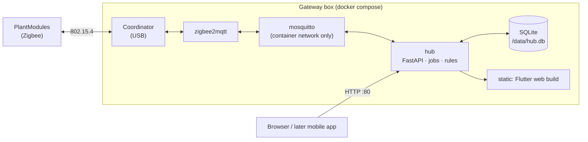
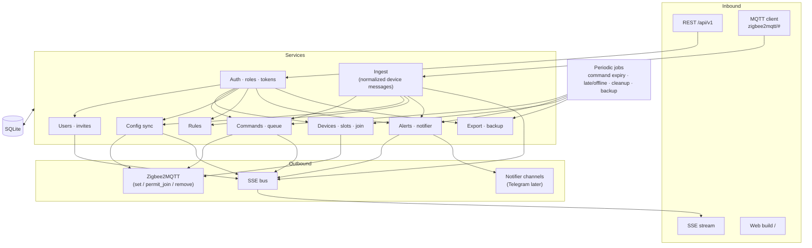
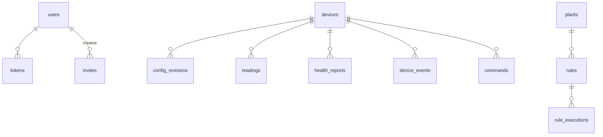
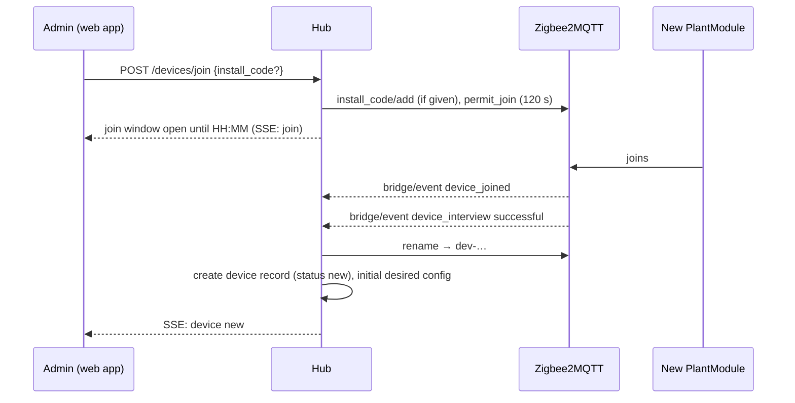
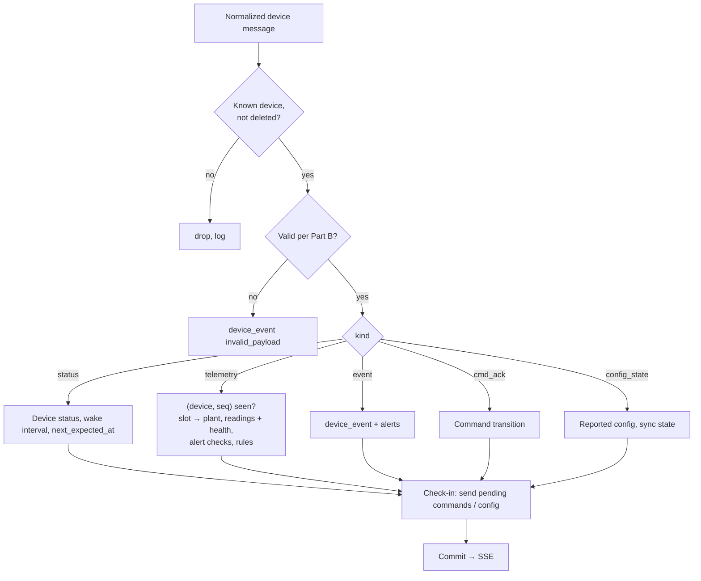
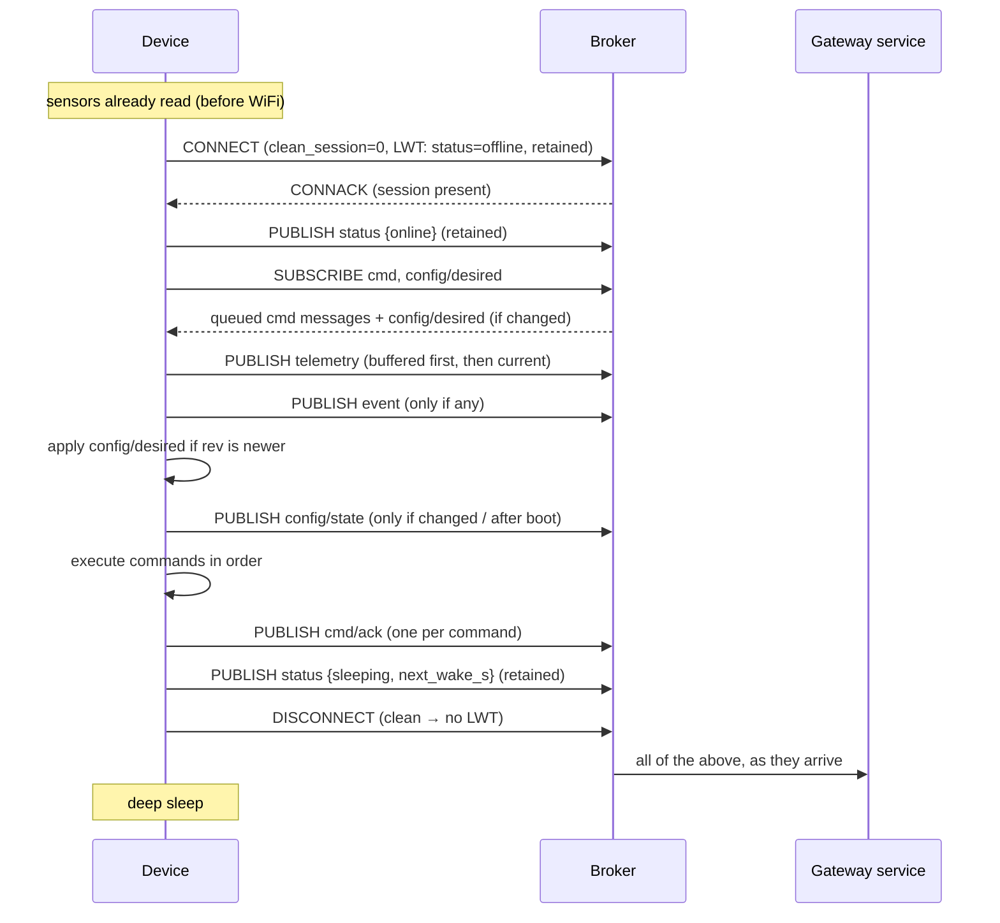

# Gateway — Specification

The Gateway is the box at home that runs the whole system: it hosts the Zigbee network, stores all data, runs the watering rules and serves the web app and its API. Its responsibilities in the system are in [`PROJECT.md`](../PROJECT.md) §4.2; this file is the design.

It contains **Part A**, the design of the gateway and its **hub service**, and **Part B**, the device message model between Zigbee2MQTT and the hub (a contract that the PlantModule's Zigbee cluster and converter implement). **Appendix** keeps the previous MQTT contract, which the existing tests still read until the code is migrated.

Folder (target): `firmware/` (hub service, compose files, Zigbee2MQTT config and converter), `scripts/` (setup, backup, device simulator), `hardware/` (empty). Run and test commands: [`readme.md`](readme.md).

> **Redesign note.** This spec replaces the previous Gateway and Server specs. The hub service reuses most of the old Server code (API, commands, rules, alerts) and the old gateway logic (rules, command checks); the WebSocket uplink, outbox, downlink queue, gateway enrollment, multi-household support, Firebase and PostgreSQL go away. Section 19 lists the migration.

---

# Part A — Gateway and hub service

## 1. Requirements

| Item | Requirement |
|---|---|
| Hardware | Raspberry Pi 4/5 (or a mini PC / old laptop), ≥ 2 GB RAM, ≥ 8 GB storage (SD card or better, SSD recommended for the database), plus a **Zigbee USB coordinator** (e.g. Sonoff ZBDongle-E or -P) |
| OS | 64-bit Linux with Docker Engine and the Compose plugin |
| Images | Multi-arch: `linux/arm64` and `linux/amd64` |
| Network | Wired Ethernet preferred; a fixed IP or a hostname (`moisture.local` through mDNS). No port is exposed beyond the LAN. |
| Time | NTP on the host. The hub refuses to create rule commands while the clock is not synced. |

## 2. Components



| Container | Image | Purpose |
|---|---|---|
| `zigbee2mqtt` | official image, version pinned | Zigbee network, device joining, translation of Zigbee messages to MQTT and back. Has the coordinator passed in as a device. Contains the external converter for the PlantModule. Its own frontend is disabled in production. |
| `mosquitto` | official image | Internal broker between Zigbee2MQTT and the hub. Listens only on the container network. |
| `hub` | `mc-hub` (ours, multi-arch) | The hub service: Zigbee2MQTT adapter, ingest, SQLite, command queue, rules, alerts, notifier, users and tokens, REST + SSE API, static hosting of the web build. |

Volumes: `hub-data` (`/data`: `hub.db`, backups), `z2m-data` (Zigbee2MQTT configuration, network key, `coordinator_backup.json`, devices database). Only the `hub` container publishes a port (80/8000, configurable).

**Single process.** The hub runs as one Uvicorn process hosting the API, the SSE hub, the MQTT client and the periodic jobs. That is plenty for one household.

## 3. Hub service architecture



- **Routers are thin**: parse, auth dependency, one service call, serialize. **Services own logic and transactions.**
- **Every write the app should see live emits an SSE event** after commit.
- **Everything towards devices goes through the command queue and the config revisions in SQLite** and is sent by the sender (section 9.4) when the device checks in.
- **Adapter boundary.** Everything Zigbee-specific lives in one module (`zigbee/`: topics, converter payloads, joining). It turns Zigbee2MQTT messages into the normalized device messages of Part B and turns commands and configs into Zigbee2MQTT `set` payloads. Ingest, commands and rules know nothing about Zigbee, so another source can be added later.

## 4. Data model (SQLite)

Timestamps are UTC Unix seconds in the database and ISO 8601 in the API. IDs are ULIDs unless noted; devices are identified by their Zigbee IEEE address (`0x00124b…`) and get a stable internal ID `dev-…`. There is **one household** per installation, so no table carries a household column.



| Table | Key columns | Notes |
|---|---|---|
| `settings` | `key`, `value` | Installation: `name`, `timezone`, `battery_low_mv`, `snapshot`/schema version, notifier configuration, setup state |
| `users` | `id`, `username` (unique), `password_hash`, `role` (`owner`/`admin`/`member`/`viewer`), `display_name`, `created_at`, `disabled_at` | Exactly one `owner` (partial unique index) |
| `tokens` | `id`, `user_id`, `token_hash`, `name` ("Philipp's iPhone"), `created_at`, `last_used_at`, `revoked_at` | SHA-256 of a 256-bit random token; only the hash is stored |
| `invites` | `id`, `code_hash`, `role`, `created_by`, `expires_at`, `used_by`, `used_at`, `revoked_at` | SHA-256 of the code only |
| `devices` | `id` (`dev-…`), `ieee` (unique), `model`, `name`, `fw`, `board`, `status`, `last_seen_at`, `next_expected_at`, `wake_interval_s`, `batt_mv`, `link_quality`, `last_seq`, `desired_rev`, `desired_config`, `reported_rev`, `reported_config`, `rejected_rev`, `config_error`, `sensor_error_streak`, `created_at`, `deleted_at` | `status` ∈ `new`, `online`, `sleeping`, `late`, `offline`, `service` |
| `config_revisions` | `device_id`, `rev`, `kind`, `body`, `result`, `error`, `created_at`, `created_by` | Full history |
| `plants` | `id`, `name`, `notes`, `sensor_device_id`, `sensor_slot`, `pump_device_id`, `pump_slot`, `archived_at` | |
| `readings` | `id` (integer), `device_id`, `slot`, `plant_id`, `type`, `value`, `raw`, `error`, `ts`, `seq` | Indexes (`plant_id`, `ts`), (`device_id`, `slot`, `ts`) |
| `health_reports`, `device_events` | per check-in / per event | Battery, link quality; events such as `low_battery`, `sensor_fault`, `safety_stop` |
| `commands` | `id`, `device_id`, `plant_id`, `action`, `args`, `status`, `reason`, `source` (`manual`/`rule`), `created_by`, `rule_id`, `created_at`, `exp`, `sent_at`, `delivered_at`, `finished_at`, `ends_at`, `cancel_of` | `sent_at` = handed to Zigbee2MQTT |
| `rules` | `id`, `plant_id`, `enabled`, `threshold`, `water_s`, `cooldown_s`, `max_per_day`, `quiet_from`, `quiet_to`, `created_by`, `updated_at` | |
| `rule_executions` | `id`, `rule_id`, `plant_id`, `ts`, `reading_ref`, `decision`, `skip_reason`, `command_id` | Written by the hub's own rule evaluation |
| `alerts` | `id`, `kind`, `subject_type`, `subject_id`, `subject_name`, `severity`, `opened_at`, `resolved_at`, `acked_by`, `acked_at`, `detail` | One open alert per (`kind`, `subject`) |
| `audit_log` | `id`, `actor`, `action`, `detail`, `ts`, `ip` | Role changes, invites, device add/remove, export, resets |

SQLite runs in WAL mode with foreign keys on; migrations with Alembic. The hub is the only process that opens the database.

## 5. Authentication and authorization

### 5.1 Setup

On first start the hub creates no user and prints a one-time **setup code** to its log (and `mc-hub status`). Opening the web app shows "set up this gateway": setup code, installation name, timezone, then the owner's username and password. The code is then spent. If the owner is lost, `mc-hub reset-owner` (shell access to the box) prints a new code.

### 5.2 Login and tokens

- `POST /auth/login {username, password, device_name}` → `{token, user}`. The token is 32 random bytes (base64url), stored by the client (browser storage or secure storage on mobile) and sent as `Authorization: Bearer <token>`. Only `SHA-256(token)` is stored.
- Passwords are hashed with argon2id. Login attempts are limited per username and per IP (for example 5 failures → exponential delay), which also protects against guessing on the LAN.
- `GET /auth/tokens` lists the user's tokens (name, created, last used); `DELETE /auth/tokens/{id}` revokes one; changing the password revokes all other tokens. Admins can revoke any user's tokens.
- Tokens do not expire on their own but can be revoked; unused tokens older than a configurable age (default 180 days) are removed by the cleanup job.

### 5.3 Roles

The role matrix is in [`PROJECT.md`](../PROJECT.md) §3.2. One FastAPI dependency per minimum role; a role that is too low → **403**. Admins may invite and assign up to `member` and remove `member`/`viewer`; only the owner changes admins, transfers ownership and exports. The owner cannot be removed.

### 5.4 Sensitive actions

Delete a device, change an admin's role, transfer ownership, export, reset the gateway: the request must include the user's password (`X-MC-Reauth` for the request, or a short `POST /auth/reauth` that returns a 5-minute proof). Without it → **401 `reauth_required`**.

### 5.5 Invites

An admin creates an invite (`POST /invites {role, expires_in}`) and gets a one-time code, shown only once: the app builds `http://<gateway>/join#c=<code>`. `GET /invites/{code}` previews it (role, installation name); `POST /invites/{code}/accept {username, password, display_name}` creates the user and returns a token. Codes are single-use, expire (default 48 h) and can be revoked.

### 5.6 Exposure

| Measure | Status |
|---|---|
| Hub listens on the LAN port only; Zigbee2MQTT, Mosquitto and the database are not published | design |
| Headers: `X-Content-Type-Options: nosniff`, `Content-Security-Policy` for the web build, `Referrer-Policy: no-referrer` | planned |
| Login rate limiting (5.2) | planned |
| Request size limits (JSON ≤ 64 KB) | planned |
| HTTPS, HSTS, CORS | not needed on the LAN; arrive with remote access (the web build is same-origin) |

## 6. REST API

Base `/api/v1`, JSON, ISO 8601 UTC timestamps, errors as RFC 9457 problem+json with stable `type`s. The web app and any later mobile app use the same API.

| Area | Endpoints (min. role) |
|---|---|
| **Setup / auth** | `GET /meta` (unauthenticated: name, setup state, version, auth mode), `POST /setup` (setup code), `POST /auth/login`, `POST /auth/logout`, `GET /auth/tokens`, `DELETE /auth/tokens/{id}`, `POST /auth/reauth`, `GET /me`, `PATCH /me` (name, password) |
| **Installation** | `GET /installation` (viewer), `PATCH /installation` (owner: name, timezone, battery threshold, notifier settings), `GET /status` (viewer: Zigbee2MQTT and coordinator state, hub version, clock, database size) |
| **Users, invites** | `GET /users` (viewer), `PATCH /users/{id}` (admin; owner for admins), `DELETE /users/{id}`, `POST /transfer-ownership` (owner), `GET/POST /invites` (admin), `DELETE /invites/{id}` (admin), `GET /invites/{code}`, `POST /invites/{code}/accept` (unauthenticated), `GET /audit` (admin) |
| **Devices** | `GET /devices` (viewer), `POST /devices/join` (admin: opens the join window, optional `install_code`), `GET /devices/join` (viewer: join state), `GET/PATCH/DELETE /devices/{d}` (viewer / admin / admin with reauth), `GET/PUT /devices/{d}/config` (viewer / admin), `GET /devices/{d}/health`, `GET /devices/{d}/events` (viewer), `POST /devices/{d}/actions` (member for identify, admin otherwise) |
| **Plants, readings** | `GET/POST /plants`, `GET/PATCH/DELETE /plants/{p}` (viewer / member), `GET /plants/{p}/readings?from&to&bucket` (viewer), `GET /plants/{p}/commands` (viewer) |
| **Watering, commands** | `POST /plants/{p}/water` (member), `GET /commands`, `GET /commands/{c}` (viewer), `POST /commands/{c}/cancel` (member) |
| **Rules** | `GET/POST /plants/{p}/rules`, `PATCH/DELETE /plants/{p}/rules/{r}` (viewer / member), `GET /plants/{p}/rules/{r}/executions` (viewer) |
| **Alerts** | `GET /alerts` (viewer), `POST /alerts/{a}/ack` (member) |
| **Live** | `POST /events/ticket`, `GET /stream?ticket=` (viewer; SSE) |
| **Data** | `POST /export` (owner, reauth), `POST /backup` (admin) |
| **Board** | `GET /meta/boards/{board}` (pin rules from `mc_core.pins`, used by the slot editor) |

The OpenAPI document is generated from the code; committing it as `api.yaml` and generating the Dart client from it is planned, until then the app keeps its hand-written Dio client.

### 6.1 Live updates (SSE)

1. `POST /events/ticket` returns a random ticket valid 60 s, single use, bound to the user.
2. `GET /stream?ticket=…` checks it, then streams.
3. `Last-Event-ID` replays from a ring buffer (200 events); too old, or from a previous process → `resync`.
4. `ping` every 25 s. Streams of revoked tokens are closed.

Events: `reading`, `device`, `command`, `config`, `plant`, `rule`, `alert`, `installation`, `join`, `resync`.

## 7. Zigbee2MQTT integration

Zigbee2MQTT does the radio work; the hub talks to it only through MQTT topics (base topic `zigbee2mqtt`). Exact payloads depend on the Zigbee2MQTT version (pinned) and the PlantModule converter; they are fixed when the PlantModule cluster is specified, and the items below marked *verify* are to be checked against the pinned version.

### 7.1 What the hub reads

| Topic | Use |
|---|---|
| `zigbee2mqtt/bridge/state` | Zigbee2MQTT online/offline (shown in `GET /status`; alert `zigbee_offline` when it stays offline) |
| `zigbee2mqtt/bridge/devices` (retained) | Device list with IEEE address, model, definition, `exposes`; the hub reconciles its `devices` table with it |
| `zigbee2mqtt/bridge/event` | `device_joined`, `device_interview` (started/successful/failed), `device_leave`, `device_announce`; drives the join flow and status |
| `zigbee2mqtt/<friendly_name>` | State/report payload of a device after every report (the converter's output) |
| `zigbee2mqtt/<friendly_name>/availability` | Not used for sleepy devices; the hub derives status from check-ins and the configured wake interval |
| `zigbee2mqtt/bridge/response/#` | Answers to the hub's requests (permit join, rename, remove, options) |

The hub sets the `friendly_name` of a device to its internal ID (`dev-…`), so MQTT topics never depend on user-visible names.

### 7.2 What the hub writes

| Topic | Use |
|---|---|
| `zigbee2mqtt/bridge/request/permit_join` | Open the join window (time ≤ 254 s); *verify* the exact payload and whether permit-join targets the coordinator or a router |
| `zigbee2mqtt/bridge/request/install_code/add` | Register an install code before the device joins; *verify* |
| `zigbee2mqtt/bridge/request/device/rename`, `…/remove` | Set the `friendly_name`; remove a device from the network |
| `zigbee2mqtt/<friendly_name>/set` | Write attributes and send commands (pump on/off with timed off, configuration attributes, the custom command); the payload keys are those of the PlantModule converter |

### 7.3 Joining



The join window closes after its time or when the admin closes it (`DELETE /devices/join`). A device whose interview fails is reported as a join error and can be removed and retried.

### 7.4 Removal

`DELETE /devices/{d}` (reauth) asks Zigbee2MQTT to remove the device (`device/remove`; the device is told to leave if it is awake, or is forgotten by the network), cancels its open commands and soft-deletes the record (history is kept).

## 8. Ingest

The adapter turns each Zigbee2MQTT report into **normalized device messages** (Part B: `telemetry`, `status`, `event`, `cmd_ack`, `config_state`) and hands them to ingest. A check-in is any report from a device.



- **Time:** readings are stamped with the hub's receive time (`ts`); a device `ts`, if present and plausible, is only used for ordering inside one report.
- **Duplicates:** a payload `seq` that is not newer than the stored `last_seq` (with the same boot) is dropped.
- **Check-in:** after ingesting a message from a device, the sender (9.4) runs for that device, immediately and inside the device's awake window.
- **Rules** run after a telemetry commit (section 12).

## 9. Commands

### 9.1 Creating a command


The checks come from `mc_core.commands`; rule-created commands use the same ones. Actions: `pump.run`, `pump.stop`, `cmd.cancel`, `device.identify`, `device.service`, `device.reboot`; `sensor.sample` is planned for calibration.

### 9.2 Lifecycle

| Incoming | From state | → New state |
|---|---|---|
| hub sent it to Zigbee2MQTT | queued | queued, `sent_at` set |
| device `cmd_ack` `running` (with `ends_at`) | queued | `delivered` |
| device `cmd_ack` `done` | queued / delivered / cancelling | `done` |
| device `cmd_ack` `rejected`, reason `expired` | queued | `expired` |
| device `cmd_ack` `rejected` / `failed` (other) | queued / delivered | `failed` (+ `command_failed` alert for pump runs) |
| device `cmd_ack` `cancelled` | queued / cancelling | `cancelled` |
| job: `now > exp + 2 × wake interval`, no ack | queued / cancelling | `expired` |
| job: `now > ends_at + 2 × wake interval` | delivered | `failed`, `no_final_ack` |

### 9.3 Cancel

On a `queued` command that was never sent (`sent_at` null) the command becomes `cancelled` immediately. If it was sent: status `cancelling` and a `cmd.cancel` for the target; the final state comes from the device's acks. A running long pump run is stopped with `pump.stop`.

### 9.4 Sender: delivering to sleeping devices

A Zigbee coordinator keeps messages for a sleepy end device only for a few seconds, so the hub holds the queue and sends only while the device can receive.

1. A check-in arrives for device D.
2. The hub loads D's pending items: open commands (oldest first), then the newest unsent or unconfirmed desired-config revision.
3. It sends them via `zigbee2mqtt/<D>/set` one after the other, waiting for the acknowledgement (or a timeout) of each before the next, and stops when the device's awake window (`awake_s`, reported by the device) is about to end.
4. Items not confirmed stay queued for the next check-in; expiry handles the rest.

The device must therefore stay awake for a short window after each report (its `awake_s`), long enough for a handful of messages. The window length is a PlantModule setting and part of the open points.

## 10. Config sync

- `PUT /devices/{d}/config` with `base_rev` (409 on mismatch); validation by `mc_core.pins` → 422 with the contract's codes.
- Valid → `rev + 1`, stored in `config_revisions` and `devices.desired_config`; the sender transmits it at the next check-in.
- The device's `config_state` (reported revision and configuration, or a rejection with the reason) is stored; `sync_state` is `in_sync`, `pending` or `rejected` (+ `config_rejected` alert).
- Changes to actuator limits or the wake interval in the **reported** configuration update the data the rules and command checks use (no extra sync needed, the hub reads them directly).

## 11. Device status

| Trigger | Status | Side effects |
|---|---|---|
| a check-in (`status` online / sleeping / service) | as reported | `last_seen_at`, `next_expected_at` |
| job: `> next_expected + 1 interval` | `late` | — |
| job: `> next_expected + 3 intervals` | `offline` | `device_offline` alert |
| Zigbee2MQTT or the coordinator down | status unchanged, `zigbee_offline` alert on the installation | the late/offline jobs are suspended while Zigbee2MQTT is down |

`wake_interval_s = 0` (device never sleeps) is treated as an expected period of 60 s.

## 12. Rules

- Rules are stored and validated by the hub (`mc_core.rules`: thresholds, quiet-hour format, water time ≤ pump limits).
- They are **evaluated by the hub right after every telemetry commit**, with the engine in `mc_core.rules`, using the plant's latest readings and the device limits:
  1. Evaluate each rule of the reading's plant → `water` / `skip` with a reason (or nothing if above threshold).
  2. For `water`: create a command exactly like a manual one (checks in 9.1); the reason for a `skip` is one of `sensor_error`, `no_pump`, `quiet_hours`, `cooldown`, `daily_limit`, `pending_command`, `clock_not_synced`.
  3. Write a `rule_executions` row for every decision.
  4. Cooldown and daily limit use the commands table; "today" uses the installation timezone.
- `rule_limit_reached` alert when a rule hits its daily limit on 2 consecutive days.

## 13. Alerts and notifications

| `kind` | Opened when | Resolved when |
|---|---|---|
| `device_offline` | Status job → offline | Device online |
| `battery_low` | `batt_mv` < threshold on 3 reports, or `low_battery` event | > threshold + 100 mV |
| `sensor_error` | Slot error on 3 consecutive cycles | Slot reports a value |
| `command_failed` | Command → failed | Acked |
| `config_rejected` | Device rejected desired config | In sync |
| `safety_stop` | `safety_stop` event | Acked |
| `rule_limit_reached` | Daily limit hit on 2 consecutive days | Acked |
| `zigbee_offline` | Zigbee2MQTT / coordinator unreachable for > 5 min | Reachable again |

Opening or resolving an alert emits an SSE event. A **notifier** interface (`notify(alert)`) delivers alerts to configured channels; today there is none besides the in-app list, a Telegram channel is planned (bot token and chat id in the installation settings, outbound HTTPS to Telegram only). The channel set is configuration, so the hub works fully with no internet.

## 14. Export and backup

- `POST /export` (owner, reauth): ZIP with `manifest.json`, `installation.json`, `users.json` (no hashes), `devices.json`, `plants.json`, `rules.json`, `readings.ndjson.gz`, `health.ndjson.gz`, `events.ndjson.gz`, `commands.ndjson.gz`, `rule_executions.ndjson.gz`. There is no import.
- **Backup** is a consistent copy of `hub.db` (`VACUUM INTO`) written by a nightly job into `/data/backups` (keep the last 14) and by `POST /backup`. The Zigbee side needs its own copy: **`z2m-data` (network key, coordinator backup, device database) must be backed up too**, because losing it means re-joining every device. `scripts/backup.sh` copies both; moving the files off the box is up to the user.

## 15. Configuration and deployment

### 15.1 Environment variables (hub)

| Variable | Meaning |
|---|---|
| `MC_DATA_DIR` | Data directory (`/data`) |
| `MC_MQTT_HOST` / `MC_MQTT_PORT` | Internal broker (`mosquitto`, 1883) |
| `MC_Z2M_BASE_TOPIC` | Zigbee2MQTT base topic (`zigbee2mqtt`) |
| `MC_BIND` / `MC_PORT` | Address and port of the web port |
| `MC_WEB_DIR` | Directory with the Flutter web build |
| `MC_INSTANCE_ID` | Stable id, reported by `/meta` and the mDNS advertisement (for the later mobile app) |
| `MC_TOKEN_MAX_AGE_DAYS` | Cleanup age for unused tokens |
| `MC_DOCS` | `1` serves the OpenAPI docs |

### 15.2 Compose

`zigbee2mqtt` (coordinator passed through, e.g. `/dev/serial/by-id/…`), `mosquitto`, `hub` (publishes the web port; `depends_on` the other two). Optional profile `lan` for the mDNS advertisement of `moisture.local` and the service `_moisture-api._tcp` (multicast needs the host network; `advertise_mdns.py` is reused). Containers run as non-root where the images allow it.

### 15.3 Code layout (target)

```
Gateway/
├── firmware/                       # hub service and stack
│   ├── pyproject.toml
│   ├── Dockerfile · docker-compose.yml · .env.example
│   ├── zigbee2mqtt/                # configuration.yaml template, external converter (PlantModule)
│   ├── mosquitto/                  # mosquitto.conf
│   ├── src/mc_hub/
│   │   ├── main.py · config.py · cli.py · crypto.py · errors.py
│   │   ├── db/ · migrations/
│   │   ├── auth/                   # tokens, passwords, roles
│   │   ├── api/                    # routers, schemas
│   │   ├── services/               # users, devices, commands, config, ingest, plants, rules, alerts, export
│   │   ├── zigbee/                 # MQTT client, topics, converters ↔ normalized messages, join
│   │   ├── realtime/               # SSE bus
│   │   ├── notify/                 # notifier channels
│   │   └── jobs/
│   ├── src/mc_core/                # contract models, rules engine, command checks, pin rules
│   └── tests/
├── scripts/                        # backup.sh, advertise_mdns.py, device simulator
└── hardware/                       # empty
```

## 16. Testing

| Level | What |
|---|---|
| Unit | Command state machine, sender algorithm (awake window, ordering, timeouts), config validation, seq handling, role checks, token handling, rule decisions, adapter mapping (Zigbee2MQTT payload ↔ normalized messages). |
| Contract | Part B examples parse with the `mc_core.contract` models. |
| API | Access tests per role, setup and invite flows, reauth, login limits. |
| Integration | Hub + Mosquitto + a **Zigbee2MQTT simulator** (a script publishing the same topics and payloads as Zigbee2MQTT for a fake PlantModule): join, readings, watering a sleeping device, config round trip, rules, restart without losing queued commands. |
| On hardware | A real PlantModule with the real coordinator; see `PlantModule/specs.md`. |

## 17. Security summary

- People: username + password (argon2id), per-device tokens stored hashed, revocable; roles on every request; password re-entry for sensitive actions; login limits.
- Radio: Zigbee network key stays in `z2m-data`; joining only while permit-join is open; install codes for individual devices.
- Services: only the hub's web port is published; Zigbee2MQTT, Mosquitto and the database are reachable only from inside the box.
- Plain HTTP on the LAN is accepted for now; HTTPS and request hardening come with remote access.

## 18. Status and open points

Status: nothing of this design is built yet; the previous gateway and server exist (see 19).

Open points:
- Zigbee coordinator model and its firmware version; pinned Zigbee2MQTT version (payloads marked *verify* in 7).
- Length and mechanism of the device's awake window (`awake_s`), and whether Zigbee2MQTT can deliver several messages inside it reliably.
- Custom cluster scope (PlantModule spec) and the converter that maps it.
- Reading retention (keep raw forever or downsample).
- Whether a separate mobile app needs token registration over discovery beyond the login endpoint.
- Telegram channel details (commands from chat, message formats).
- Remote access: VPN/tunnel plus HTTPS, request hardening, push.

## 19. Migration from the existing code

| Existing | Becomes |
|---|---|
| `Server/src/mc_api` routers, services (households, plants, devices, commands, ingest, alerts, export), SSE bus, jobs | `mc_hub`: same logic without household scoping, with SQLite, own auth, Zigbee2MQTT ingest instead of the gateway WebSocket |
| `Server` gateway endpoint, downlink queue, enrollment, snapshots/keys, Firebase auth, push, PostgreSQL | removed |
| `Gateway/firmware/src/mc_gateway` (agent: rules, command checks, MQTT adapter), outbox, uplink | rules and command checks move to `mc_hub` / `mc_core`; MQTT adapter is rewritten for Zigbee2MQTT; outbox and uplink removed |
| `Gateway/firmware/broker` (TLS-PSK Mosquitto, PSK watcher) | plain internal `mosquitto.conf`; PSK files and watcher removed |
| `Shared/core` (`mc_core`) | moves into `Gateway/firmware/src/mc_core`; BLE modules removed |
| `Gateway/scripts/fake_device.py` | replaced by the Zigbee2MQTT simulator |

---

# Part B — Device message model (Zigbee2MQTT ↔ hub)

This part fixes **what the hub understands** from a device, independent of how Zigbee carries it. The PlantModule's Zigbee cluster and the Zigbee2MQTT external converter implement it; the adapter (7, 8) maps between the converter's output and these messages.

**Status:** the exact attribute and cluster layout is defined in `PlantModule/specs.md` together with the firmware. Until then the shapes of the previous MQTT contract (Appendix) remain the reference for the *content* of each message: `status`, `telemetry` (readings + health), `event`, `cmd_ack`, `config_state`, plus the desired config and the commands sent to the device. The mapping rules are:

| Normalized message | Carried by (Zigbee) |
|---|---|
| `telemetry` (readings per slot, battery, link quality, `seq`) | Attribute reports of standard clusters (soil moisture, temperature, power configuration) and the custom cluster for per-slot raw values |
| `status` (online / sleeping / service, `next_wake_s`, wake interval) | The custom cluster's status attributes, reported at the end of each awake window |
| `event` (`low_battery`, `sensor_fault`, `safety_stop`, …) | The custom cluster's event report |
| `cmd_ack` (command `id`, `running` / `done` / `failed` / `rejected` / `cancelled`, reason, `ends_at`) | The custom cluster's command response / report |
| `config_state` (reported revision + configuration, or rejection reason) | The custom cluster's configuration attributes |
| desired config, `pump.run`, `pump.stop`, `cmd.cancel`, `device.*` | Attribute writes and commands via `set`; the pump's standard on/off-with-timed-off command where the device supports it |

Rules that hold whatever the encoding:
- Every command has an `id` and an expiry; the device drops expired ones.
- A configuration carries a revision number; the device reports the revision it runs.
- Unknown fields are ignored; unknown enum values reject only that message.
- The device never trusts the hub for safety: hard limits live in the firmware.


---

# Appendix — previous device MQTT contract (reference, to be retired)

This is the contract of the previous WiFi/MQTT design. It stays here, unchanged, because the contract tests (`Shared/core/tests/test_contract_examples.py`) and the firmware example generator parse its JSON examples, and the `mc_core.contract` models are still built on these shapes. When the code is migrated to the Zigbee design (section 19) and Part B gets its own examples, this appendix is removed together with its markers.

<!-- contract:mqtt -->
# MQTT contract — ESP32 device ↔ gateway

**Version:** v1. Implemented by the gateway (`firmware/src/mc_gateway`), the device simulator (`scripts/fake_device.py`) and the PlantModule firmware (unit-tested against the JSON examples below and verified on a board); items marked *planned* are not implemented yet.

This part is the **single source of truth** for everything that goes over MQTT between an ESP32 plant device and its household's **gateway** — the gateway service behind the gateway's broker ("server" below): topics, payloads, QoS, retained flags, ordering, and error codes. The firmware and the server both implement *this document*; if code and contract disagree, the code is wrong.

Context: [`PROJECT.md`](../PROJECT.md) (system overview), [`PlantModule/specs.md`](../PlantModule/specs.md) (device internals).

**Broker.** A device connects to the Mosquitto broker inside its household's **gateway**, on the LAN (Part B above). The gateway service (adapter `esp32-mqtt`) is the only other client; it forwards the payloads of §4–§6 **unchanged** to the API server inside normalized device messages ([`Server/specs.md` Part C](../Server/specs.md) §5.1) and publishes what the API sends down. There is no cloud broker.

These payload shapes are also the **canonical device model** of the whole system: adapters for other technologies (Zigbee, LoRaWAN, …) map their devices into the same status / telemetry / event / ack / config shapes, adding new `module` and `type` values in §8 first.

---

## 1. Design principles

1. **Every wake costs battery.** A normal wake cycle is: connect → a handful of publishes → receive whatever is queued → disconnect. No request/response round trips initiated by the device, no waiting for the server to answer.
2. **The device never waits for the server.** Anything the server wants the device to do is already queued at the broker (persistent session) or retained, so it is delivered right after connect.
3. **Everything is idempotent.** QoS 1 means "at least once": both sides must tolerate duplicates (command IDs, telemetry sequence numbers, config revisions).
4. **Desired vs. reported.** The server publishes the *desired* config, the device publishes the config it is *actually* running. They are separate topics and never mixed.
5. **Forward compatible.** Receivers ignore unknown JSON fields. Adding optional fields is not a breaking change; anything else requires `v2` topics (§9).

---

## 2. Identity, connection and credentials

| Item | Value |
|---|---|
| Device ID | `mc-` + 16 lowercase Crockford-base32 characters (80 random bits), e.g. `mc-8f3kq2v7xw1m9hzt`. **Assigned by the API server** when the device is added to the household and sent to the device during BLE pairing ([`PlantModule/specs.md` Part B](../PlantModule/specs.md)). Not derived from the MAC, so it cannot be guessed or pre-registered by others. Changes when the device is re-paired to another household. |
| MQTT client ID | = device ID |
| TLS-PSK identity | = device ID. The broker uses it as the MQTT username (`use_identity_as_username`), so the device sends **no** username/password in CONNECT. |
| TLS-PSK key | 32 random bytes per device, generated by the API server when the device is added (or re-keyed), delivered to the gateway in its key set, delivered only over the encrypted BLE pairing session, stored in NVS. |
| Protocol | MQTT 3.1.1 (widest support in Zephyr's MQTT client and Mosquitto). |
| Session | `clean_session = false` — required so the broker queues QoS 1 messages while the device sleeps. |
| Keep-alive | 60 s |
| Transport | **TLS 1.2 with pre-shared key**, cipher suite `TLS_PSK_WITH_AES_128_GCM_SHA256` (OpenSSL name `PSK-AES128-GCM-SHA256`), port **8883** on the gateway's LAN address. No certificates on the device; no public-key operations in the handshake. |
| Server client | The gateway service: client ID `mc-gateway`, on the broker's internal listener, `clean_session = false` so no telemetry is lost while it restarts. |

The device registers the **Last Will** at connect time (see `status`, §4.1).

### Provisioning note

A device's ID and key exist **before** it first connects: when an admin adds a device in the app, the API server creates the device record with a new random ID and PSK and sends the key to the household's gateway, which writes it into its broker's PSK file; the app then sends ID, key and the gateway's LAN address over the PoP-authenticated BLE session ([`PlantModule/specs.md` Part B](../PlantModule/specs.md)) together with the WiFi credentials. A client without a known PSK identity fails the TLS handshake — the broker never even sees an MQTT CONNECT from it.

---

## 3. Topic overview

All topics start with **`mc/v1/<device-id>/`**. Short prefix on purpose — it is sent in every packet.

| Topic (suffix) | Direction | QoS | Retained | Payload | When |
|---|---|:-:|:-:|---|---|
| `status` | device → server | 1 | **yes** | §4.1 | Right after connect (`online`), right before disconnect (`sleeping`), LWT (`offline`), service mode (`service`) |
| `telemetry` | device → server | 1 | no | §4.2 | Once per wake cycle (+ one per buffered older cycle) |
| `event` | device → server | 1 | no | §4.3 | Only when something noteworthy happened |
| `cmd/ack` | device → server | 1 | no | §5.3 | For every command received |
| `config/state` | device → server | 1 | **yes** | §6.3 | After boot, after every config change attempt, and whenever `rev` differs from what was last published |
| `cmd` | server → device | 1 | no | §5.1 | Whenever the server has a command (queued by broker while device sleeps) |
| `config/desired` | server → device | 1 | **yes** | §6.1 | Whenever the desired config changes |

The device **subscribes** to `mc/v1/<id>/cmd` and `mc/v1/<id>/config/desired` (QoS 1). With a persistent session the subscription survives sleep; the device still re-subscribes after every connect (cheap, and it recovers from a broker that lost the session).

The server subscribes to `mc/v1/+/status`, `mc/v1/+/telemetry`, `mc/v1/+/event`, `mc/v1/+/cmd/ack`, `mc/v1/+/config/state`.

---

## 4. Device → server

### 4.1 `status` (retained)

```json
{ "state": "online", "fw": "0.4.0", "boot": 5521 }
```
```json
{ "state": "sleeping", "next_wake_s": 600 }
```
```json
{ "state": "offline" }
```
```json
{ "state": "service", "until_s": 900 }
```

| Field | Type | Meaning |
|---|---|---|
| `state` | enum | `online` · `sleeping` · `offline` · `service` |
| `next_wake_s` | int | Only with `sleeping`: seconds until the device intends to connect again. The server uses this to compute *late* / *offline*. |
| `until_s` | int | Only with `service`: how long the device will stay awake. |
| `fw` | string | Firmware version (semver). |
| `boot` | int | Boot counter (deep-sleep wakes included). |

- `offline` is **only** ever sent as Last Will, i.e. the device vanished without saying `sleeping` (crash, brownout, WiFi lost mid-cycle). A normal sleep publishes `sleeping` and then does a clean MQTT DISCONNECT, which does *not* trigger the Last Will.
- Retained, so a (re)starting server immediately knows the last state of every device.

### 4.2 `telemetry`

One message per wake cycle: all readings plus device health. One publish instead of one per sensor saves wake time.

```json
{
  "seq": 18422,
  "ts": 1790412305,
  "cfg_rev": 8,
  "readings": [
    { "slot": 0, "type": "soil_moisture", "value": 41.5, "unit": "%",  "raw": 2143 },
    { "slot": 1, "type": "soil_moisture", "error": "no_signal", "raw": 4095 },
    { "slot": 3, "type": "temperature",   "value": 21.3, "unit": "°C" }
  ],
  "health": {
    "batt_mv": 3910,
    "rssi": -67,
    "wake": "timer",
    "cycle_ms": 2140,
    "wifi_ms": 1450
  }
}
```

| Field | Type | Req. | Meaning |
|---|---|:-:|---|
| `seq` | uint32 | ✔ | Monotonic per device, kept across deep sleep (RTC memory) and persisted periodically. Server uses it to drop duplicates and detect gaps. Resets only on full power loss → server detects a reset by `seq` going down together with `boot` going down. |
| `ts` | int | – | Unix time (s) when the readings were taken. **Omitted if the device clock is not synced** — the server then uses its receive time. |
| `cfg_rev` | int | ✔ | Config revision the readings were taken with. |
| `readings[]` | array | ✔ | One entry per configured sensor slot. Actuator slots are not listed. |
| `readings[].slot` | int | ✔ | Slot index 0…N-1. |
| `readings[].type` | enum | ✔ | Measurement type, §8.1. |
| `readings[].value` | number | – | Calibrated value. Absent if `error` is set. |
| `readings[].unit` | string | – | Unit of `value`, §8.1. |
| `readings[].raw` | int | – | Uncalibrated value (e.g. ADC counts), so the server can re-calibrate history. |
| `readings[].error` | enum | – | Per-slot sensor error, §8.3. |
| `health.batt_mv` | int | ✔ | Battery voltage in mV. |
| `health.rssi` | int | ✔ | WiFi RSSI in dBm at connect. |
| `health.wake` | enum | ✔ | `timer` · `pump_stop` · `button` · `power_on` · `reset` |
| `health.cycle_ms` | int | – | Duration of the **previous** wake cycle (current one isn't finished yet). |
| `health.wifi_ms` | int | – | Time from WiFi start to MQTT connected, this cycle. |

**Buffered cycles.** If a cycle fails to connect, the device keeps that cycle's telemetry in RTC memory (max **6** cycles, oldest dropped first) and publishes the buffered messages **before** the current one on the next successful connect, each with its own `seq` and `ts`.

### 4.3 `event`

For things that should not wait for — or don't fit into — telemetry.

```json
{ "seq": 18423, "ts": 1790412306, "kind": "safety_stop", "slot": 2, "detail": "max_run_s reached" }
```

| `kind` | Meaning |
|---|---|
| `boot` | Cold boot (not a deep-sleep wake). `detail` = reset reason. |
| `safety_stop` | A pump was stopped by a local safety limit. |
| `sensor_fault` | A sensor went from OK to error (sent once per transition, not every cycle). |
| `low_battery` | Battery below the firmware's threshold; device may lengthen its wake interval. |
| `config_error` | Stored config was invalid at boot and a safe default was used. |
| `service_mode` | Service mode entered (button or command). |

`seq` shares the counter with `telemetry`.

---

## 5. Commands

### 5.1 `cmd` (server → device)

```json
{ "id": "01J8ZQ6H7K2M4N5P6Q7R8S9T0V", "action": "pump.run", "exp": 1790414100, "args": { "slot": 2, "seconds": 10 } }
```

| Field | Type | Req. | Meaning |
|---|---|:-:|---|
| `id` | string ≤ 26 | ✔ | Unique command ID (ULID). |
| `action` | enum | ✔ | See table below. |
| `exp` | int | ✔ | Unix time (s) after which the device must **not** execute the command. |
| `args` | object | – | Action-specific. |

| `action` | `args` | Effect |
|---|---|---|
| `pump.run` | `slot`, `seconds` | Switch the actuator on `slot` on for `seconds`. Never silently shortened — if `seconds` exceeds the slot's `max_run_s` or the firmware hard limit, the command is **rejected**, not shortened. |
| `pump.stop` | `slot` | Switch the actuator off immediately (also ends a run that is holding across sleep). |
| `cmd.cancel` | `target` (command id) | If `target` has not been executed yet, drop it and ack it as `cancelled`. If it already ran, ack this cancel as `rejected` / `already_done`. |
| `sensor.sample` *(planned — not in `mc_core`, the firmware or the API yet)* | `slot`, `samples` (default 16, 1–64) | Read the sensor slot `samples` times and ack `done` with `result: {raw, min, max}` (§5.3). Used by the app's calibration wizard ([`PlantModule/specs.md`](../PlantModule/specs.md) "Moisture calibration"). Changes no config. Empty or actuator slot → `slot_not_sensor`. |
| `device.identify` | `seconds` (default 10) | Blink the status LED, to find the device physically. |
| `device.service` | `minutes` (1–30) | Stay awake and connected (service mode). |
| `device.reboot` | – | Reboot after acking. |

### 5.2 Device rules for commands

- **Order:** commands are processed in the order received.
- **Expiry:** the device needs a synced clock to check `exp`. If its clock is not synced, it runs SNTP **before** processing commands; if that fails, every command is rejected with `no_time` (a stale watering is worse than a missed one — the server will retry via a new command). `pump.stop` and `cmd.cancel` are the exception: they never wait for a clock (switching a pump off must not depend on SNTP).
- **Duplicates:** the device remembers the IDs of the last **16** commands (RTC memory). A repeated ID is acked again with the stored result and not executed twice.
- **Safety first:** local limits (§6.2 `max_run_s`, firmware hard limit, minimum pause between runs) are always checked; a violating command is rejected with `safety_limit`.
- **Long runs:** if a pump run ends after the device would normally sleep, the device acks `running` with `ends_at`, holds the pump pin through deep sleep and schedules a wake at `ends_at` (a `pump_stop` wake, which is a normal full wake cycle). It then acks `done`. Only RTC GPIOs can hold a level through deep sleep; on other pins the device stays awake for the whole run instead. A `pump.stop` for a held run acks the run's command `cancelled`.

### 5.3 `cmd/ack` (device → server)

```json
{ "id": "01J8ZQ6H7K2M4N5P6Q7R8S9T0V", "status": "done", "ts": 1790412318 }
```
```json
{ "id": "01J8ZQ6H7K2M4N5P6Q7R8S9T0V", "status": "running", "ends_at": 1790413500 }
```
```json
{ "id": "01J8ZQ6H7K2M4N5P6Q7R8S9T0V", "status": "done", "ts": 1790412318, "result": { "raw": 2143, "min": 2139, "max": 2150 } }
```
```json
{ "id": "01J8ZQ6H7K2M4N5P6Q7R8S9T0V", "status": "rejected", "reason": "expired" }
```

| `status` | Final? | Meaning |
|---|:-:|---|
| `running` | no | Accepted and started; a final ack follows (long pump runs). |
| `done` | ✔ | Executed successfully. |
| `rejected` | ✔ | Not executed. `reason` ∈ §8.2. |
| `failed` | ✔ | Started but went wrong. `reason` ∈ §8.2. |
| `cancelled` | ✔ | Dropped because of a `cmd.cancel`. |

Mapping to the server's command lifecycle ([`PROJECT.md` §6.4](../PROJECT.md)): first ack of any kind → *Delivered*; `done` → *Done*; `rejected` / `failed` → *Failed* (`reason: expired` → *Expired*); `cancelled` → *Cancelled*. If no ack arrives until `exp` + 2 wake intervals, the server marks the command *Expired* on its own.

---

## 6. Configuration

### 6.1 `config/desired` (server → device, retained)

The **complete** desired configuration, not a diff. Retained, so the device gets it after any reconnect even if the queued copy was lost.

```json
{
  "rev": 8,
  "wake_interval_s": 600,
  "awake_s": 0,
  "slots": [
    { "slot": 0, "module": "moisture_capacitive", "pin": 34, "cal": { "dry": 3000, "wet": 1200 } },
    { "slot": 1, "module": "moisture_capacitive", "pin": 35, "cal": { "dry": 3050, "wet": 1180 } },
    { "slot": 2, "module": "pump_relay", "pin": 25, "active_high": true, "max_run_s": 60, "min_pause_s": 600 },
    { "slot": 3, "module": "ds18b20", "pin": 27 }
  ]
}
```

| Field | Type | Meaning |
|---|---|---|
| `rev` | int | Increases by 1 on every change (server-owned). |
| `wake_interval_s` | int | `0` or 60 – 86400. `0` = never deep-sleep (the factory default of a device without a stored config): the device stays connected and publishes telemetry about once a minute. The server is meant to treat 60 s as the expected telemetry period for *late* / *offline* detection (*planned*: the API does not do this yet and still rejects values below 60). |
| `awake_s` | int | 0 – 3600, optional (absent = 0). Minimum time the device stays awake and connected after every wake. A BOOT-button wake stays up at least `max(120, awake_s)` seconds. |
| `slots[]` | array | Every configured slot. Slots not listed are **empty** (unconfigured). |
| `slots[].module` | enum | Module driver, §8.1. The bus (ADC / GPIO / 1-Wire / I2C) follows from the module. |
| `slots[].pin` | int | GPIO number (ADC/GPIO/1-Wire modules). |
| `slots[].addr` | int | I2C address (I2C modules). |
| `slots[].cal` | object | Module-specific calibration. Moisture modules: `{ "dry": int, "wet": int }`, raw ADC counts at 0 % and 100 %. Polarity follows the points: `dry > wet` → smaller counts are wetter, `dry < wet` → larger counts are wetter. Both integers 1–4094 and `\|dry − wet\| ≥ 300`, else `out_of_range` (*planned*: today the firmware and `mc_core` only reject `dry == wet`). Absent → 3000 / 1200 (uncalibrated placeholders). |
| other | – | Module-specific options (e.g. `active_high`, `max_run_s`, `min_pause_s`). |

### 6.2 Device rules for config

- If `rev` ≤ the device's applied `rev`: ignore (duplicate / old).
- Otherwise validate the **whole** document (pin allowed for that module — e.g. no outputs on GPIO 34–39, no reserved pins, no pin used twice; values in range). Invalid → nothing is applied.
- Valid → apply atomically, persist to NVS, then publish `config/state`.
- `max_run_s` can never exceed the firmware hard limit (compile-time constant); a higher value makes the document invalid.

### 6.3 `config/state` (device → server, retained)

What the device is **actually** running, plus the result of the last attempt.

```json
{
  "rev": 8,
  "result": "applied",
  "wake_interval_s": 600,
  "awake_s": 0,
  "slots": [ "… same shape as desired …" ],
  "detected": [ { "bus": "i2c", "addr": 68, "module": "sht3x" }, { "bus": "onewire", "pin": 27, "module": "ds18b20" } ],
  "limits": { "max_run_s_hard": 300, "slots_max": 6 }
}
```
```json
{
  "rev": 7,
  "result": "rejected",
  "rejected_rev": 8,
  "error": { "slot": 2, "code": "pin_not_output", "detail": "GPIO 34 is input-only" },
  "wake_interval_s": 600,
  "slots": [ "… config rev 7, still active …" ]
}
```

| Field | Meaning |
|---|---|
| `rev` | Revision currently active on the device. |
| `result` | `applied` · `rejected` · `boot` (published after boot without a new desired config). |
| `rejected_rev`, `error` | Only with `rejected`. `error.code` ∈ §8.2. |
| `detected` | Modules found by auto-detect (I2C scan, 1-Wire search), whether configured or not — lets the app suggest a config. |
| `limits` | Firmware capabilities the server/app need for validation. |

Server: desired `rev` == reported `rev` → *in sync*; reported `rejected_rev` == desired `rev` → *rejected, show error*; otherwise → *pending*.

---

## 7. One wake cycle on the wire



- The device waits for **PUBACKs** of its own QoS 1 publishes before DISCONNECT, and for a short **drain window (≈ 300 ms)** after SUBACK to receive queued messages. Both are the main tunables for wake time and belong in the firmware spec.
- Config is applied **before** commands, so a command that refers to a newly configured slot works in the same cycle.

---

## 8. Enumerations

### 8.1 Modules and measurement types

| `module` | Bus | Produces `type` | `unit` | Auto-detect |
|---|---|---|---|---|
| `moisture_capacitive` | ADC | `soil_moisture` | `%` | presence only |
| `moisture_resistive` | ADC | `soil_moisture` | `%` | presence only |
| `pump_relay` | GPIO out | – (actuator) | – | no |
| `ds18b20` | 1-Wire | `temperature` | `°C` | yes |
| `sht3x` | I2C | `temperature`, `air_humidity` | `°C`, `%` | yes |
| `water_level_float` | GPIO in | `water_level_ok` | `bool` (0/1) | no |

New modules are added here first, then implemented. Adding a module is non-breaking.

### 8.2 Reason / error codes

| Code | Used in | Meaning |
|---|---|---|
| `expired` | cmd | `exp` passed before execution. |
| `no_time` | cmd | Clock not synced, cannot check `exp`. |
| `invalid_args` | cmd | Missing / out-of-range arguments. |
| `unknown_action` | cmd | Action not supported by this firmware. |
| `slot_not_actuator` | cmd | Slot is empty or a sensor. |
| `slot_not_sensor` *(planned, with `sensor.sample`)* | cmd | Slot is empty or an actuator (`sensor.sample`). |
| `safety_limit` | cmd | Would exceed `max_run_s`, hard limit, or `min_pause_s`. |
| `busy` | cmd | Actuator already running a different command. |
| `already_done` | cmd | `cmd.cancel` target already executed. |
| `hw_error` | cmd | Driver error during execution. |
| `pin_reserved` | config | Pin is reserved (flash, UART, strapping, LED). |
| `pin_not_output` | config | Output module on an input-only pin. |
| `pin_conflict` | config | Same pin used twice. |
| `unknown_module` | config | Module not supported by this firmware. |
| `out_of_range` | config | A value is outside its allowed range. |

### 8.3 Sensor errors (`readings[].error`)

| Code | Meaning |
|---|---|
| `no_signal` | Nothing connected / floating input. |
| `out_of_range` | Raw value outside the plausible range for the module. |
| `bus_error` | I2C / 1-Wire communication failed. |
| `not_found` | Configured I2C / 1-Wire device not present. |

---

## 9. Encoding, limits and versioning

- Payloads are **UTF-8 JSON**, compact (no whitespace). Times are Unix seconds (int). No floats where an int works.
- Max payload size: **1024 bytes** server → device, **2048 bytes** device → server. The firmware can use fixed buffers; the server rejects/logs larger messages.
- Receivers **ignore unknown fields** and treat unknown enum values as errors for that message only (never crash).
- `v1` in the topic is the contract version. Breaking changes (renaming/removing fields, changing semantics) → `mc/v2/...`; the server may speak both versions during a firmware rollout.

---

## 10. Broker ACLs

The PSK identity is the MQTT username, so Mosquitto's `%u` pattern gives every device access to its own subtree only:

| Client | Publish | Subscribe |
|---|---|---|
| Device `<id>` | `mc/v1/<id>/status`, `…/telemetry`, `…/event`, `…/cmd/ack`, `…/config/state` | `mc/v1/<id>/cmd`, `mc/v1/<id>/config/desired` |
| Gateway service (`mc-agent`, internal listener) | `mc/v1/+/cmd`, `mc/v1/+/config/desired`, clearing retained messages when a device is removed | `mc/v1/+/#` |
| Anyone else | – (fails the TLS-PSK handshake) | – |

The exact broker configuration is in Part B.

---

## 11. Open points

- **Clock sync cost:** how often to run SNTP (every wake vs. every N wakes, relying on the RTC in between). Measure drift of the ESP32 RTC during deep sleep on the DevKit (no 32 kHz crystal) first.
- **Payload format:** JSON for now (debuggable). CBOR could cut size and parse cost later — would be a `v2` change.
- **Remote re-pointing** of a device to a new gateway address or a replaced gateway — would add a `device.migrate` command with the new address and key; v1 re-pairs over BLE instead.
- **Forward secrecy:** plain PSK cipher suites have none (a leaked device key exposes that device's recorded traffic). `ECDHE-PSK` would add it at the cost of one X25519 operation per wake — measure on the ESP32 before deciding.
<!-- /contract:mqtt -->
