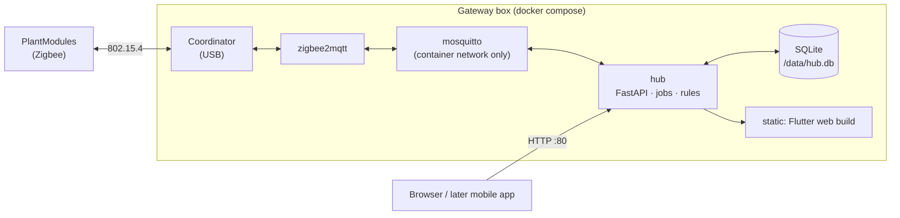
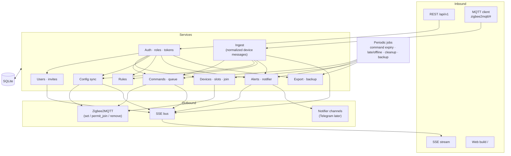
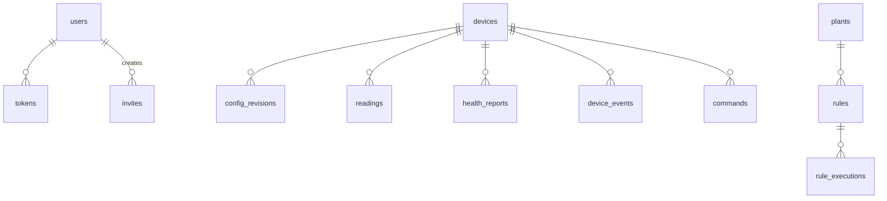
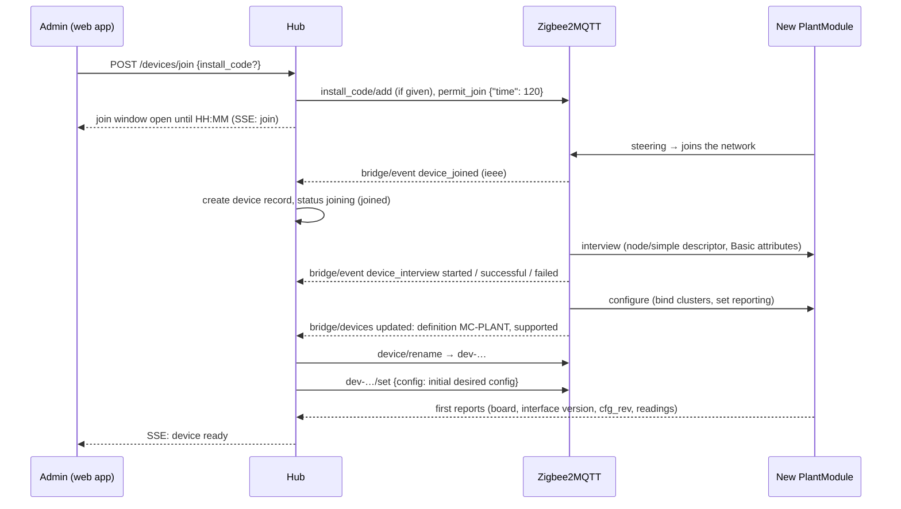
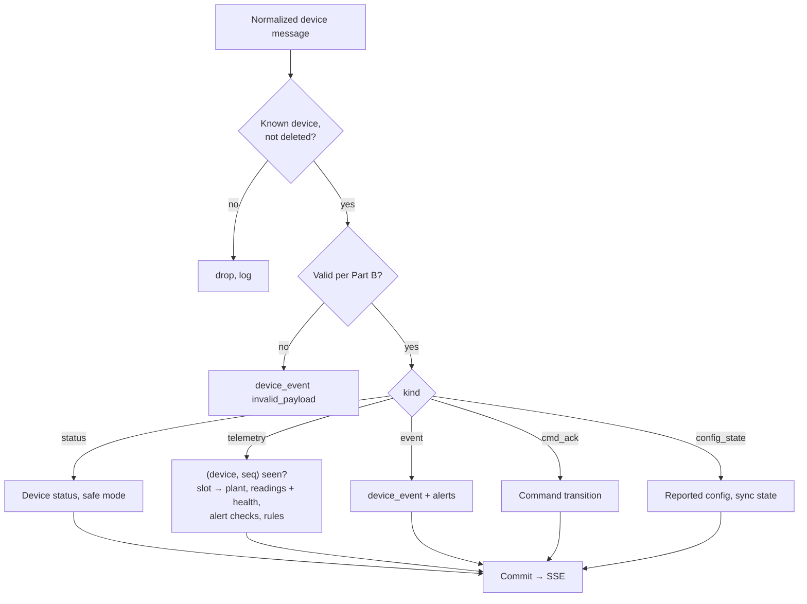
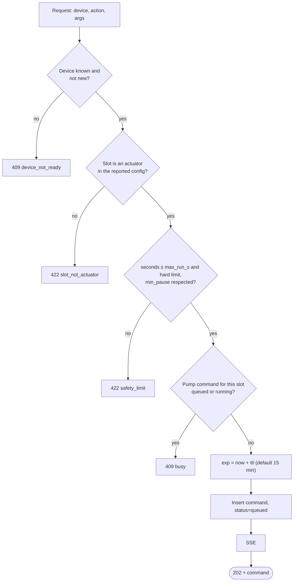

# Gateway — Specification

The Gateway is the box at home that runs the whole system: it hosts the Zigbee network, stores all data, runs the watering rules and serves the web app and its API. Its responsibilities in the system are in [`PROJECT.md`](../PROJECT.md) §4.2; this file is the design.

It contains **Part A**, the design of the gateway and its **hub service**, and **Part B**, the device message model between Zigbee2MQTT and the hub (a contract that the PlantModule's Zigbee cluster and converter implement).

Folder (target): `firmware/` (hub service, compose files, Zigbee2MQTT config and converter), `scripts/` (setup, backup, device simulator), `hardware/` (empty). Run and test commands: [`readme.md`](readme.md).

---

# Part A — Gateway and hub service

## 1. Requirements

| Item | Requirement |
|---|---|
| Hardware | Raspberry Pi 4/5 (or a mini PC / old laptop), ≥ 2 GB RAM, ≥ 8 GB storage (SD card or better, SSD recommended for the database), plus a **Zigbee USB coordinator**. Tested: **SONOFF Dongle Plus MG24** (Silicon Labs EFR32MG24, adapter `ember`, coordinator firmware EmberZNet 7.4.5), see 7.6. Other adapters supported by Zigbee2MQTT (for example the SONOFF ZBDongle-E/-P) should work with another `serial.adapter` setting. |
| OS | 64-bit Linux with Docker Engine and the Compose plugin |
| Images | Multi-arch: `linux/arm64` and `linux/amd64` |
| Network | Wired Ethernet preferred; a fixed IP or a hostname (`moisture.local` through mDNS). No port is exposed beyond the LAN. |
| Time | NTP on the host. The hub refuses to create rule commands while the clock is not synced. |

## 2. Components



| Container | Image | Purpose |
|---|---|---|
| `zigbee2mqtt` | official image, version pinned | Zigbee network, device joining, translation of Zigbee messages to MQTT and back. Has the coordinator passed in as a device. Contains the external converter for the PlantModule. Its own frontend is disabled in production. |
| `mosquitto` | official image | Internal broker between Zigbee2MQTT and the hub. Listens only on the container network. |
| `hub` | `mc-hub` (ours, multi-arch) | The hub service: Zigbee2MQTT adapter, ingest, SQLite, command queue, rules, alerts, notifier, users and tokens, REST + SSE API, static hosting of the web build. |

Volumes: `hub-data` (`/data`: `hub.db`, backups), `z2m-data` (Zigbee2MQTT configuration, network key, `coordinator_backup.json`, devices database). Only the `hub` container publishes a port (80/8000, configurable).

**Single process.** The hub runs as one Uvicorn process hosting the API, the SSE hub, the MQTT client and the periodic jobs. That is plenty for one household.

## 3. Hub service architecture



- **Routers are thin**: parse, auth dependency, one service call, serialize. **Services own logic and transactions.**
- **Every write the app should see live emits an SSE event** after commit.
- **Everything towards devices goes through the command queue and the config revisions in SQLite** and is sent by the sender (section 9.4): at once while the device is online, otherwise when it returns.
- **Adapter boundary.** Everything Zigbee-specific lives in one module (`zigbee/`: topics, converter payloads, joining). It turns Zigbee2MQTT messages into the normalized device messages of Part B and turns commands and configs into Zigbee2MQTT `set` payloads. Ingest, commands and rules know nothing about Zigbee, so another source can be added later.

## 4. Data model (SQLite)

Timestamps are UTC Unix seconds in the database and ISO 8601 in the API. IDs are ULIDs unless noted; devices are identified by their Zigbee IEEE address (`0x00124b…`) and get a stable internal ID `dev-…`. There is **one household** per installation, so no table carries a household column.



| Table | Key columns | Notes |
|---|---|---|
| `settings` | `key`, `value` | Installation: `name`, `timezone`, `battery_low_mv`, `snapshot`/schema version, notifier configuration, setup state |
| `users` | `id`, `username` (unique), `password_hash`, `role` (`owner`/`admin`/`member`/`viewer`), `display_name`, `created_at`, `disabled_at` | Exactly one `owner` (partial unique index) |
| `tokens` | `id`, `user_id`, `token_hash`, `name` ("Philipp's iPhone"), `created_at`, `last_used_at`, `revoked_at` | SHA-256 of a 256-bit random token; only the hash is stored |
| `invites` | `id`, `code_hash`, `role`, `created_by`, `expires_at`, `used_by`, `used_at`, `revoked_at` | SHA-256 of the code only |
| `devices` | `id` (`dev-…`), `ieee` (unique), `model`, `name`, `fw`, `board`, `status`, `last_seen_at`, `report_interval_s`, `voltage_mv`, `link_quality`, `last_seq`, `boot_id`, `desired_rev`, `desired_config`, `reported_rev`, `reported_config`, `rejected_rev`, `config_error`, `sensor_error_streak`, `created_at`, `deleted_at` | `status` ∈ `joining` (joined, interviewing, configuring), `join_failed`, `unsupported`, `ready` (waiting for the first report), `online`, `late`, `offline`, `safe_mode` |
| `config_revisions` | `device_id`, `rev`, `kind`, `body`, `result`, `error`, `created_at`, `created_by` | Full history |
| `plants` | `id`, `name`, `notes`, `sensor_device_id`, `sensor_slot`, `pump_device_id`, `pump_slot`, `archived_at` | |
| `readings` | `id` (integer), `device_id`, `slot`, `plant_id`, `type`, `value`, `raw`, `error`, `ts`, `seq` | Indexes (`plant_id`, `ts`), (`device_id`, `slot`, `ts`) |
| `health_reports`, `device_events` | per report / per event | Battery, link quality; events such as `low_battery`, `sensor_fault`, `safety_stop` |
| `commands` | `id`, `zb_id` (32-bit id used on the Zigbee side), `device_id`, `plant_id`, `action`, `args`, `status`, `reason`, `source` (`manual`/`rule`), `created_by`, `rule_id`, `created_at`, `exp`, `sent_at`, `delivered_at`, `finished_at`, `ends_at`, `cancel_of` | `sent_at` = handed to Zigbee2MQTT |
| `rules` | `id`, `plant_id`, `enabled`, `threshold`, `water_s`, `cooldown_s`, `max_per_day`, `quiet_from`, `quiet_to`, `created_by`, `updated_at` | |
| `rule_executions` | `id`, `rule_id`, `plant_id`, `ts`, `reading_ref`, `decision`, `skip_reason`, `command_id` | Written by the hub's own rule evaluation |
| `alerts` | `id`, `kind`, `subject_type`, `subject_id`, `subject_name`, `severity`, `opened_at`, `resolved_at`, `acked_by`, `acked_at`, `detail` | One open alert per (`kind`, `subject`) |
| `audit_log` | `id`, `actor`, `action`, `detail`, `ts`, `ip` | Role changes, invites, device add/remove, export, resets |

SQLite runs in WAL mode with foreign keys on; migrations with Alembic. The hub is the only process that opens the database.

## 5. Authentication and authorization

### 5.1 Setup

On first start the hub creates no user and prints a one-time **setup code** to its log (and `mc-hub status`). Opening the web app shows "set up this gateway": setup code, installation name, timezone, then the owner's username and password. The code is then spent. If the owner is lost, `mc-hub reset-owner` (shell access to the box) prints a new code.

### 5.2 Login and tokens

- `POST /auth/login {username, password, device_name}` → `{token, user}`. The token is 32 random bytes (base64url), stored by the client (browser storage or secure storage on mobile) and sent as `Authorization: Bearer <token>`. Only `SHA-256(token)` is stored.
- Passwords are hashed with argon2id. Login attempts are limited per username and per IP (for example 5 failures → exponential delay), which also protects against guessing on the LAN.
- `GET /auth/tokens` lists the user's tokens (name, created, last used); `DELETE /auth/tokens/{id}` revokes one; changing the password revokes all other tokens. Admins can revoke any user's tokens.
- Tokens do not expire on their own but can be revoked; unused tokens older than a configurable age (default 180 days) are removed by the cleanup job.

### 5.3 Roles

The role matrix is in [`PROJECT.md`](../PROJECT.md) §3.2. One FastAPI dependency per minimum role; a role that is too low → **403**. Admins may invite and assign up to `member` and remove `member`/`viewer`; only the owner changes admins, transfers ownership and exports. The owner cannot be removed.

### 5.4 Sensitive actions

Delete a device, change an admin's role, transfer ownership, export, reset the gateway: the request must include the user's password (`X-MC-Reauth` for the request, or a short `POST /auth/reauth` that returns a 5-minute proof). Without it → **401 `reauth_required`**.

### 5.5 Invites

An admin creates an invite (`POST /invites {role, expires_in}`) and gets a one-time code, shown only once: the app builds `http://<gateway>/join#c=<code>`. `GET /invites/{code}` previews it (role, installation name); `POST /invites/{code}/accept {username, password, display_name}` creates the user and returns a token. Codes are single-use, expire (default 48 h) and can be revoked.

### 5.6 Exposure

| Measure | Status |
|---|---|
| Hub listens on the LAN port only; Zigbee2MQTT, Mosquitto and the database are not published | design |
| Headers: `X-Content-Type-Options: nosniff`, `Content-Security-Policy` for the web build, `Referrer-Policy: no-referrer` | planned |
| Login rate limiting (5.2) | planned |
| Request size limits (JSON ≤ 64 KB) | planned |
| HTTPS, HSTS, CORS | not needed on the LAN; arrive with remote access (the web build is same-origin) |

## 6. REST API

Base `/api/v1`, JSON, ISO 8601 UTC timestamps, errors as RFC 9457 problem+json with stable `type`s. The web app and any later mobile app use the same API.

| Area | Endpoints (min. role) |
|---|---|
| **Setup / auth** | `GET /meta` (unauthenticated: name, setup state, version, auth mode), `POST /setup` (setup code), `POST /auth/login`, `POST /auth/logout`, `GET /auth/tokens`, `DELETE /auth/tokens/{id}`, `POST /auth/reauth`, `GET /me`, `PATCH /me` (name, password) |
| **Installation** | `GET /installation` (viewer), `PATCH /installation` (owner: name, timezone, battery threshold, notifier settings), `GET /status` (viewer: Zigbee2MQTT and coordinator state, hub version, clock, database size) |
| **Users, invites** | `GET /users` (viewer), `PATCH /users/{id}` (admin; owner for admins), `DELETE /users/{id}`, `POST /transfer-ownership` (owner), `GET/POST /invites` (admin), `DELETE /invites/{id}` (admin), `GET /invites/{code}`, `POST /invites/{code}/accept` (unauthenticated), `GET /audit` (admin) |
| **Devices** | `GET /devices` (viewer), `POST /devices/join` (admin: opens the join window, optional `install_code`), `GET /devices/join` (viewer: join state), `GET/PATCH/DELETE /devices/{d}` (viewer / admin / admin with reauth), `GET/PUT /devices/{d}/config` (viewer / admin), `GET /devices/{d}/health`, `GET /devices/{d}/events` (viewer), `POST /devices/{d}/actions` (member for identify, admin otherwise) |
| **Plants, readings** | `GET/POST /plants`, `GET/PATCH/DELETE /plants/{p}` (viewer / member), `GET /plants/{p}/readings?from&to&bucket` (viewer), `GET /plants/{p}/commands` (viewer) |
| **Watering, commands** | `POST /plants/{p}/water` (member), `GET /commands`, `GET /commands/{c}` (viewer), `POST /commands/{c}/cancel` (member) |
| **Rules** | `GET/POST /plants/{p}/rules`, `PATCH/DELETE /plants/{p}/rules/{r}` (viewer / member), `GET /plants/{p}/rules/{r}/executions` (viewer) |
| **Alerts** | `GET /alerts` (viewer), `POST /alerts/{a}/ack` (member) |
| **Live** | `POST /events/ticket`, `GET /stream?ticket=` (viewer; SSE) |
| **Data** | `POST /export` (owner, reauth), `POST /backup` (admin) |
| **Board** | `GET /meta/boards/{board}` (the board description of that PCB revision: logical ports, roles, low-power capabilities, battery divider; the files come from `PlantModule/firmware/boards/` and are copied into the hub image; used by the slot editor) |

The OpenAPI document is generated from the code; committing it as `api.yaml` and generating the Dart client from it is planned, until then the app keeps its hand-written Dio client.

### 6.1 Live updates (SSE)

1. `POST /events/ticket` returns a random ticket valid 60 s, single use, bound to the user.
2. `GET /stream?ticket=…` checks it, then streams.
3. `Last-Event-ID` replays from a ring buffer (200 events); too old, or from a previous process → `resync`.
4. `ping` every 25 s. Streams of revoked tokens are closed.

Events: `reading`, `device`, `command`, `config`, `plant`, `rule`, `alert`, `installation`, `join`, `resync`.

## 7. Zigbee2MQTT integration

Zigbee2MQTT does the radio work; the hub talks to it only through MQTT topics (base topic `zigbee2mqtt`). Exact payloads depend on the Zigbee2MQTT version (pinned) and the PlantModule converter; they are defined together with the PlantModule interface (`PlantModule/interface.yaml`). Items that were checked on the tested setup (7.6) are stated as facts; items marked *verify* are still to be checked against the pinned version.

### 7.1 What the hub reads

| Topic | Use |
|---|---|
| `zigbee2mqtt/bridge/state` | Zigbee2MQTT online/offline (shown in `GET /status`; alert `zigbee_offline` when it stays offline) |
| `zigbee2mqtt/bridge/devices` (retained) | Device list with IEEE address, model, definition, `exposes`; the hub reconciles its `devices` table with it |
| `zigbee2mqtt/bridge/event` | `device_joined`, `device_interview` (started/successful/failed), `device_leave`, `device_announce`; drives the join flow and status |
| `zigbee2mqtt/<friendly_name>` | State/report payload of a device after every report (the converter's output) |
| `zigbee2mqtt/<friendly_name>/availability` | `online` / `offline` from Zigbee2MQTT's active availability check (the module is always listening, so it answers pings); the hub combines it with the last-seen time (section 11) |
| `zigbee2mqtt/bridge/response/#` | Answers to the hub's requests (permit join, rename, remove, options) |

The hub sets the `friendly_name` of a device to its internal ID (`dev-…`), so MQTT topics never depend on user-visible names.

### 7.2 What the hub writes

| Topic | Use |
|---|---|
| `zigbee2mqtt/bridge/request/permit_join` | Open the join window: payload `{"time": <seconds>}` (≤ 254), answered on `bridge/response/permit_join`; `bridge/info` then shows `permit_join: true` and `permit_join_end` (checked, 7.6) |
| `zigbee2mqtt/bridge/request/install_code/add` | Register an install code before the device joins; *verify* the payload |
| `zigbee2mqtt/bridge/request/device/interview`, `…/configure` | Repeat the interview or the configure step of a device; *verify* |
| `zigbee2mqtt/bridge/request/device/rename`, `…/remove` | Set the `friendly_name`; remove a device from the network |
| `zigbee2mqtt/<friendly_name>/set` | Write attributes and send commands (pump on/off with timed off, configuration attributes, the custom command); the payload keys are those of the PlantModule converter |

### 7.3 Discovery and connect

How a new module becomes a device in the hub. The admin starts it in the web app; the module is in factory state (or was reset) and steers for a network by itself (`PlantModule/specs.md` Part A §7.3).



**Device states during the join** (shown in the app as a step list): `joined` → `interviewing` → `configuring` → `ready`; failures end in `join_failed`, an unknown model in `unsupported`.

- **Recognition:** the converter definition matches `manufacturerName` `MoistureController` and `modelID` `MC-PLANT` (the module's Basic cluster). Another Zigbee device that joins is created as `unsupported` with its model name; the admin can remove it. (Supporting other devices is a later feature that uses the same adapter boundary.)
- **Configure:** Zigbee2MQTT's configure step binds the module's clusters to the coordinator and sets the attribute reporting (`PlantModule/interface.yaml` `reporting`).
- **Initial config:** after rename the hub sends the initial desired configuration (all slots empty, default intervals) with revision 1, so a new device has a defined state. Slots are assigned and configured by the admin afterwards.
- **Interview or configure failed:** the hub retries twice with a pause of 30 s (requests `device/interview` / `device/configure`, *verify*), then sets `join_failed`; the app offers "remove and retry". The module may have to be power-cycled.
- **The join window** closes after its time or when the admin closes it (`DELETE /devices/join`). While it is open `GET /devices/join` returns the remaining time and the devices that joined during it.
- **Rejoin and announce:** `device_announce` or a report after a gap updates the status. If the module's `boot_id` changed and its `cfg_rev` is lower than the desired revision, the hub resends the configuration; if no report arrives within 2 × the maximum reporting interval after an announce, it requests `device/configure` again (the reporting configuration may have been lost).
- **Leave:** a module told to leave erases its configuration (`PlantModule/specs.md` Part A §7.3); the hub sees `device_leave`.
- **Coordinator replaced:** a new coordinator forms a new network, so every module has to be factory-reset and joined again. Restoring `z2m-data` from a backup (7.6, section 14) keeps the network.

### 7.4 Removal

`DELETE /devices/{d}` (reauth) asks Zigbee2MQTT to remove the device (`device/remove`; the always-listening module is told to leave and erases its configuration), cancels its open commands and soft-deletes the record (history is kept). A module that cannot be reached is removed with the `force` option.

### 7.5 Message paths

The module never speaks MQTT. It speaks Zigbee; **Zigbee2MQTT is the bridge**, with the converter (`Gateway/firmware/zigbee2mqtt/`) translating between the module's attributes/commands and MQTT JSON (definition: `PlantModule/interface.yaml`). The hub's Zigbee adapter translates between that MQTT JSON and the normalized device messages (Part B).

```mermaid
flowchart LR
    M["Module"] -- "attribute reports,<br/>cluster commands" --> Z["Zigbee2MQTT<br/>converter fromZigbee"]
    Z -- "zigbee2mqtt/dev-…<br/>state JSON" --> A["Hub adapter"]
    A -- "normalized messages" --> I["Ingest"]
    C["Commands / config"] --> A2["Hub adapter"]
    A2 -- "zigbee2mqtt/dev-…/set<br/>JSON" --> Z2["Zigbee2MQTT<br/>converter toZigbee"]
    Z2 -- "attribute writes,<br/>cluster commands" --> M
```



**Module → hub.** A report from the module (attribute report or cluster command) becomes a state message on `zigbee2mqtt/<dev-id>`; Zigbee2MQTT merges it into the device's state and publishes the whole object (QoS 0; retained as configured), so every publication holds all keys; the adapter finds what changed through `seq`, `cmd_ack.n` and `event.n`.

```json
{ "seq": 1042, "boot_id": 7, "status": "operational", "fast_mode": false, "safe_reason": "none",
  "slot0_type": "moisture", "slot0_value": 41.5, "slot0_raw": 2143, "slot0_error": "ok",
  "slot2_type": "pump", "slot2_value": 0, "slot2_raw": 0, "slot2_error": "ok",
  "cfg_rev": 8, "cfg_result": "ok", "cfg_error": null,
  "voltage_mv": 0, "linkquality": 112,
  "uptime_s": 86400, "boot_reason": "power_on", "reset_count": 0, "rejoin_count": 1,
  "last_error": 0, "free_heap": 143000, "interface": "1.0", "config_schema": 1, "board": "carrier-v1",
  "cmd_ack": { "n": 17, "cmd_id": 1048577, "state": "done", "reason": "none", "ends_in_s": 0 },
  "event":   { "n": 4, "code": "sensor_fault", "slot": 1, "arg": 0 } }
```

- Slot keys are `slot<N>_type|value|raw|error`; actuator slots report their output state in `value` (100 = on, 0 = off).
- `cmd_ack` and `event` are transient objects with a module-assigned counter `n`; the adapter processes each `n` once (the state keeps showing the last one). *Verify* how the converter publishes transient objects; the fallback is Zigbee2MQTT's `action` mechanism.
- Normalization: one state message with a new `seq` becomes a `telemetry` message (readings per slot, health); `status`, `safe_reason`, `fast_mode` become a `status` message; a new `event.n` an `event`; a new `cmd_ack.n` a `cmd_ack`; `cfg_rev`, `cfg_result`, `cfg_error` a `config_state` message.

**Hub → module.** The adapter publishes to `zigbee2mqtt/<dev-id>/set`; the converter's `toZigbee` turns each key into attribute writes or a cluster command.

```json
{ "config": { "rev": 9, "report_interval_s": 300, "fast_report_interval_s": 30, "fast_report_hold_s": 120, "batt_low_mv": 3500,
    "slots": [
      { "slot": 0, "module": "moisture", "port": "P1", "cal_dry": 3000, "cal_wet": 1200, "samples": 16 },
      { "slot": 2, "module": "pump", "port": "P3", "max_run_s": 60, "min_pause_s": 600, "active_high": true } ] } }
{ "pump_run":      { "cmd_id": 1048577, "slot": 2, "seconds": 10, "ttl_s": 900 } }
{ "pump_stop":     { "cmd_id": 1048578, "slot": 2 } }
{ "cancel":        { "cmd_id": 1048579, "target": 1048577 } }
{ "device_action": { "cmd_id": 1048580, "action": "identify" } }
```

- `config` is one MQTT message but several Zigbee operations: the converter writes the attribute set (`report_interval_s`, …, `slot_cfg_n` for every slot) and then sends `commit_config(rev)`; the result comes back as `cfg_rev` / `cfg_result` / `cfg_error`.
- The hub keeps a 32-bit `zb_id` per command (counter in SQLite) as the `cmd_id` on the Zigbee side and maps it back to the command's ULID when the `cmd_ack` arrives.
- `ttl_s` is the remaining lifetime of the command at send time (not the original expiry), so a command that waited for an offline device is sent with a shorter ttl.

**Delivery.** Zigbee gives a link-level acknowledgement per message (APS ack); Zigbee2MQTT reports a failed `set` as an error on `bridge/response`/log. The hub treats an item as delivered when the matching report arrives (`cfg_rev` for a config, `cmd_ack` for a command), as lost when Zigbee2MQTT reports a send failure or when no answer arrives within the item's timeout (10 s), and retries it (section 9.4).

### 7.6 Tested setup

Facts from the first bring-up of the coordinator (the hub itself is not built yet):

| Item | Value |
|---|---|
| Coordinator | SONOFF Dongle Plus MG24 (EFR32MG24), USB 10c4:ea60, serial device `/dev/cu.usbserial-120` on macOS (a `/dev/serial/by-id/…` path on Linux) |
| Coordinator firmware | EmberZNet 7.4.5 [GA], a coordinator image (the stick forms a network without flashing) |
| Zigbee2MQTT | 2.14.2 with zigbee-herdsman 10.10.0, Node 23, pnpm 11 |
| Adapter | `serial.adapter: ember` |
| Configuration | `version: 5`; `advanced.channel: 25` (away from the usual 2.4 GHz WiFi channels 1/6/11 in the EU), generated `network_key`, `pan_id`, `ext_pan_id`; frontend on for development only |
| Join window | `bridge/request/permit_join` with `{"time": N}` is accepted; `bridge/info` then shows `permit_join: true` and `permit_join_end` (Unix ms) |
| Network data | `coordinator_backup.json` and the generated keys live in Zigbee2MQTT's data directory; **back it up** (section 14) |

## 8. Ingest

The adapter turns each Zigbee2MQTT report into **normalized device messages** (Part B: `telemetry`, `status`, `event`, `cmd_ack`, `config_state`) and hands them to ingest. Any report from a device also counts as proof that it is online.



- **Time:** readings are stamped with the hub's receive time (`ts`); a device `ts`, if present and plausible, is only used for ordering inside one report.
- **Duplicates:** a payload `seq` that is not newer than the stored `last_seq` (with the same `boot_id`) is a heartbeat repeat of the same reading and is not stored again; a repeated `cmd_ack.n` or `event.n` is ignored.
- **Back online:** a message from a device that was `offline` or `late` marks it online again and triggers the sender (9.4) to flush items queued for it.
- **Rules** run after a telemetry commit (section 12).

## 9. Commands

### 9.1 Creating a command



The checks come from `mc_core.commands`; rule-created commands use the same ones. Actions: `pump.run`, `pump.stop`, `cmd.cancel`, `device.identify`, `device.reboot`, `device.clear_safe_mode`; `sensor.sample` is planned for calibration. A pump command to a device in safe mode is refused with `409 device_safe_mode`.

### 9.2 Lifecycle

| Incoming | From state | → New state |
|---|---|---|
| hub sent it to Zigbee2MQTT | queued | queued, `sent_at` set |
| device `cmd_ack` `running` (with `ends_at`) | queued | `delivered` |
| device `cmd_ack` `done` | queued / delivered / cancelling | `done` |
| device `cmd_ack` `rejected`, reason `expired` | queued | `expired` |
| device `cmd_ack` `rejected` / `failed` (other) | queued / delivered | `failed` (+ `command_failed` alert for pump runs) |
| device `cmd_ack` `cancelled` | queued / cancelling | `cancelled` |
| job: `now > exp + 30 s`, no ack | queued / cancelling | `expired` |
| job: `now > ends_at + 60 s`, no final ack | delivered | `failed`, `no_final_ack` |

### 9.3 Cancel

On a `queued` command that was never sent (`sent_at` null) the command becomes `cancelled` immediately. If it was sent: status `cancelling` and a `cmd.cancel` for the target; the final state comes from the device's acks. A running long pump run is stopped with `pump.stop`.

### 9.4 Sender

The module is always listening, so the hub can send as soon as there is something to send; the queue exists for the times the module is offline.

1. **New command or config revision, device online:** sent at once to `zigbee2mqtt/<dev-id>/set`.
2. **Device offline** (availability `offline`, or Zigbee2MQTT down): the item stays queued (`commands.status = queued`, config revision pending) and the app shows "queued, device offline". When the device is back (availability `online` or any report), the sender flushes the queue.
3. **Order and pacing:** per device one item at a time, oldest command first, then the newest unconfirmed config revision; the next item is sent when the previous one is confirmed (matching report) or timed out (10 s, 3 attempts with a 2 s pause), so the module is never flooded.
4. **Ttl:** each command is sent with the remaining `ttl_s`; a command whose expiry passed while queued is marked `expired` instead of being sent.
5. **Idempotency:** the module does not execute a `cmd_id` twice, so a retry after a lost acknowledgement is safe; a repeated config revision with identical content answers `ok` again.
6. **Restart:** the queue lives in SQLite, so a hub restart loses nothing.

> **Low power (later):** a sleepy module can receive only right after it has reported. The sender then waits for a report ("check-in") and sends inside the module's awake window; items not confirmed stay queued for the next check-in. This mode comes back with the low-power firmware (`PlantModule/specs.md` Part A §18).

## 10. Config sync

- `PUT /devices/{d}/config` with `base_rev` (409 on mismatch); validation by `mc_core.pins` against the device's board description (ports, roles, limits) → 422 with the contract's codes.
- Valid → `rev + 1`, stored in `config_revisions` and `devices.desired_config`; the sender transmits it at once if the device is online (otherwise when it returns).
- The device's `config_state` (reported revision and configuration, or a rejection with the reason) is stored; `sync_state` is `in_sync`, `pending` or `rejected` (+ `config_rejected` alert).
- Changes to actuator limits or the report interval in the **reported** configuration update the data the rules and command checks use (no extra sync needed, the hub reads them directly).

## 11. Device status

| Trigger | Status | Side effects |
|---|---|---|
| join in progress (7.3) | `joining` → `ready` | step shown in the app |
| a report with `status = operational` | `online` | `last_seen_at`, `link_quality`, `voltage_mv` |
| a report with `status = safe_mode` | `safe_mode` | `device_safe_mode` alert with `safe_reason`; pump commands refused |
| no report for 3 × `report_interval_s` (reports repeat at least every 300 s as a heartbeat) | `late` | — |
| Zigbee2MQTT availability `offline` (active check about every 5 minutes) | `offline` | `device_offline` alert |
| availability `online` or any report | `online` | alerts resolved, queue flushed (9.4) |
| Zigbee2MQTT or the coordinator down | status unchanged, `zigbee_offline` alert on the installation | the late/offline jobs are suspended while Zigbee2MQTT is down |

## 12. Rules

- Rules are stored and validated by the hub (`mc_core.rules`: thresholds, quiet-hour format, water time ≤ pump limits).
- They are **evaluated by the hub right after every telemetry commit**, with the engine in `mc_core.rules`, using the plant's latest readings and the device limits:
  1. Evaluate each rule of the reading's plant → `water` / `skip` with a reason (or nothing if above threshold).
  2. For `water`: create a command exactly like a manual one (checks in 9.1); the reason for a `skip` is one of `sensor_error`, `no_pump`, `quiet_hours`, `cooldown`, `daily_limit`, `pending_command`, `clock_not_synced`.
  3. Write a `rule_executions` row for every decision.
  4. Cooldown and daily limit use the commands table; "today" uses the installation timezone.
- `rule_limit_reached` alert when a rule hits its daily limit on 2 consecutive days.

## 13. Alerts and notifications

| `kind` | Opened when | Resolved when |
|---|---|---|
| `device_offline` | Status job → offline | Device online |
| `battery_low` | `batt_mv` < threshold on 3 reports, or `low_battery` event | > threshold + 100 mV |
| `sensor_error` | Slot error on 3 consecutive cycles | Slot reports a value |
| `command_failed` | Command → failed | Acked |
| `config_rejected` | Device rejected desired config | In sync |
| `safety_stop` | `safety_stop` event | Acked |
| `device_safe_mode` | Status `safe_mode` reported | Device back to `operational` |
| `rule_limit_reached` | Daily limit hit on 2 consecutive days | Acked |
| `zigbee_offline` | Zigbee2MQTT / coordinator unreachable for > 5 min | Reachable again |

Opening or resolving an alert emits an SSE event. A **notifier** interface (`notify(alert)`) delivers alerts to configured channels; today there is none besides the in-app list, a Telegram channel is planned (bot token and chat id in the installation settings, outbound HTTPS to Telegram only). The channel set is configuration, so the hub works fully with no internet.

## 14. Export and backup

- `POST /export` (owner, reauth): ZIP with `manifest.json`, `installation.json`, `users.json` (no hashes), `devices.json`, `plants.json`, `rules.json`, `readings.ndjson.gz`, `health.ndjson.gz`, `events.ndjson.gz`, `commands.ndjson.gz`, `rule_executions.ndjson.gz`. There is no import.
- **Backup** is a consistent copy of `hub.db` (`VACUUM INTO`) written by a nightly job into `/data/backups` (keep the last 14) and by `POST /backup`. The Zigbee side needs its own copy: **`z2m-data` (network key, coordinator backup, device database) must be backed up too**, because losing it means re-joining every device. `scripts/backup.sh` copies both; moving the files off the box is up to the user.

## 15. Configuration and deployment

### 15.1 Environment variables (hub)

| Variable | Meaning |
|---|---|
| `MC_DATA_DIR` | Data directory (`/data`) |
| `MC_MQTT_HOST` / `MC_MQTT_PORT` | Internal broker (`mosquitto`, 1883) |
| `MC_Z2M_BASE_TOPIC` | Zigbee2MQTT base topic (`zigbee2mqtt`) |
| `MC_BIND` / `MC_PORT` | Address and port of the web port |
| `MC_WEB_DIR` | Directory with the Flutter web build |
| `MC_INSTANCE_ID` | Stable id, reported by `/meta` and the mDNS advertisement (for the later mobile app) |
| `MC_TOKEN_MAX_AGE_DAYS` | Cleanup age for unused tokens |
| `MC_DOCS` | `1` serves the OpenAPI docs |

### 15.2 Compose

`zigbee2mqtt` (coordinator passed through, e.g. `/dev/serial/by-id/…`), `mosquitto`, `hub` (publishes the web port; `depends_on` the other two). Optional profile `lan` for the mDNS advertisement of `moisture.local` and the service `_moisture-api._tcp` (multicast needs the host network; `advertise_mdns.py` is reused). Containers run as non-root where the images allow it.

### 15.3 Code layout (target)

```
Gateway/
├── firmware/                       # hub service and stack
│   ├── pyproject.toml
│   ├── Dockerfile · docker-compose.yml · .env.example
│   ├── zigbee2mqtt/                # configuration.yaml template, external converter (PlantModule)
│   ├── mosquitto/                  # mosquitto.conf
│   ├── src/mc_hub/
│   │   ├── main.py · config.py · cli.py · crypto.py · errors.py
│   │   ├── db/ · migrations/
│   │   ├── auth/                   # tokens, passwords, roles
│   │   ├── api/                    # routers, schemas
│   │   ├── services/               # users, devices, commands, config, ingest, plants, rules, alerts, export
│   │   ├── zigbee/                 # MQTT client, topics, converters ↔ normalized messages, join
│   │   ├── realtime/               # SSE bus
│   │   ├── notify/                 # notifier channels
│   │   └── jobs/
│   ├── src/mc_core/                # contract models, rules engine, command checks, pin rules
│   └── tests/
├── scripts/                        # backup.sh, advertise_mdns.py, device simulator
└── hardware/                       # empty
```

## 16. Testing

| Level | What |
|---|---|
| Unit | Command state machine, sender algorithm (online/offline queueing, ordering, pacing, retries, ttl), config validation, seq handling, role checks, token handling, rule decisions, adapter mapping (Zigbee2MQTT payload ↔ normalized messages). |
| Contract | Part B examples parse with the `mc_core.contract` models. |
| API | Access tests per role, setup and invite flows, reauth, login limits. |
| Integration | Hub + Mosquitto + a **Zigbee2MQTT simulator** (a script publishing the same topics and payloads as Zigbee2MQTT for a fake PlantModule): join, readings, watering with the module offline and back, config round trip, join with interview failure, rules, restart without losing queued commands. |
| On hardware | A real PlantModule with the real coordinator; see `PlantModule/specs.md`. |

## 17. Security summary

- People: username + password (argon2id), per-device tokens stored hashed, revocable; roles on every request; password re-entry for sensitive actions; login limits.
- Radio: Zigbee network key stays in `z2m-data`; joining only while permit-join is open; install codes for individual devices.
- Services: only the hub's web port is published; Zigbee2MQTT, Mosquitto and the database are reachable only from inside the box.
- Plain HTTP on the LAN is accepted for now; HTTPS and request hardening come with remote access.

## 18. Status and open points

Status: only this specification exists. The previous implementation (WiFi/MQTT gateway and a separate FastAPI server) was removed; it is in git history at commit `eb97b07` and is the reference for the logic listed in 19. The coordinator side was brought up once (7.6).

Open points:
- Zigbee2MQTT behaviour with the custom device (items marked *verify* in 7): publication of transient `cmd_ack`/`event` objects, `install_code/add` payload, `device/interview` and `device/configure` requests, reporting configuration for custom-cluster attributes, whether reporting configuration survives a module reset.
- External converter packaging and loading in the container image; generation of the converter and the hub models from `PlantModule/interface.yaml`.
- Reading retention (keep raw forever or downsample).
- Whether a separate mobile app needs token registration over discovery beyond the login endpoint.
- Telegram channel details (commands from chat, message formats).
- Remote access: VPN/tunnel plus HTTPS, request hardening, push.
- Low power: the check-in sender mode (9.4) returns with the sleepy firmware.

## 19. Reusing the previous implementation

The hub is written from this spec. The previous code is in git history at `eb97b07` (paths as they were then) and is worth reading for:

| Previous code | Useful for |
|---|---|
| `Server/src/mc_api` routers, services (devices, plants, commands, ingest, alerts, export), SSE bus, jobs | The API surface, the command state machine, alert rules, the ingest pipeline, the SSE ticket and ring buffer |
| `Server/src/mc_api/db/models.py`, `migrations/` | Table and index design (drop household columns, gateways, downlink, push tokens, device keys) |
| `Server/tests` | Access, flow and replay tests to port |
| `Gateway/firmware/src/mc_gateway/agent.py` | Local rule evaluation, command checks, `rule_exec` reporting |
| `Shared/core/src/mc_core` | Contract models, `rules.py`, `commands.py`, `pins.py` (config validation); the BLE modules are not needed |
| `Gateway/scripts/fake_device.py` | Shape of a device simulator (to be rebuilt as a Zigbee2MQTT simulator) |
| `Server/scripts/advertise_mdns.py` | mDNS advertisement for the later mobile app |

Not carried over: the WebSocket uplink, outbox, downlink queue, gateway enrollment, snapshots and key sets, multi-household support, Firebase and push, PostgreSQL, the TLS-PSK broker.

---

# Part B — Device message model (Zigbee2MQTT ↔ hub)

This part fixes **what the hub understands** from a device, independent of how Zigbee carries it. The Zigbee side is defined in [`PlantModule/interface.yaml`](../PlantModule/interface.yaml) (readable view: `PlantModule/specs.md` Part B); the Zigbee2MQTT converter and the hub's adapter implement it. The MQTT JSON between Zigbee2MQTT and the hub, with examples, is in 7.5 "Message paths".

**Status:** the interface definition is a design proposal; message content follows the previous design's contract (git history `eb97b07`, `Gateway/specs.md` Part C) where it still applies.

| Normalized message | Content | Carried by (Zigbee) |
|---|---|---|
| `telemetry` | `seq`, readings per slot (`slot`, `type`, `value`, `raw`, `error`), health (`voltage_mv`, `linkquality`) | Attribute reports `slot_n`, `seq`, battery voltage from the Power Configuration cluster |
| `status` | `status` (operational / interviewing / safe_mode), `safe_reason`, `fast_mode`, diagnostics (`uptime_s`, `boot_reason`, `reset_count`, `rejoin_count`, `last_error`, `free_heap`), identity (`board`, interface version, config schema, firmware) | Attribute reports of the custom cluster and Basic |
| `event` | `n`, `code` (`boot`, `low_battery`, `sensor_fault`, `sensor_ok`, `safety_stop`, `safe_mode`, `config_rejected`), `slot`, `arg` | Cluster command `event` from the module |
| `cmd_ack` | `n`, `cmd_id`, `state` (`running` / `done` / `failed` / `rejected` / `cancelled`), `reason`, `ends_in_s` | Cluster command `cmd_ack` from the module |
| `config_state` | `cfg_rev`, `cfg_result`, `cfg_error` (code, slot) | Attribute reports `cfg_*` |
| desired config | revision, intervals, slot table | `set` key `config` → attribute writes + `commit_config` |
| commands | `pump.run`, `pump.stop`, `cmd.cancel`, `device.identify`, `device.reboot`, `device.clear_safe_mode` (`sensor.sample` planned) | `set` keys `pump_run`, `pump_stop`, `cancel`, `device_action` → cluster commands |

Rules that hold whatever the encoding:
- Every command has an id and a time to live; the module drops expired ones and never executes an id twice.
- A configuration carries a revision number; the module reports the revision it runs.
- Unknown fields are ignored; unknown enum values reject only that message.
- The module never trusts the hub for safety: hard limits live in the firmware.
- The hub tolerates a different minor interface version and refuses a different major version (the device is shown as `unsupported`).
