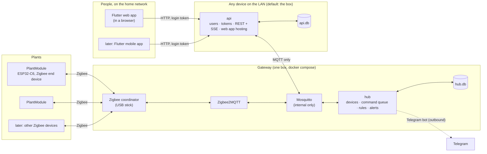
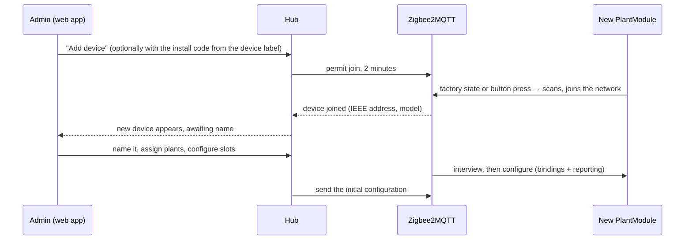
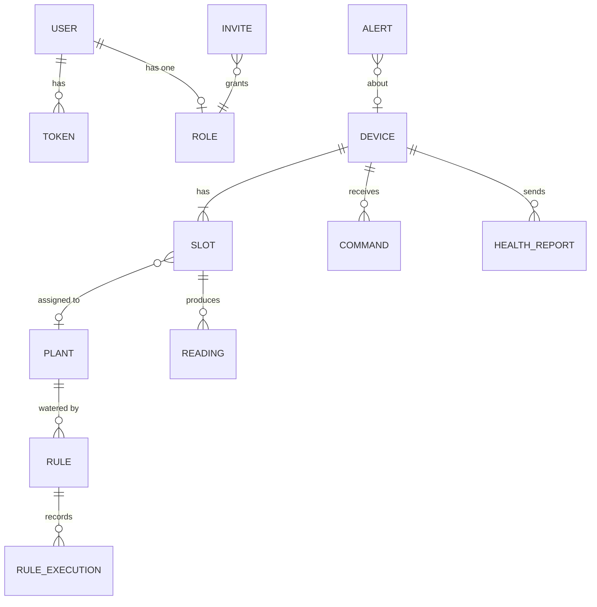
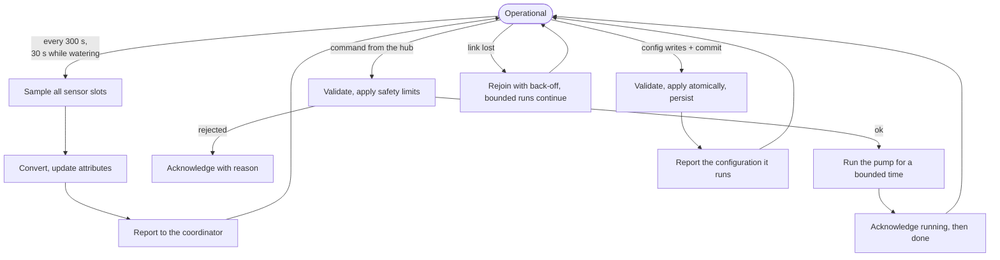
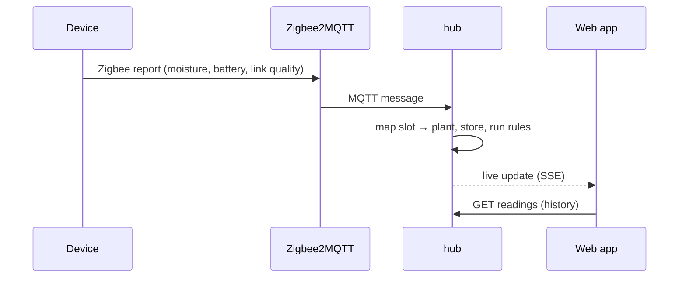
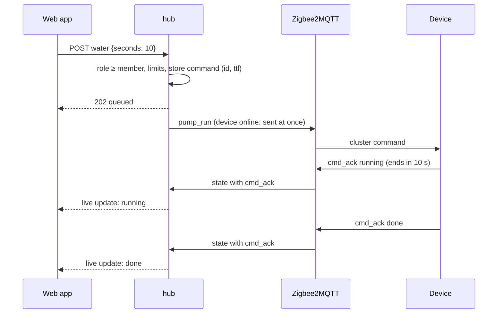
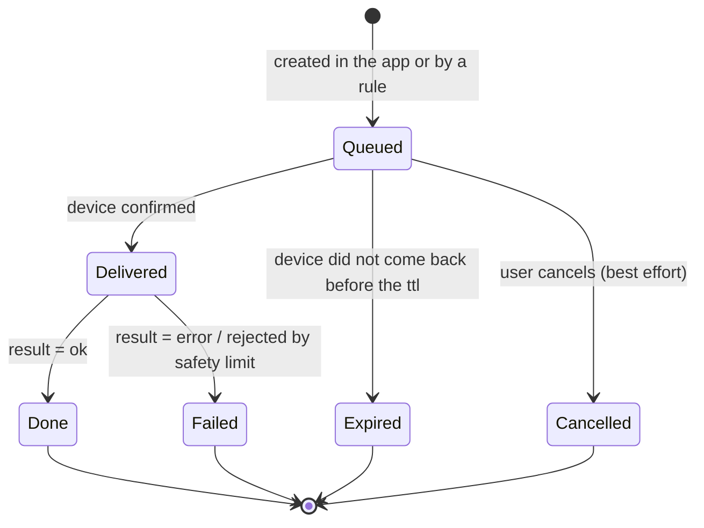
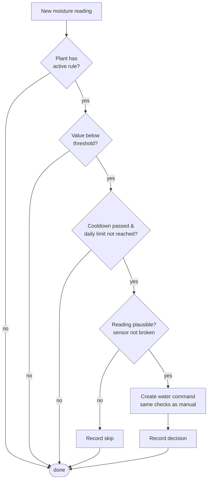

# MoistureController — System Overview

The top-level document: **what the parts are, what each is responsible for, and how they talk to each other.** Implementation details live in the `specs.md` of each product folder. If this document and a spec disagree about *how* something is implemented, the spec wins. If they disagree about *what a component is responsible for* or *how components talk to each other*, this document wins and the spec gets fixed.

| Product | Folder | What it is |
|---|---|---|
| **PlantModule** | `PlantModule/` | Battery-powered ESP32-C6 Zigbee end device: firmware (ESP-IDF, `esp-zigbee-sdk`), carrier board, scripts |
| **Gateway** | `Gateway/` | The box at home: Zigbee coordinator, Zigbee2MQTT, Mosquitto and our two services: `hub` (devices, commands, rules, alerts) and `api` (users, REST, web app hosting) |
| **App** | `App/` | Flutter: runs as web app served by the Gateway; later also as Android/iOS app |

> **Status:** this document is the **design**. The repository currently holds the specs, the carrier board and the Flutter app; the hub, the Zigbee firmware and the Zigbee2MQTT converter are still to be written. The previous WiFi/MQTT implementation is in git history at commit `eb97b07`.

---

## 1. Goal

Monitor soil moisture (and later other values) of plants with small battery-powered devices, show the data in a web app, and water plants manually or by rules, all running **locally at home, at no cost**.

**Primary user stories**

- I see the current moisture of each plant and its history.
- I can water a plant from the app, and see whether the device actually did it.
- I can set a rule like *"if moisture < 30 %, water for 10 s, at most once every 6 h"*, and it keeps working whatever else is down.
- I get told when a device is offline, its battery is low, or a sensor looks broken.
- I can change which sensor/pump is plugged into which port of a device without reflashing it.
- I can let other people in the household use the app and decide what they may do.
- Later: reach the system from outside (VPN or tunnel), get Telegram notifications, install it as a mobile app, add other Zigbee devices.

**Out of scope for now:** remote access, push notifications (Telegram comes later), multiple households, cloud services.

---

## 2. System architecture

One box at home does everything. Plant devices join its Zigbee network; people open the web app served by the box on the home network. Nothing is hosted elsewhere and no account with any provider is needed.



### Core architectural rules

1. **One box, one trust boundary.** Devices talk only to the coordinator; apps talk only to the `api` service; nothing else is exposed. Each service opens only its own database, and the services talk to each other only over MQTT (`Gateway/specs.md` §3).
2. **Every interaction with a device is asynchronous.** The hub records an intent and sends it when the device can receive it: at once while the device is online, later if it is offline. "Pending" is a normal state in the API and the UI. Today the module is always awake; sleepy low-power devices are possible later and use the same model.
3. **The hub is the source of truth for intent; the device for reality.** The hub stores *desired* state (config, commands, rules); the device reports *actual* state (readings, running config, command results). The app shows both, and where they differ.
4. **Rules run in `hub`**, next to the data. Watering does not depend on any browser being open, on `api` or on the internet.
5. **The device stays dumb and safe.** It measures, reports, executes commands and enforces hard safety limits locally. The hub checks commands again before sending them.
6. **Zigbee handles the radio side.** Joining, network keys, routing and delivery belong to Zigbee and Zigbee2MQTT. We add only what Zigbee has no standard for (custom settings, a command queue for devices that are offline).
7. **Extensible by design.** Other Zigbee devices known to Zigbee2MQTT can appear as further device types; the hub works on normalized readings and commands, not on one device model.

---

## 3. Users, access and joining devices

### 3.1 Concepts

| Concept | Meaning |
|---|---|
| **Gateway** | The box. There is one per installation; it defines the household. |
| **User** | A person with a username and password stored on the gateway. |
| **Role** | Owner, Admin, Member or Viewer; one household per gateway. |
| **Invite** | One-time code with a role and expiry, created by an admin and shared as a link. |
| **Browser/app token** | A random token issued at login, bound to that browser or phone. It is stored there; only its hash is stored on the gateway. |

### 3.2 Roles

Enforced by the hub on every request.

| Action | Owner | Admin | Member | Viewer |
|---|:-:|:-:|:-:|:-:|
| See plants, readings, history, alerts | ✔ | ✔ | ✔ | ✔ |
| Water manually, cancel commands | ✔ | ✔ | ✔ | |
| Create/edit plants and rules | ✔ | ✔ | ✔ | |
| Add/remove/configure devices, open the Zigbee network for joining | ✔ | ✔ | | |
| Invite members, change roles (up to Member), remove members/viewers | ✔ | ✔ | | |
| Promote/demote admins, transfer ownership, export data | ✔ | | | |

Exactly one owner.

### 3.3 Login and tokens

- **First setup:** the first user (the owner) is created when the gateway starts for the first time, using a one-time setup code shown in the gateway's log.
- **Login:** username and password in the web app (or later the mobile app) returns a **device token**. The token is stored in that browser, and every request carries it. Passwords are stored hashed.
- **My devices:** a user sees the browsers/phones that hold a token and can revoke any of them. Changing the password revokes all.
- **Sensitive actions** (delete device, change admin roles, transfer ownership, export, reset the gateway) additionally ask for the password again.
- **Discovery:** the web app is opened at the gateway's address (e.g. `http://moisture.local`). A future mobile app finds the gateway on the LAN through mDNS and registers itself with username and password, which issues its token.
- Over plain HTTP the token travels unencrypted on the home network. That is accepted for now and goes away with HTTPS when remote access is added.

### 3.4 Sharing (invites)

An admin creates an invite with a role and expiry; the app shows a link/QR to the gateway (`http://moisture.local/join#c=<code>`). The invited person opens it, chooses a username and password, and gets a token. Invites are single-use, expire and can be revoked.

### 3.5 Adding a plant device

Zigbee replaces pairing over Bluetooth and WiFi credentials: a device needs neither.



- **Install codes:** a per-device code printed on the label lets the coordinator accept only that device while the network is open. It plays the role the proof-of-possession code played before.
- The device ID is the Zigbee IEEE address; the hub keeps its own record per device.
- Joining is possible only while permit-join is open (a few minutes, started by an admin).

### 3.6 What happens when parts are down

| Situation | Effect |
|---|---|
| Home internet down | None. Everything is local. (Only the later Telegram notifications need internet.) |
| Browser closed | Rules, the command queue and data collection keep running on the gateway. |
| Gateway box down | Devices keep their local safety limits and retry; no data is collected; the app is unreachable. Data from that period is lost except what devices still hold themselves. |
| `hub` restarts | Zigbee2MQTT and the network keep running; `hub` resumes from SQLite; `api` shows the last state as stale and refuses changes meanwhile. |
| `api` down or on another device and unreachable | Rules, commands in flight, data collection and Telegram alerts keep running; only the web app is unavailable. |

### 3.7 Security model

| Party | Trusted with | Cannot |
|---|---|---|
| **Gateway** | Everything of its household: users (hashed), tokens (hashed), data | — |
| **Device** | Its own Zigbee link and its own sensor/pump | Reach anything except through the coordinator (but shares the network key with other devices) |
| **Browser/app** | The user's token | Talk to Zigbee2MQTT, Mosquitto or the database |
| **Home network** | Reaches the web port | Join the Zigbee network without permit-join (+ install code); tokens are readable on plain HTTP, see 3.3 |

The Zigbee network key protects the radio side; the web port is the only service meant for people.

---

## 4. Components and responsibilities

Each product has its own `specs.md` (design) and `readme.md` (build, run, test).

### 4.1 PlantModule — `PlantModule/`

ESP32-C6 firmware on **ESP-IDF with `esp-zigbee-sdk`**, plus the carrier board (KiCad) and scripts.

- An **always-awake Zigbee end device** (receiver on): samples all configured sensor slots every 5 minutes (every 30 s while watering), reports to the coordinator, and executes commands as they arrive. It is written as explicit state machines. Low power (deep sleep) comes later.
- Standard Zigbee clusters where they exist (soil moisture, temperature, battery, on/off with timed off for the pump); a manufacturer-specific cluster for what has no standard (slot configuration, calibration, safety limits, report intervals).
- Enforces local safety limits independent of what the hub says.
- No WiFi, no MQTT, no Bluetooth pairing and no TLS keys on the device.

### 4.2 Gateway — `Gateway/`

One box (Raspberry Pi 4/5, a mini PC or any 64-bit Linux with Docker, plus a Zigbee USB coordinator of about €20) running Docker Compose.

| Part | Responsibility |
|---|---|
| **Zigbee coordinator + Zigbee2MQTT** | Runs the Zigbee network, joins and talks to devices, publishes their messages on MQTT. Needs one external converter that describes the PlantModule's custom cluster. |
| **Mosquitto** | The only channel between Zigbee2MQTT, `hub` and `api`; per-service users and ACLs; TLS listener only when `api` runs on another device. |
| **`hub`** (Python) | Everything about plants and devices: ingest and normalization; SQLite history; device and plant records; the **command queue** (sent at once while a device is online, held while it is offline); **rules**; alerts and the Telegram notifier; export and backup of its data. Talks to Zigbee2MQTT and `api` over MQTT; no HTTP port. |
| **`api`** (Python) | The edge: login, tokens, roles, invites and audit (own SQLite file); REST API and SSE live updates; serves the Flutter web build. Decides who may do something and asks `hub` over MQTT; can run on another device. |
| **Contract** | `Gateway/mqtt-contract.yaml` describes the `api` ↔ `hub` messages; there is no shared code library. |

### 4.3 App — `App/`

**Flutter**, one codebase: the web build is served by the gateway today, Android/iOS builds come later.

- Login, dashboard, plant detail (history, water now, rules), device detail (slots, health, report interval), alerts, users and invites, "add device" (opens the join window), gateway status.
- Clearly shows **pending** actions ("device expected ~14:32").
- Talks only to the hub's REST/SSE API on its own origin.

---

## 5. Domain model (conceptual)



- **User**, **Role**, **Token**, **Invite**: access to the gateway.
- **Device**: Zigbee IEEE address, model, name, desired and reported configuration.
- **Slot**: one physical connector with a module type (moisture sensor, pump, …). *Users think in plants, devices think in slots; the hub maps between them.*
- **Plant**: linked to a sensor slot and optionally a pump slot.
- **Reading**, **Health report**, **Command**, **Rule** (+ executions), **Alert**.

---

## 6. Key flows

### 6.1 Device run loop (summary)

Full detail in `PlantModule/specs.md` Part A §6 and §7.



### 6.2 Sensor reading → app



### 6.3 Manual watering

The app gets an answer **immediately** ("queued"); the result arrives within moments when the device is online. If the device is offline the command stays queued until it returns or its time to live ends, and the app shows "queued, device offline".



### 6.4 Command lifecycle



Every command carries an ID and an expiry; the device ignores expired commands. "Cancel" is best effort.

### 6.5 Automatic watering (rule)



### 6.6 Changing a device's configuration

The app saves the **desired** configuration (revision + 1, validated against the pin rules). The hub sends it to the device at once (or when the device returns): the converter writes the configuration attributes and sends `commit_config`; the device validates, applies atomically, persists and reports the configuration it runs. The app shows *Pending (rev 8)* until the reported revision matches, or *Rejected* with the device's reason.

### 6.7 Adding a new device

See 3.5: open the join window, the device joins, name it, assign plants, configure slots.

---

## 7. Cross-cutting concerns

| Topic | Direction |
|---|---|
| **Security** | One service for people (the hub's web port); everything else is internal to the box. Passwords and tokens hashed. Zigbee network key plus install codes on the radio side. HTTPS and rate limiting come with remote access. |
| **Time** | The hub stamps every message with its own receive time; the device sends only relative information unless the Zigbee Time cluster is used. The gateway needs NTP. |
| **Offline detection** | The hub marks a device *late* after 3 missed reports and *offline* when Zigbee2MQTT's availability check fails; link quality and the last report are shown. |
| **Power** | The module is externally powered for now. Low power is **planned** (D24): three power modes (`always_on`, `light_sleep`, `deep_sleep`), a switched sensor supply on carrier v2, a target of months on one 1S Li-ion cell; the plan, budget, measurements and phases are in `PlantModule/specs.md` Part A §18. |
| **Safety** | Hard maximum pump duration and minimum pause, enforced on the device and again in the hub. |
| **Data** | SQLite on the gateway. History stays local; the owner can export. Backup is copying the database file (documented, automatable later). |
| **Notifications** | In-app alerts are sent by `api`; Telegram messages are sent by `hub` itself (set per rule), so they work without `api`. Web push needs HTTPS and comes with remote access. |
| **Deployment** | Docker Compose, multi-arch (arm64 + amd64): Zigbee2MQTT, Mosquitto, `hub`, `api` (serving the web build); `api` can be deployed on another device. |
| **Updates** | `hub`, `api` and Zigbee2MQTT via `docker compose pull`. Device firmware over Zigbee OTA (supported by Zigbee2MQTT) later. |
| **Remote access** | Not part of this design. Later through a VPN or a tunnel in front of the same web port, together with HTTPS. |

---

## 8. Repository layout (target)

```
MoistureController/
├── PROJECT.md              ← this file
├── readme.md
├── PlantModule/            ← firmware/ (ESP-IDF) · hardware/ (KiCad) · scripts/ · specs.md · readme.md
├── Gateway/                ← hub + api services, compose (Zigbee2MQTT, Mosquitto, hub, api), converter, mqtt-contract.yaml · scripts/ · specs.md · readme.md
└── App/                    ← Flutter (web, later mobile) · specs.md · readme.md
```

The interfaces are described in the spec of the component that serves them: the custom Zigbee cluster in `PlantModule/specs.md`, the REST/SSE API and the Zigbee2MQTT message handling in `Gateway/specs.md`.

---

## 9. Status and plan

| Product | State |
|---|---|
| **PlantModule** | Carrier board designed (KiCad, not fabricated). No firmware yet. |
| **Gateway** | Specified. No code yet. |
| **App** | Flutter app exists against the previous API (dashboard, plant detail, rules, devices, alerts, gateway screen, connection handling); it has to be adapted to the hub API. |

The previous implementation (WiFi/MQTT firmware, gateway service, central FastAPI server, BLE pairing) was removed; what can be reused from it is listed in `Gateway/specs.md` §19 and `PlantModule/specs.md` §11.

Planned order of work:

1. Prove the radio side on the real board (carrier v1 with the SONOFF Dongle Plus MG24 coordinator, already brought up with Zigbee2MQTT 2.14.2): a minimal ESP32-C6 always-listening end device that joins, is interviewed and configured by Zigbee2MQTT, reports moisture and executes a command. The checklist is in `PlantModule/specs.md` Part A §17.1.
2. Write the hub: SQLite, local login with device tokens, command queue (online/offline), Zigbee2MQTT ingest, REST + SSE API, hosting of the web build.
3. Adapt the app to the hub API.
4. Write the real firmware on ESP-IDF and the Zigbee2MQTT converter.
5. Later: Telegram, HTTPS and remote access, mobile builds, OTA.

---

## 10. Decisions

| # | Topic | Decision | Consequences |
|---|---|---|---|
| D1 | Scope | **All local, free, one box at home.** No cloud services, no accounts with providers. | Remote access, push and mobile builds are later additions. |
| D2 | Radio | **Zigbee**, ESP32-C6 as end device with the receiver on (low power later), **`esp-zigbee-sdk` on ESP-IDF** | Firmware moves from Zephyr to ESP-IDF; no WiFi/MQTT/TLS on the device. Going to a sleepy end device later is a configuration change, not a new role. |
| D3 | Zigbee side of the gateway | **Zigbee2MQTT** with a Zigbee USB coordinator and one external converter for the PlantModule | Standard clusters where possible; a custom cluster for slots, calibration, limits and report intervals. |
| D4 | Hub | **One Python service** (rules, command queue, API, SSE, hosting of the web build) with **SQLite** | PostgreSQL, the WebSocket uplink and the separate Server are dropped. |
| D5 | Commands to devices | **The hub sends at once while the device is online and queues while it is offline** (until the ttl ends) | The sleep modes (D24) add a per-device sender mode; deep sleep uses a check-in sender (`Gateway/specs.md` 9.4). |
| D6 | Rules | **Evaluated in the hub**, next to the data | No dependency on any browser or the internet. |
| D7 | Login | **Username + password on the gateway; per-device (per-browser) tokens**, hashed at rest, revocable | Plain HTTP on the LAN until remote access brings HTTPS. |
| D8 | Roles | **Owner / Admin / Member / Viewer**, one household per gateway | Matrix in 3.2. |
| D9 | Sharing | **Invite links**, one-time code + role + expiry | |
| D10 | Joining devices | **Permit-join on the coordinator**, optional install code from the device label | No BLE and no credentials on the device. |
| D11 | Client | **Flutter**, web build served by the gateway; mobile builds later | One codebase; same origin, no CORS. |
| D12 | Notifications | **In-app alert list now, Telegram bot later** | Web push needs HTTPS; native push would need an Apple developer account. |
| D13 | Live updates | **Server-Sent Events** | One-way push over HTTP; everything the app sends goes through REST. |
| D14 | Commands | **Expiry + best-effort cancel** | Every command has `id` + `exp`; the device drops expired ones. |
| D15 | Safety | **Hard pump limits on the device and again in the hub** | The device is the final authority. |
| D16 | Remote access | **Not now.** Later a VPN or tunnel in front of the same web port, with HTTPS | Nothing in this design may depend on it. |
| D17 | Zigbee interface definition | **One machine-readable file** (`PlantModule/interface.yaml`) is the source for the firmware header, the Zigbee2MQTT converter and the hub models | The spec describes it; generators are future work. |
| D18 | Reporting | **Zigbee2MQTT configures bindings and attribute reporting during the join**; the module adds explicit reports every 30 s while watering | The module only answers the configure step; reports are tied to the module's own sampling. |
| D19 | Firmware structure | **Explicit state machines** (lifecycle, sensing/report, command, configuration) in a portable core, tested on the host with Unity | Every state has a timeout; a safe mode covers invalid factory data, an unknown board and crash loops. |
| D20 | Install code | **Required for deployed devices**, optional with a development flag | The hub registers the code before opening the join window. |
| D21 | Hub split | **Two services, `api` and `hub`, that talk only over MQTT**; each has its own SQLite file; no shared code library, a contract file instead | Watering and alerts do not depend on the web side; `api` can run on another device. `api` decides who may do something, `hub` decides whether it can be done. |
| D22 | Notifications | **`api` sends in-app notifications, `hub` sends Telegram** (chosen per rule) | Telegram alerts work while `api` is down. |
| D23 | Battery level detection | **Built (not yet verified with a real cell):** the module measures and classifies a **1S Li-ion/LiPo** cell (`batt_mv`, `batt_state`, thresholds 3600 / 3400 mV, calibration per device), the hub raises `battery_low` / `battery_critical` alerts and computes an estimated percentage, the app shows "about NN %" with the volts in the device detail; a critical cell refuses pump runs | The module stays cell-agnostic and honest (no charge detection on carrier v1); interpretation lives where it can be changed without reflashing. Low-power effects stay parked. Details: `PlantModule/specs.md` §6.1, `Gateway/specs.md` §13.1, `App/specs.md` §10.1. |
| D24 | Low power | **Planned (not built):** three power modes chosen by configuration (`always_on` default, `light_sleep` sleepy end device polling every ≤ 5 s, `deep_sleep` with a check-in window), one 1S Li-ion/LiPo cell lasting months, sensors powered only around a read (switched rail on carrier v2), the pump never runs under deep sleep | One firmware for mains and cell; light sleep keeps commands near-live and the hub sender unchanged; deep sleep for the smallest current. Plan, measurements and phases: `PlantModule/specs.md` §18. |

### Still open

- **`esp-zigbee-sdk` on the ESP32-C6:** end device with the receiver on, reporting configuration kept across a reset, reporting for custom-cluster attributes; to verify in the first prototype.
- **Custom cluster vs. standard clusters only:** how much configuration really needs a manufacturer-specific cluster, and whether the first moisture slot also appears as the standard soil-moisture cluster.
- **Zigbee2MQTT with the custom device:** publication of transient acknowledgements/events, install-code registration, repeated interview/configure requests (`Gateway/specs.md` §7).
- **Data retention** on the gateway: keep raw readings forever, or downsample after N months.
- **Backup** of the SQLite file and the Zigbee network settings (losing the coordinator's network data forces re-joining every device).
- **Low power:** planned in `PlantModule/specs.md` Part A §18; open questions in 18.12 (cell capacity, whether light sleep is enough, combined report frames, OTA for sleepy modules).
- **Battery (D23):** final thresholds and the percentage curve after a measured discharge of the real cell with the real pump; a charger-status input on the next carrier revision.
