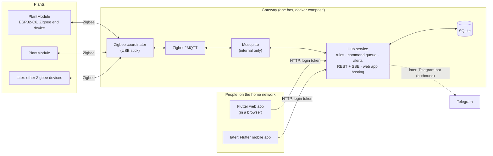
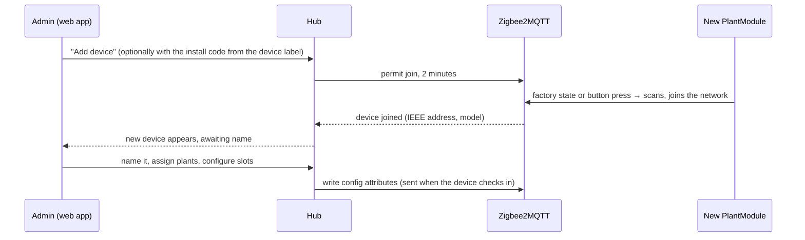
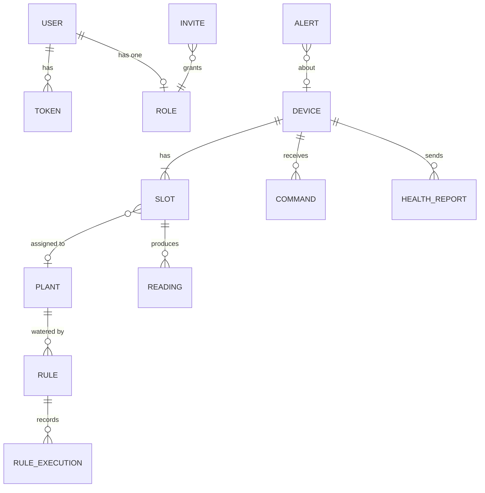
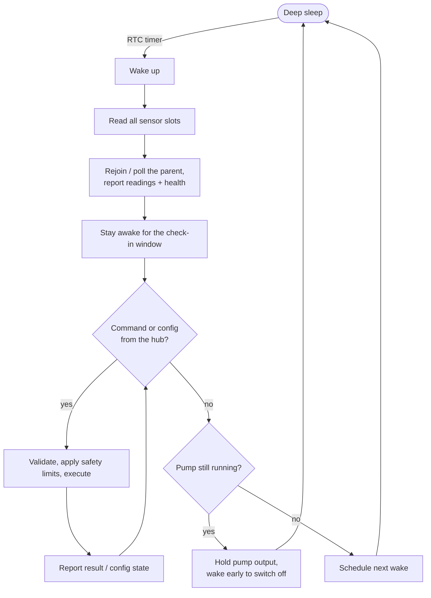
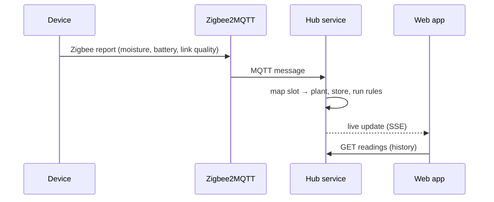
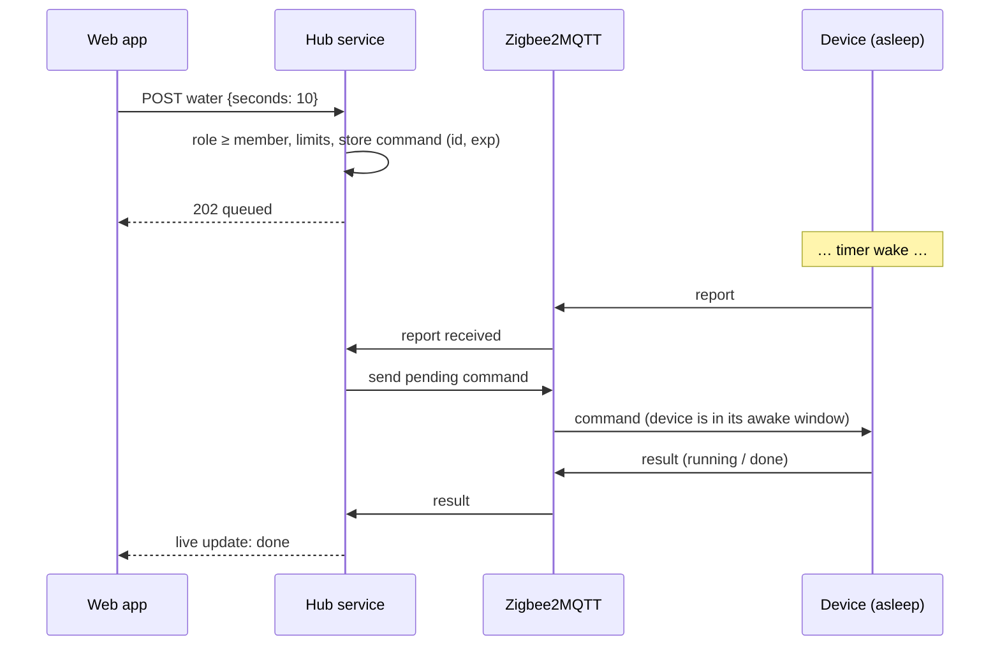
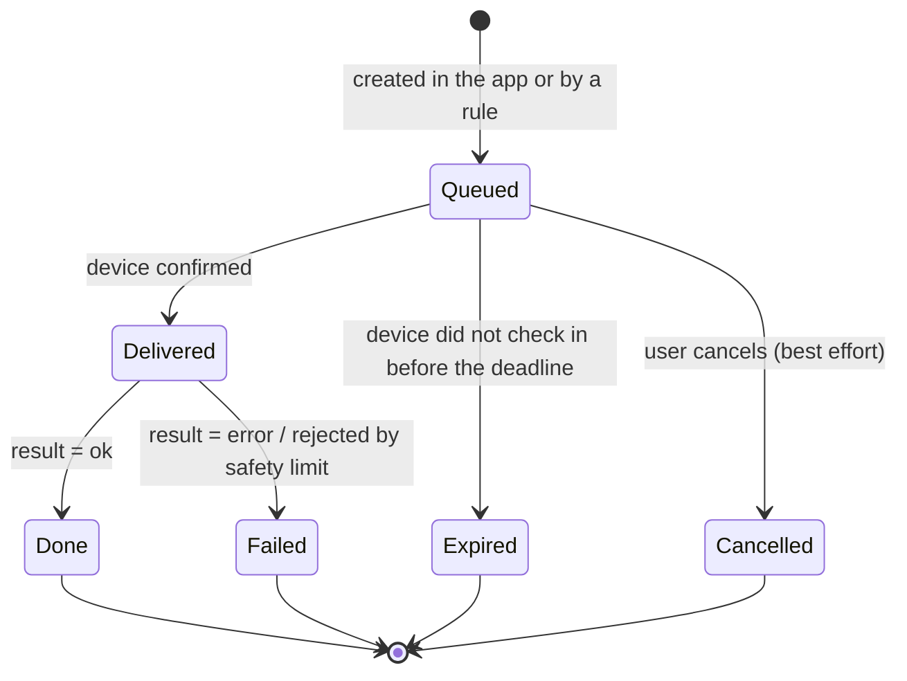

# MoistureController — System Overview

The top-level document: **what the parts are, what each is responsible for, and how they talk to each other.** Implementation details live in the `specs.md` of each product folder. If this document and a spec disagree about *how* something is implemented, the spec wins. If they disagree about *what a component is responsible for* or *how components talk to each other*, this document wins and the spec gets fixed.

| Product | Folder | What it is |
|---|---|---|
| **PlantModule** | `PlantModule/` | Battery-powered ESP32-C6 Zigbee end device: firmware (ESP-IDF, `esp-zigbee-sdk`), carrier board, scripts |
| **Gateway** | `Gateway/` | The box at home: Zigbee coordinator, Zigbee2MQTT, Mosquitto (internal) and our hub service (rules, API, database, web app hosting) |
| **App** | `App/` | Flutter: runs as web app served by the Gateway; later also as Android/iOS app |

> **Status:** this document is the **design**. The repository currently holds the specs, the carrier board and the Flutter app; the hub, the Zigbee firmware and the Zigbee2MQTT converter are still to be written. The previous WiFi/MQTT implementation is in git history at commit `eb97b07`.

---

## 1. Goal

Monitor soil moisture (and later other values) of plants with small battery-powered devices, show the data in a web app, and water plants manually or by rules, all running **locally at home, at no cost**.

**Primary user stories**

- I see the current moisture of each plant and its history.
- I can water a plant from the app, and see whether the device actually did it.
- I can set a rule like *"if moisture < 30 %, water for 10 s, at most once every 6 h"*, and it keeps working whatever else is down.
- I get told when a device is offline, its battery is low, or a sensor looks broken.
- I can change which sensor/pump is plugged into which port of a device without reflashing it.
- I can let other people in the household use the app and decide what they may do.
- Later: reach the system from outside (VPN or tunnel), get Telegram notifications, install it as a mobile app, add other Zigbee devices.

**Out of scope for now:** remote access, push notifications (Telegram comes later), multiple households, cloud services.

---

## 2. System architecture

One box at home does everything. Plant devices join its Zigbee network; people open the web app served by the box on the home network. Nothing is hosted elsewhere and no account with any provider is needed.



### Core architectural rules

1. **One box, one trust boundary.** Devices talk only to the coordinator; apps talk only to the hub's API; nothing else is exposed. The database is reachable only by the hub service.
2. **Devices are asleep most of the time.** Every interaction is **asynchronous**: the hub records an intent and sends it when the device next checks in. "Pending until the device wakes" is a normal state in the API and the UI.
3. **The hub is the source of truth for intent; the device for reality.** The hub stores *desired* state (config, commands, rules); the device reports *actual* state (readings, running config, command results). The app shows both, and where they differ.
4. **Rules run on the hub**, next to the data. Watering does not depend on any browser being open or on the internet.
5. **The device stays dumb and safe.** It measures, reports, executes commands and enforces hard safety limits locally. The hub checks commands again before sending them.
6. **Zigbee handles the radio side.** Joining, network keys, routing and delivery belong to Zigbee and Zigbee2MQTT. We add only what Zigbee has no standard for (custom settings, a command queue for sleeping devices).
7. **Extensible by design.** Other Zigbee devices known to Zigbee2MQTT can appear as further device types; the hub works on normalized readings and commands, not on one device model.

---

## 3. Users, access and joining devices

### 3.1 Concepts

| Concept | Meaning |
|---|---|
| **Gateway** | The box. There is one per installation; it defines the household. |
| **User** | A person with a username and password stored on the gateway. |
| **Role** | Owner, Admin, Member or Viewer; one household per gateway. |
| **Invite** | One-time code with a role and expiry, created by an admin and shared as a link. |
| **Browser/app token** | A random token issued at login, bound to that browser or phone. It is stored there; only its hash is stored on the gateway. |

### 3.2 Roles

Enforced by the hub on every request.

| Action | Owner | Admin | Member | Viewer |
|---|:-:|:-:|:-:|:-:|
| See plants, readings, history, alerts | ✔ | ✔ | ✔ | ✔ |
| Water manually, cancel commands | ✔ | ✔ | ✔ | |
| Create/edit plants and rules | ✔ | ✔ | ✔ | |
| Add/remove/configure devices, open the Zigbee network for joining | ✔ | ✔ | | |
| Invite members, change roles (up to Member), remove members/viewers | ✔ | ✔ | | |
| Promote/demote admins, transfer ownership, export data | ✔ | | | |

Exactly one owner.

### 3.3 Login and tokens

- **First setup:** the first user (the owner) is created when the gateway starts for the first time, using a one-time setup code shown in the gateway's log.
- **Login:** username and password in the web app (or later the mobile app) returns a **device token**. The token is stored in that browser, and every request carries it. Passwords are stored hashed.
- **My devices:** a user sees the browsers/phones that hold a token and can revoke any of them. Changing the password revokes all.
- **Sensitive actions** (delete device, change admin roles, transfer ownership, export, reset the gateway) additionally ask for the password again.
- **Discovery:** the web app is opened at the gateway's address (e.g. `http://moisture.local`). A future mobile app finds the gateway on the LAN through mDNS and registers itself with username and password, which issues its token.
- Over plain HTTP the token travels unencrypted on the home network. That is accepted for now and goes away with HTTPS when remote access is added.

### 3.4 Sharing (invites)

An admin creates an invite with a role and expiry; the app shows a link/QR to the gateway (`http://moisture.local/join#c=<code>`). The invited person opens it, chooses a username and password, and gets a token. Invites are single-use, expire and can be revoked.

### 3.5 Adding a plant device

Zigbee replaces pairing over Bluetooth and WiFi credentials: a device needs neither.



- **Install codes:** a per-device code printed on the label lets the coordinator accept only that device while the network is open. It plays the role the proof-of-possession code played before.
- The device ID is the Zigbee IEEE address; the hub keeps its own record per device.
- Joining is possible only while permit-join is open (a few minutes, started by an admin).

### 3.6 What happens when parts are down

| Situation | Effect |
|---|---|
| Home internet down | None. Everything is local. (Only the later Telegram notifications need internet.) |
| Browser closed | Rules, the command queue and data collection keep running on the gateway. |
| Gateway box down | Devices keep their local safety limits and retry; no data is collected; the app is unreachable. Data from that period is lost except what devices still hold themselves. |
| Hub service restarts | Zigbee2MQTT and the network keep running; the hub resumes from SQLite. |

### 3.7 Security model

| Party | Trusted with | Cannot |
|---|---|---|
| **Gateway** | Everything of its household: users (hashed), tokens (hashed), data | — |
| **Device** | Its own Zigbee link and its own sensor/pump | Reach anything except through the coordinator (but shares the network key with other devices) |
| **Browser/app** | The user's token | Talk to Zigbee2MQTT, Mosquitto or the database |
| **Home network** | Reaches the web port | Join the Zigbee network without permit-join (+ install code); tokens are readable on plain HTTP, see 3.3 |

The Zigbee network key protects the radio side; the web port is the only service meant for people.

---

## 4. Components and responsibilities

Each product has its own `specs.md` (design) and `readme.md` (build, run, test).

### 4.1 PlantModule — `PlantModule/`

ESP32-C6 firmware on **ESP-IDF with `esp-zigbee-sdk`**, plus the carrier board (KiCad) and scripts.

- A **sleepy Zigbee end device**: wakes on a timer, reads all configured sensor slots, reports to the coordinator, stays awake for a short window so queued commands can arrive, then deep-sleeps.
- Standard Zigbee clusters where they exist (soil moisture, temperature, battery, on/off with timed off for the pump); a manufacturer-specific cluster for what has no standard (slot configuration, calibration, safety limits, wake interval).
- Enforces local safety limits independent of what the hub says.
- No WiFi, no MQTT, no Bluetooth pairing and no TLS keys on the device.

### 4.2 Gateway — `Gateway/`

One box (Raspberry Pi 4/5, a mini PC or any 64-bit Linux with Docker, plus a Zigbee USB coordinator of about €20) running Docker Compose.

| Part | Responsibility |
|---|---|
| **Zigbee coordinator + Zigbee2MQTT** | Runs the Zigbee network, joins and talks to devices, publishes their messages on MQTT. Needs one external converter that describes the PlantModule's custom cluster. |
| **Mosquitto** | Internal broker between Zigbee2MQTT and the hub service; not reachable from outside the box. |
| **Hub service** (Python) | Ingest and normalization; SQLite history; device and plant records; the **command queue** (commands are sent right after a device checks in); local **rules**; alerts; users, tokens and invites; REST API and SSE live updates; serves the Flutter web build. |
| **Shared code** (`mc_core`) | Contract models, rules engine, command checks, config validation; part of the hub, kept as a package so it stays testable. |

### 4.3 App — `App/`

**Flutter**, one codebase: the web build is served by the gateway today, Android/iOS builds come later.

- Login, dashboard, plant detail (history, water now, rules), device detail (slots, health, wake interval), alerts, users and invites, "add device" (opens the join window), gateway status.
- Clearly shows **pending** actions ("device expected ~14:32").
- Talks only to the hub's REST/SSE API on its own origin.

---

## 5. Domain model (conceptual)



- **User**, **Role**, **Token**, **Invite**: access to the gateway.
- **Device**: Zigbee IEEE address, model, name, desired and reported configuration.
- **Slot**: one physical connector with a module type (moisture sensor, pump, …). *Users think in plants, devices think in slots; the hub maps between them.*
- **Plant**: linked to a sensor slot and optionally a pump slot.
- **Reading**, **Health report**, **Command**, **Rule** (+ executions), **Alert**.

---

## 6. Key flows

### 6.1 Device wake cycle (summary)



### 6.2 Sensor reading → app



### 6.3 Manual watering

The app gets an answer **immediately** ("queued"); the result arrives when the device next checks in. A Zigbee coordinator holds messages for sleepy devices only for seconds, so **the hub keeps the queue itself** and sends pending commands the moment the device reports.



### 6.4 Command lifecycle



Every command carries an ID and an expiry; the device ignores expired commands. "Cancel" is best effort.

### 6.5 Automatic watering (rule)


### 6.6 Changing a device's configuration

The app saves the **desired** configuration (revision + 1, validated against the pin rules). The hub writes it to the device's configuration attributes the next time the device checks in; the device validates, applies, persists and reports the configuration it runs. The app shows *Pending (rev 8)* until the reported revision matches, or *Rejected* with the device's reason.

### 6.7 Adding a new device

See 3.5: open the join window, the device joins, name it, assign plants, configure slots.

---

## 7. Cross-cutting concerns

| Topic | Direction |
|---|---|
| **Security** | One service for people (the hub's web port); everything else is internal to the box. Passwords and tokens hashed. Zigbee network key plus install codes on the radio side. HTTPS and rate limiting come with remote access. |
| **Time** | The hub stamps every message with its own receive time; the device sends only relative information unless the Zigbee Time cluster is used. The gateway needs NTP. |
| **Offline detection** | The hub knows each device's wake interval and marks it *late* or *offline*; link quality and the last check-in are shown. |
| **Power** | Zigbee sleepy end devices use far less energy than WiFi. Every device feature is judged by what it adds to the awake window. |
| **Safety** | Hard maximum pump duration and minimum pause, enforced on the device and again in the hub. |
| **Data** | SQLite on the gateway. History stays local; the owner can export. Backup is copying the database file (documented, automatable later). |
| **Notifications** | In-app alert list now; a Telegram bot later; web push needs HTTPS and comes with remote access. A notifier interface in the hub keeps channels pluggable. |
| **Deployment** | Docker Compose, multi-arch (arm64 + amd64): Zigbee2MQTT, Mosquitto, hub service (serving the web build). |
| **Updates** | Hub and Zigbee2MQTT via `docker compose pull`. Device firmware over Zigbee OTA (supported by Zigbee2MQTT) later. |
| **Remote access** | Not part of this design. Later through a VPN or a tunnel in front of the same web port, together with HTTPS. |

---

## 8. Repository layout (target)

```
MoistureController/
├── PROJECT.md              ← this file
├── readme.md
├── PlantModule/            ← firmware/ (ESP-IDF) · hardware/ (KiCad) · scripts/ · specs.md · readme.md
├── Gateway/                ← hub service, compose (Zigbee2MQTT, Mosquitto, hub), converter, mc_core · scripts/ · specs.md · readme.md
└── App/                    ← Flutter (web, later mobile) · specs.md · readme.md
```

The interfaces are described in the spec of the component that serves them: the custom Zigbee cluster in `PlantModule/specs.md`, the REST/SSE API and the Zigbee2MQTT message handling in `Gateway/specs.md`.

---

## 9. Status and plan

| Product | State |
|---|---|
| **PlantModule** | Carrier board designed (KiCad, not fabricated). No firmware yet. |
| **Gateway** | Specified. No code yet. |
| **App** | Flutter app exists against the previous API (dashboard, plant detail, rules, devices, alerts, gateway screen, connection handling); it has to be adapted to the hub API. |

The previous implementation (WiFi/MQTT firmware, gateway service, central FastAPI server, BLE pairing) was removed; what can be reused from it is listed in `Gateway/specs.md` §19 and `PlantModule/specs.md` §11.

Planned order of work:

1. Prove the radio side on the real board: a minimal ESP32-C6 sleepy end device that joins, reports moisture and receives a command, with Zigbee2MQTT and an external converter. Measure sleep current, the awake window and rejoin time.
2. Write the hub: SQLite, local login with device tokens, command queue driven by device check-ins, Zigbee2MQTT ingest, REST + SSE API, hosting of the web build.
3. Adapt the app to the hub API.
4. Write the real firmware on ESP-IDF and the Zigbee2MQTT converter.
5. Later: Telegram, HTTPS and remote access, mobile builds, OTA.

---

## 10. Decisions

| # | Topic | Decision | Consequences |
|---|---|---|---|
| D1 | Scope | **All local, free, one box at home.** No cloud services, no accounts with providers. | Remote access, push and mobile builds are later additions. |
| D2 | Radio | **Zigbee**, ESP32-C6 as sleepy end device, **`esp-zigbee-sdk` on ESP-IDF** | Firmware moves from Zephyr to ESP-IDF; no WiFi/MQTT/TLS on the device. |
| D3 | Zigbee side of the gateway | **Zigbee2MQTT** with a Zigbee USB coordinator and one external converter for the PlantModule | Standard clusters where possible; a custom cluster for slots, calibration, limits and wake interval. |
| D4 | Hub | **One Python service** (rules, command queue, API, SSE, hosting of the web build) with **SQLite** | PostgreSQL, the WebSocket uplink and the separate Server are dropped. |
| D5 | Sleepy-device commands | **The hub keeps the queue and sends pending commands right after a device checks in** | The device must stay awake for a short window after reporting. |
| D6 | Rules | **Evaluated in the hub**, next to the data | No dependency on any browser or the internet. |
| D7 | Login | **Username + password on the gateway; per-device (per-browser) tokens**, hashed at rest, revocable | Plain HTTP on the LAN until remote access brings HTTPS. |
| D8 | Roles | **Owner / Admin / Member / Viewer**, one household per gateway | Matrix in 3.2. |
| D9 | Sharing | **Invite links**, one-time code + role + expiry | |
| D10 | Joining devices | **Permit-join on the coordinator**, optional install code from the device label | No BLE and no credentials on the device. |
| D11 | Client | **Flutter**, web build served by the gateway; mobile builds later | One codebase; same origin, no CORS. |
| D12 | Notifications | **In-app alert list now, Telegram bot later** | Web push needs HTTPS; native push would need an Apple developer account. |
| D13 | Live updates | **Server-Sent Events** | One-way push over HTTP; everything the app sends goes through REST. |
| D14 | Commands | **Expiry + best-effort cancel** | Every command has `id` + `exp`; the device drops expired ones. |
| D15 | Safety | **Hard pump limits on the device and again in the hub** | The device is the final authority. |
| D16 | Remote access | **Not now.** Later a VPN or tunnel in front of the same web port, with HTTPS | Nothing in this design may depend on it. |

### Still open

- **Zigbee coordinator stick:** which model (e.g. Sonoff ZBDongle-E or -P), and whether its firmware is supported by the chosen Zigbee2MQTT version.
- **`esp-zigbee-sdk` on the ESP32-C6:** sleep current, polling behaviour of the sleepy end device, and the length of the awake window; to verify in step 2 of the plan.
- **Custom cluster vs. standard clusters only:** how much configuration really needs a manufacturer-specific cluster.
- **Time on the device:** whether it needs the Zigbee Time cluster.
- **Buffering on the device:** how many readings a device keeps if the hub is unreachable (RTC memory is small).
- **Data retention** on the gateway: keep raw readings forever, or downsample after N months.
- **Backup** of the SQLite file and the Zigbee network settings (losing the coordinator's network data forces re-joining every device).
