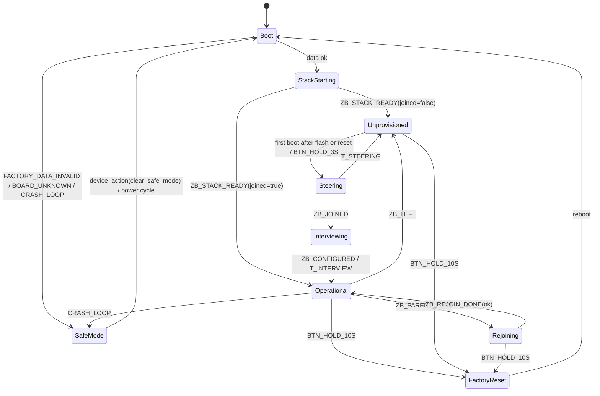
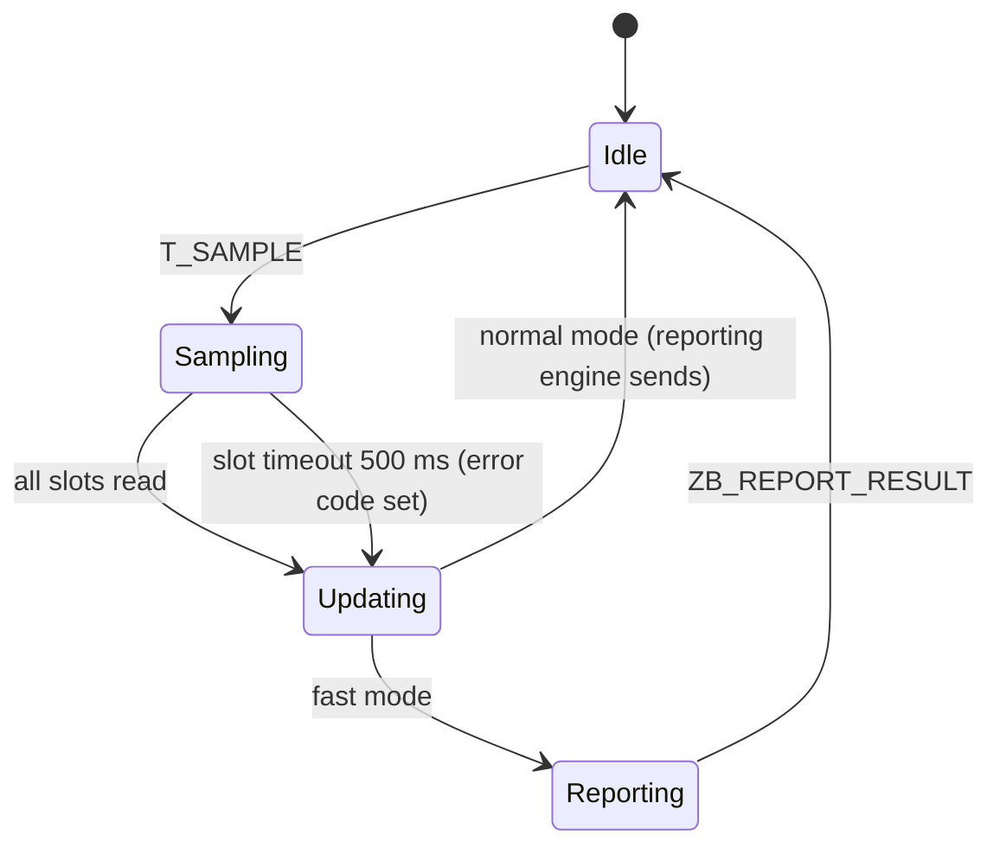
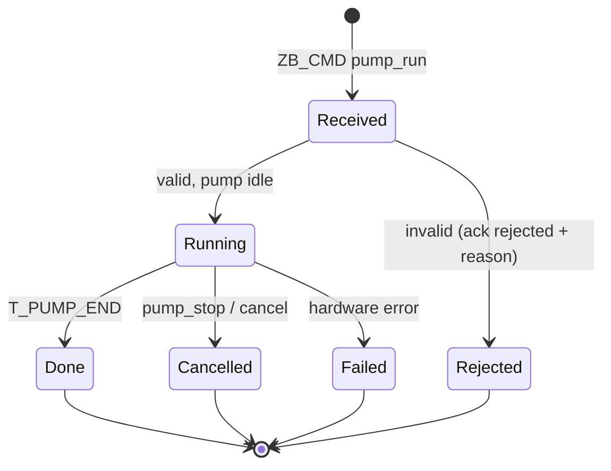
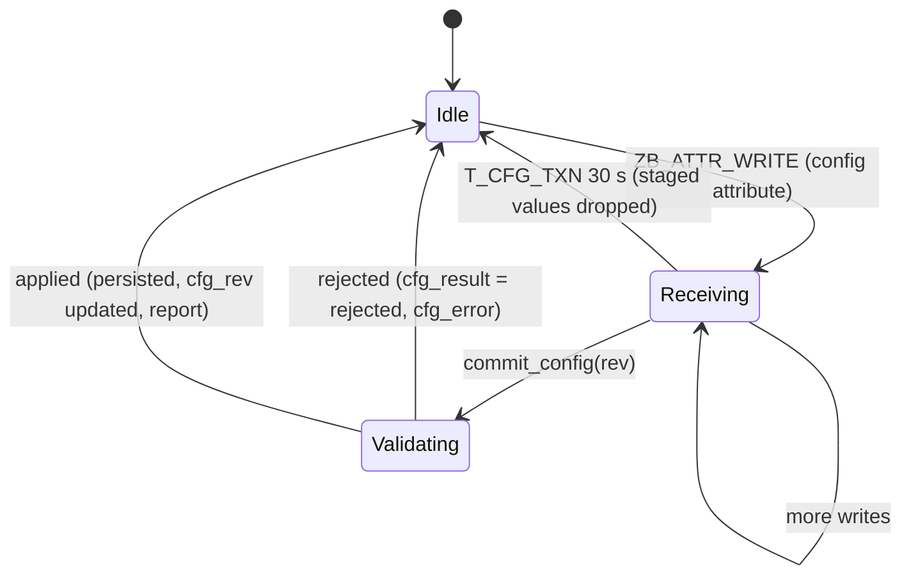
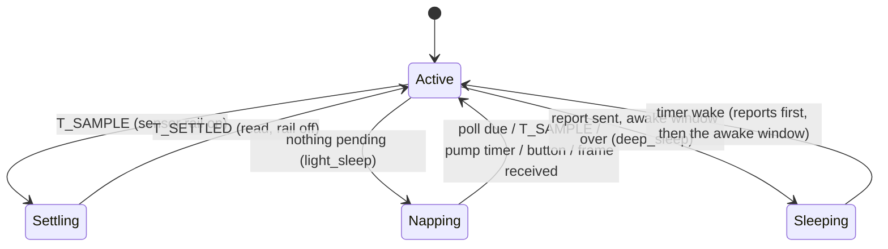

# PlantModule — Specification

The PlantModule is the plant device: an **ESP32-C6 running as an always-listening Zigbee end device** that measures soil moisture (and later other values) and waters on command. It is powered externally for now (USB or 5 V on the carrier's power connector); **low power and deep sleep come later** (Part A §18). This file is its single specification: **Part A** the firmware, **Part B** its Zigbee interface (the contract with the Gateway's Zigbee2MQTT converter; machine-readable in [`interface.yaml`](interface.yaml)), **Part C** the carrier board.

Where it fits: the module talks only to the Gateway's Zigbee coordinator; Zigbee2MQTT turns its Zigbee messages into MQTT messages for the hub and back (`Gateway/specs.md` "Message paths"). People never talk to it directly. System rules: [`PROJECT.md`](../PROJECT.md).

Folder: `firmware/` (ESP-IDF project), `hardware/` (KiCad carrier), `scripts/` (labels and provisioning, QR images), `interface.yaml` (the Zigbee interface definition). Build and test commands: [`readme.md`](readme.md).

---

# Part A — Firmware

## 1. Requirements

- Read a configurable set of sensors and drive a pump; which module sits on which port is **runtime configuration**, changed without reflashing.
- Report readings and health to the Gateway; execute commands (e.g. "run pump for N s") and apply configs sent by the Gateway.
- Enforce hard safety limits locally, whatever the Gateway sends.
- Join the Gateway's Zigbee network without any credentials typed into the device.
- Be written as **explicit state machines** (§7) so every behaviour, timeout and failure path is defined and testable on the host.
- Be easy to extend later: other PCB revisions (§2.1), more module types (§4), and low power (§18, planned).

## 2. Hardware target

**ESP32-C6** (RISC-V, 2.4 GHz WiFi 6 / BLE 5 / 802.15.4). Only the 802.15.4 radio is used; WiFi and BLE stay off. Final hardware is the carrier board in Part C (Waveshare ESP32-C6-Zero module), whose first revision (`carrier-v1`) exists and is the first development target. An ESP32-C6-DevKitC-1 board description (`devkitc-1`) is kept for bench work.

| Aspect | Notes |
|---|---|
| ADC | Only ADC1 (GPIO0–6); there is no ADC2/WiFi conflict, sensors can be read at any time. |
| Strapping pins | GPIO8, 9, 15 and the USB pins are not used for modules. GPIO4 and GPIO5 are also strapping pins on the C6 (**verify** against the datasheet); on the carrier they carry port 4 and the battery sense. |
| Console | USB-Serial-JTAG. |
| Power | USB or 5 V on the carrier's power connector. The battery divider is read as information only. |

### 2.1 Board revisions and the board description

The carrier board will change between revisions, so no pin number is hard-coded in the application. Everything that depends on the PCB is in a **board description**, one JSON file per revision (`firmware/boards/<name>.json`, for example `carrier-v1`, `devkitc-1`):

| Field | Meaning |
|---|---|
| `schema`, `name`, `hw_version` | Description schema version, board name (`carrier-v1`) and numeric hardware version, reported to the Gateway |
| `ports` | Logical ports `P1…Pn`: GPIO, ADC channel, supported roles (analog sensor, digital in, digital out/pump) |
| `i2c` | SDA/SCL GPIOs and whether the pull-ups can be switched |
| `battery` | Sense GPIO, ADC channel, divider ratio (carrier v1: 2.0) |
| `led`, `button` | GPIO and polarity |
| `sensor_power` | Optional switched sensor supply: GPIO, polarity, settle time (absent on carrier v1; used with low power, §18) |
| `low_power` | Capabilities needed once sleep is added: which ports can hold an output through deep sleep, whether the button can wake the chip (carrier v1: no) |
| `reserved` | Pins the application must not use (strapping, console, flash) |
| `allow_raw_gpio` | Whether slots may name raw GPIOs (true on dev kits, false on the carrier) |

- **One source:** the JSON files are the single source. The firmware build turns them into a C table; the Gateway ships the same files and serves them as `GET /meta/boards/{board}`, so the slot editor offers only ports and roles that exist on that board. A schema check at build time rejects an invalid description.
- **Which board am I:** the board name is stored in the `factory` partition (§10), written at flashing time by the provisioning tool. One firmware image therefore supports every revision. If the partition has no board entry, the firmware falls back to a build-time default (`CONFIG_MC_DEFAULT_BOARD`) in development builds only; a production build treats it as invalid factory data (safe mode, §11). From a later PCB revision on, an ID resistor on a spare GPIO can be read as a second source and checked against the partition.
- **Reporting:** the module reports the board name and hardware version (Basic cluster `HWVersion` and the custom `board` attribute); the Gateway looks up the matching description.
- **Unknown board:** a name the firmware does not know puts the device in safe mode with reason `board_unknown`; no output is driven.

## 3. Software stack

- **ESP-IDF** (the latest stable release that supports the C6 Zigbee SDK, pinned at the first install and recorded here and in the project) with **`esp-zigbee-sdk`** as a Zigbee 3.0 **end device that keeps its receiver on** (`rx_on_when_idle`). **Verify** that the pinned release supports this role on the C6.
- FreeRTOS tasks: the Zigbee stack task, and one application task that owns the state machines and all hardware access. The Zigbee task never calls application code directly; it only posts events (§7.1).
- Non-volatile storage: NVS (configuration, counters), the Zigbee stack's own storage partitions (network state), a raw `factory` partition (§10), and two `ota` slots reserved in the partition table so Zigbee OTA can be added later.
- Time: a monotonic timer only. The module has no wall clock; commands carry a `ttl_s` (§8).

## 4. Module slots

A fixed table of slots (6) is the single source of truth for what is connected where. Each slot: `{module type, port, options}`. A slot refers to a **logical port** of the board (`P1…Pn`, I2C), never to a raw GPIO number, so a stored configuration keeps working when a new PCB revision wires the port to a different pin. Boards with `allow_raw_gpio` (dev kits) also accept raw GPIOs.

- At runtime the firmware resolves each slot's port through the board description and configures GPIO and ADC; nothing is bound to a pin at compile time.
- Each module type is a small driver registered in a static table: `probe`, `init`, `read` (sensors), `write` (actuators such as the pump).
- Validation of a desired config (port exists on this board and supports the module's role, duplicates, limits) runs on the device as the final authority. The Python mirror (`mc_core.pins`) lets the Gateway reject bad configs earlier.

**Drivers.** To build first: `moisture_*` (analog, capacitive/resistive) and the GPIO pump (an implementation for the previous firmware is in git history, see §15). Later: DS18B20, SHT3x, `water_level_float`; until they exist those modules report `not_found` plus one `sensor_fault` event. I2C/1-Wire auto-detect is a later feature (pumps are always configured manually).

**Configuration path.** The slot table lives in NVS and survives reboot. The Gateway sends a new configuration as attribute writes plus a commit command (Part B §4 and §5); the device validates (§7.6), applies atomically, persists and reports the revision it runs.

## 5. Moisture calibration

Moisture slots map raw ADC counts to 0–100 % with a two-point calibration in the slot config, `cal: {dry, wet}` (raw counts at 0 % and at 100 %).

- **Polarity follows the two points.** `dry > wet`: small counts are wetter (typical capacitive sensor); `dry < wet`: the scale is reversed. Results clamp to 0–100 %. A raw value more than 15 % of the span outside either point is `out_of_range`; counts at the ADC limits are `no_signal`.
- **Calibration is config, not device state.** The Gateway owns it; the device persists it and never changes it itself. A re-calibration is a normal new config revision.
- **Default** when absent: `dry` 3000 / `wet` 1200 (placeholders; the ADC range of the C6 is rechecked on the board).
- **Validation today:** `dry == wet` is rejected. **Planned:** both values within the ADC range and `|dry − wet| ≥ 300`, on both sides.
- **Raw values are always reported** next to the percentage, so the hub can recompute history after a re-calibration.
- **Planned: capture command** `sensor_sample` (Part B §5): reads the slot's ADC `samples` times (default 16, max 64) and answers with median, min and max, without touching the stored config. An empty or actuator slot is rejected with `slot_not_sensor`; a floating input fails with `hw_error`. The calibration wizard in the app is built on it.

## 6. Run loop

The module is always awake. In the operational state it repeats:

1. Every **`report_interval_s`** (default 300 s, 10–3600 s) it **samples** all sensor slots, converts them (§5), increments `seq`, updates the telemetry attributes (readings, battery, diagnostics).
2. The Zigbee reporting engine sends the updated attributes to the coordinator according to the reporting configuration that Zigbee2MQTT set during the join (§8): on change beyond the reportable change, and at the latest at the max interval as a heartbeat.
3. **Fast reporting during watering:** while any pump runs, and for **`fast_report_hold_s`** (default 120 s) after the last run ended, the module samples every **`fast_report_interval_s`** (default 30 s) and **sends an explicit report after every sample**, so the moisture response to watering is seen. After the hold time it returns to the normal interval.
4. Commands and configuration writes are handled whenever they arrive (§7.5, §7.6); acknowledgements and events are sent at once.

**Pump runs.**
- A run is always **time-bounded locally**: `seconds` of the command, capped by the slot's `max_run_s` and a firmware ceiling (`MC_PUMP_HARD_MAX_S`, 300 s). The run is a timer inside the pump state machine; nothing depends on the radio while it runs.
- **Link loss during a run:** the run finishes as planned, then the pump stays off. The result is reported when the link is back (pending acknowledgements and events are kept in RAM, up to 8). A `pump_stop` or `cancel` received later is still honoured.
- `pump_stop` and `cancel` are never refused for lack of time information: stopping a pump must always work.
- A `cancel` in the same delivery wins over its target; a cancel for a command not seen yet leaves a tombstone (kept 10 minutes) so the command is answered `cancelled` when it arrives.
- After a run a **minimum pause** (`min_pause_s`) applies before the same pump may run again.
- Outputs come up **off** after any reset.

**Power.** Supplied externally (USB, or 5 V / a charger-boost board on J7). The battery level is measured and reported as described in §6.1; the module does not change its behaviour for a low cell except for the pump refusal in §6.1.4. Running from the cell with sleep is planned in §18 (`power_mode`; this section describes `always_on`).

### 6.1 Battery level detection

**Status: implemented** in the portable core (127 host tests), the HAL, the Zigbee layer, the converter, hub, api and app, and **running on the bench module** (new attributes reported, thresholds and calibration pushed and confirmed, config schema 2); **not yet verified with a real cell**. The bench carrier has none and its sense pin **floats**: a few minutes after a reset it still reads up to about 1.9 V (a false "3.7 V, ok"), then decays to 0 and the state becomes `absent`. A pull-down on the sense node (R4 populated and effective, or a firmware-switched one) belongs on the next carrier; until then a module without a cell can show a false level right after a reset. A firmware update that adds attributes also **needs the Zigbee storage erased** (see below). Differences from the plan: the battery read is the **last step of the sensor sample** (so the value is part of the same report as the moisture and `seq`), not a separate timer; the hub **trusts the module's debounced `batt_state`** and does not debounce again. Goal: the user is told **in time** that a cell is getting low, sees a believable level, and a flat cell never makes a pump run half-way. Scope decided with the project owner: **one Li-ion/LiPo cell (1S)**, detection, reporting and alerts **now** on the always-awake firmware; everything that only matters once the module sleeps stays in §18.

**6.1.1 What is measured and what limits the accuracy**

| Topic | Fact / decision |
|---|---|
| Path | Cell (J7 VBAT pin, sense only; the cell's charging and protection are on an external board) → R3/R4 **330 kΩ / 330 kΩ** divider → C7 100 nF → **GPIO5 (ADC1_CH4)**; board description `battery: {gpio: 5, divider: 2.0}`; 4.2 V full gives 2.1 V at the pin (inside the 12 dB range). |
| Source impedance | 165 kΩ is high for the ADC sample-and-hold. C7 (100 nF) acts as the reservoir, so the reading is stable but must be averaged over several conversions; **verify on the prototype** that a single conversion and an 8-conversion average agree within 10 mV. |
| ADC accuracy | Use the chip's eFuse-calibrated conversion (curve fitting, as in the HAL today) with 12 dB attenuation. Expected total error about ±50 mV (ADC ±30 mV, resistors 1 % ≈ ±20 mV at 4 V). Good for a threshold and a level, not for a fuel gauge. |
| Per-device correction | A per-device **`batt_cal_permille`** (default 1000, range 900–1100) multiplies the result, set from a multimeter reading (§6.1.6). It sits in the configuration, so it survives a factory reset only through the hub (factory reset clears the configuration). |
| No cell connected | Pin below 500 mV after settling means "no cell": state `absent`, voltage reported as 0, **no alerts**. This is the normal case on USB / VIN only. |
| Charging / USB | The board has no charger sense: while a cell is on a charger the pin shows the charge voltage (up to 4.2 V), so the level looks full and **"charging" cannot be detected**. The app must not claim to know it. A charger-status input is a carrier wishlist item. |
| Load sag | A running pump pulls the cell down. The "level" is therefore measured **at rest**: no sample while any pump runs and for 5 s after it stopped (the sample is skipped, the previous value stays, `seq` is unaffected). |
| Strapping pin | GPIO5 is a strapping pin on the C6 (**verify**); the 165 kΩ divider is high impedance and with the cell absent the pin floats to 0 V, so a boot-time problem is not expected, but it is checked in the prototype (§17.1). |
| Divider current | 330 k + 330 k draws about 5 µA at 3.7 V, permanent; irrelevant now, a switch or a higher resistance belongs to the low-power work (§18). |

**All battery settings in one place.** Every number below is in **`PlantModule/interface.yaml`**; nothing is repeated by hand in the firmware, the converter or the hub (generators: `scripts/gen_interface_h.py` for the firmware header, `Gateway/scripts/gen_converter.py`, `Gateway/scripts/gen_hub_params.py`; the checks run in `scripts/test_host.sh` and in a hub test).

| Setting | Value | In `interface.yaml` | Who uses it |
|---|---|---|---|
| Low threshold `batt_low_mv` | 3600 mV (3000–4000), per installation, per device | `custom_cluster.attributes` | module, hub, app |
| Critical threshold `batt_critical_mv` | 3400 mV (3000–4000), below low | `custom_cluster.attributes` | module, hub, app |
| Calibration factor `batt_cal_permille` | 1000 (900–1100), per device | `custom_cluster.attributes` | module, hub |
| ADC conversions per sample | 8 | `battery.measure.adc_conversions` | firmware HAL |
| Samples in the reported median | 3 | `battery.measure.filter_samples` | firmware core |
| Quiet time after a pump run | 5000 ms | `battery.measure.quiet_after_pump_ms` | firmware core |
| Battery read timeout | 500 ms | `battery.measure.read_timeout_ms` | firmware core |
| No-cell limit | 500 mV | `battery.classify.present_min_mv` | firmware, hub |
| Hysteresis | 100 mV | `battery.classify.hysteresis_mv` | firmware core |
| Debounce | 3 samples | `battery.classify.debounce_samples` | firmware core |
| Reports in the percentage median | 5 | `battery.hub.history_reports` | hub |
| Stale limit for the percentage | 2 report intervals | `battery.hub.stale_factor` | hub |
| Percentage curve | Li-ion 1S table | `battery.hub.percent_curves` | hub |
| Reporting of `batt_mv` / `batt_state` | min 60 s, max 600 s, change 20 mV / on any change | `reporting` | converter, Zigbee2MQTT |

Not in the file: the battery divider ratio and sense pin (they belong to the board and live in `firmware/boards/<board>.json`), and the installation's current threshold values (settings in the hub, set in the app).

**6.1.2 Sampling and filtering (firmware)**
- One battery sample **with every sensor sample** (every `report_interval_s`, and in fast mode too) plus one at boot, instead of the free-running 30 s timer. So a reading is always aligned with a `seq` and the hub can store it with the moisture value.
- A sample is the **median of 8 conversions** (calibrated, divided by the divider ratio, multiplied by `batt_cal_permille`). The core then keeps the **median of the last 3 samples** as the reported `batt_mv`, which removes single outliers (radio transmit bursts, a load switching on) without delaying a real trend by more than two intervals.
- The core stays pure: the HAL delivers raw millivolts at the pin (`BATT_SAMPLE`), the core applies divider, calibration, filter and thresholds, so all of it is host-tested.

**6.1.3 Battery state machine (in the sensing machine)**

| State | Entered when (filtered `batt_mv`) | Leaves when |
|---|---|---|
| `absent` | below 500 mV | at or above 500 mV |
| `ok` | above `batt_low_mv` + hysteresis, or first value above `batt_low_mv` | below `batt_low_mv` |
| `low` | at or below `batt_low_mv` for **3 consecutive samples** | above `batt_low_mv` + 100 mV (`ok`), or at or below `batt_critical_mv` (`critical`) |
| `critical` | at or below `batt_critical_mv` for 3 consecutive samples | above `batt_critical_mv` + 100 mV (`low`) |

Defaults: **`batt_low_mv` 3600** (about 10 % at rest for a Li-ion cell) and **`batt_critical_mv` 3400** (a few percent left; the protection circuit of a typical cell cuts off near 3.0 V and the module's regulator needs margin). The current default 3500 changes. Hysteresis 100 mV so a cell recovering after a pump run does not flap. Changing a threshold in the configuration re-evaluates at the next sample. A reset starts in `ok`/`absent` from the first sample; the state is not stored.

**Events** (cluster command `event`, existing counter `n`): `low_battery` (arg = `batt_mv`) once on entering `low`; the new `battery_critical` (arg = `batt_mv`) once on entering `critical`. Recovery has no event: the hub resolves from the reported state.

**6.1.4 Behaviour in `critical`**
- A `pump_run` is **refused** with the new ack reason `battery_low`, because a pump start on an almost flat cell can brown the module out in the middle of a run (it would come back with the pump off, but the run is lost and the cell is stressed). `pump_stop`, `cancel`, `device_action` and reporting are unaffected. A run that is already running when the state changes finishes.
- The validation order of §7.5 gets one more step after `slot_not_actuator`: **battery critical → `battery_low`**.
- No other behaviour changes (no longer intervals): that belongs to low power (§18, planned).

**6.1.5 Interface changes (planned, not yet in `interface.yaml`)**

| Where | Change |
|---|---|
| Custom cluster, telemetry | `batt_mv` **0x0138** uint16 (filtered millivolts, 0 when absent), reportable; `batt_state` **0x0139** enum8 (0 absent, 1 ok, 2 low, 3 critical), reportable. The standard Power Configuration `batteryVoltage` (100 mV units) stays for generic clients but is too coarse for the thresholds. |
| Custom cluster, configuration | `batt_low_mv` default 3600 (was 3500); new `batt_critical_mv` **0x0005** uint16 (default 3400); new `batt_cal_permille` **0x0006** uint16 (default 1000, 900–1100). Config schema 1 → 2: a stored schema-1 configuration is migrated on boot (new fields get their defaults), no re-join. |
| Enums | `event_code` 8 `battery_critical`; `reason` 8 `battery_low`; new enum `batt_state`. |
| Reporting (set by the converter) | `batt_mv`: min 60 s, max 600 s, change 20 mV; `batt_state`: min 1 s, max 600 s, any change. Both are numbers/enums, not octet strings, so the stack can report them (§17.1 finding). |
| MQTT keys | `batt_mv` → `batt_mv` (and `voltage_mv` kept as an alias for the standard attribute), `batt_state` → `batt_state`. |

**6.1.6 Calibration (per device, optional)**
1. The user measures the cell (or a bench supply on the VBAT pin) with a multimeter and enters the value in the app (Device detail → "Calibrate battery").
2. The hub computes `permille = measured_mv / uncorrected_mv × 1000` (uncorrected = the reported value divided by the current `batt_cal_permille`), clamps it to 900–1100 and sends a new configuration revision.
3. The module applies it from the next sample; the app shows the new value when the hub sees it. A reading more than 10 % off is not "calibrated away": the app tells the user to check the wiring instead.

**6.1.7 Tests**
- **Host tests (`mc_core`):** divider and calibration maths; median filter; state machine including debounce, hysteresis, the 500 mV "absent" rule, threshold change at runtime; sample skipped while a pump runs and 5 s after; `battery_critical` event and `low_battery` once each; `pump_run` refused with `battery_low` in `critical` and a running run unaffected; stored schema-1 configuration migrates.
- **Hardware (prototype):** a bench supply at 3.0 / 3.4 / 3.6 / 3.9 / 4.2 V against a multimeter (error table, then the calibration step); single conversion versus 8-average at 165 kΩ source impedance; sag during a real pump run; boot with the pin driven and floating (strapping); behaviour on USB with and without a cell.
- **Converter and hub tests:** see `Gateway/specs.md` §13.1; the app tests are listed in `App/specs.md` §17.

**6.1.8 Open points and risks**
- The rest-voltage percentage is **only an estimate**; the Li-ion curve is flat between 3.7 and 3.9 V. The app shows it as "about" and the voltage next to it (decided with the project owner).
- Without a charger sense the module cannot tell "charging" from "full".
- The default thresholds (3600 / 3400) are a starting point; a measured discharge of the real cell with the real pump decides the final values.
- Other chemistries (2×AA, LiFePO4) need different dividers, thresholds and curves; the hub's curve table (`Gateway/specs.md` §13.1) is built for that, the module is cell-agnostic apart from the thresholds.

## 7. State machines

### 7.1 Principles

- **Event-driven, run-to-completion.** All behaviour is a set of finite state machines in the portable core (`mc_core`). The application task waits on one event queue and passes each event to the machines; a handler never blocks.
- **Pure core, effects through an interface.** The core exposes `step(machine, state, event) → (new state, actions)` as a function of its inputs, with no hardware access. The application task executes the returned **actions** through a small I/O interface (`drive_pump`, `read_adc`, `zb_report`, `zb_send_cmd_ack`, `nvs_write`, `set_led`, `arm_timer`, `reboot`, …). On the host the same core runs with a fake clock and fake I/O (§16).
- **One writer per resource.** Only the pump state machine of a port drives that port; only the configuration machine writes the configuration; only the lifecycle machine starts or stops the Zigbee stack.
- **Events come from four sources:** the Zigbee task (stack callbacks translated into events), timers (all armed through `arm_timer` and delivered as events), GPIO (button) and ADC completions, and the watchdog/system. Every event has a defined source (table 7.2).
- **Every state has a time budget.** A state that waits for something has a timeout event or is covered by the watchdog (7.7). There are no states without a way out.
- **Hierarchy:** the lifecycle machine (7.3) contains the other machines (7.4–7.6) as long as it is in `Operational`; leaving `Operational` stops them in a defined way (pumps off).

### 7.2 Events and actions

| Source | Events |
|---|---|
| System | `BOOT`, `FACTORY_DATA_OK/INVALID`, `BOARD_KNOWN/UNKNOWN`, `CRASH_LOOP`, `WATCHDOG` |
| Zigbee task | `ZB_STACK_READY(joined)`, `ZB_STEERING_DONE(ok)`, `ZB_JOINED`, `ZB_CONFIGURED` (bindings and reporting config received), `ZB_PARENT_LOST`, `ZB_REJOIN_DONE(ok)`, `ZB_LEFT` (told to leave), `ZB_ATTR_WRITE(id, value)`, `ZB_CMD(command, payload)`, `ZB_REPORT_RESULT(ok)` |
| Timers | `T_SAMPLE`, `T_FAST_HOLD`, `T_STEERING`, `T_INTERVIEW`, `T_REJOIN`, `T_PUMP_END(port)`, `T_PUMP_PAUSE(port)`, `T_CMD_TTL(id)`, `T_CFG_TXN`, `T_STABLE` (5 min uptime) |
| Hardware | `ADC_DONE(slot)`, `BTN_SHORT`, `BTN_HOLD_3S`, `BTN_HOLD_10S`, `BATT_SAMPLE` |

Actions: `start_zigbee`, `start_steering`, `rejoin`, `leave_network`, `report_attributes`, `send_cmd_ack`, `send_event`, `drive_pump(port, on)`, `read_slot(slot)`, `persist_config`, `set_led(pattern)`, `arm_timer`, `cancel_timer`, `reboot`, `factory_reset`.

### 7.3 Device lifecycle machine



| State | What happens | Time budget / exit |
|---|---|---|
| `Boot` | Load and verify the factory data (§10) and the board description; load the configuration (§12); read the reset reason and update the crash counter; force all outputs off | ms; invalid data → `SafeMode` |
| `StackStarting` | Start the Zigbee stack from stored network state | stack answers within 10 s, else reboot |
| `Unprovisioned` | Not on a network; LED slow blink; no sensing reports; waits for a button hold. The very first boot after flashing or factory reset goes straight to `Steering` | until a 3 s hold |
| `Steering` | Scan for an open network and join (with the install code when the provisioning data has one, §10) | `T_STEERING` 180 s, then back to `Unprovisioned` |
| `Interviewing` | Joined; the stack answers Zigbee2MQTT's reads and applies the bindings and reporting configuration; sensing runs, commands are rejected `busy` | until `ZB_CONFIGURED` or `T_INTERVIEW` 120 s |
| `Operational` | Normal operation: sensing/report loop (7.4), command machines (7.5), configuration machine (7.6) | until a lifecycle event |
| `Rejoining` | Parent lost: retry rejoin with back-off 5, 10, 20, 40 s … capped at 5 min, forever. Sampling continues, pump runs finish, only the radio is down; the latest values are reported once the link is back | until `ZB_REJOIN_DONE` or reset |
| `FactoryReset` | Leave the network, erase network state and configuration (the `factory` partition stays), reboot | seconds |
| `SafeMode` | See §11 | until cleared |

A told-to-leave (`ZB_LEFT`, for example the device was removed in Zigbee2MQTT) erases the network state and the configuration, forces outputs off and returns to `Unprovisioned`.

**Buttons** (§9): a short press blinks the LED to identify the module and triggers a report; a 3 s hold starts steering when not on a network (and does nothing but the LED cue when on one); a 10 s hold is the factory reset.

### 7.4 Sensing/report machine (inside `Operational`)



- `Idle` waits for `T_SAMPLE`; the interval is `report_interval_s` normally, `fast_report_interval_s` in fast mode.
- `Sampling` reads the sensor slots one after another (`read_slot`, `ADC_DONE`), at most 500 ms per slot and 2 s in total; a slot that does not answer gets error `hw_error` for this sample.
- `Updating` converts, writes the telemetry attributes, increments `seq`, raises `sensor_fault`/`sensor_ok` events (a slot error on 3 consecutive samples raises the event once; the first good sample clears it).
- `Reporting` exists only in fast mode: an explicit report of the changed attributes; a failed report is not repeated (the next sample follows within `fast_report_interval_s`).
- **Fast mode** is entered by any pump run starting and left `fast_report_hold_s` after the last run ended (`T_FAST_HOLD`).

### 7.5 Command machines (inside `Operational`)

One **pump actuator machine per pump port** and one **command record per `cmd_id`**.



Validation on `Received`, in this order (first failure wins, the reason goes into the ack): module not in `Operational` or in safe mode → `busy`; `ttl_s` already expired → `expired`; slot not configured as a pump → `slot_not_actuator`; **battery in `critical` → `battery_low` (planned, §6.1.4)**; `seconds` > min(`max_run_s`, firmware ceiling) → `limit`; pump in its minimum pause → `min_pause`; pump already running → `busy`. A command id seen before is **not executed twice**: the stored result is acknowledged again.

Actuator machine per port: `Off` → `On` (timer `T_PUMP_END`) → `Pause` (timer `T_PUMP_PAUSE`, `min_pause_s`) → `Off`. A stop in `On` goes to `Pause` at once. The actuator machine is the only code that drives the pin; a reset or `ZB_LEFT` or entering safe mode forces `Off`.

Acknowledgements: `running` is sent when the pump starts (with `ends_in_s`), then `done`, `failed` or `cancelled` at the end. They are queued (up to 8) while the link is down and sent in order when it is back.

### 7.6 Configuration machine (inside `Operational`)



- Attribute writes only **stage** values in RAM; nothing becomes active before `commit_config`.
- Validation covers the slot table (ports, roles, duplicates, calibration, limits) and the scalar fields (`report_interval_s` 10–3600, `fast_report_interval_s` 10–300, `fast_report_hold_s` 0–1800). An invalid configuration is rejected as a whole with the first error and the slot it belongs to; the running configuration is untouched.
- A commit that changes a slot whose pump is running is rejected with `busy`; the Gateway retries later.
- Applying is atomic (§12): write the inactive configuration slot, verify it, switch the active pointer, then apply to the running machines; a power loss at any point leaves either the old or the new configuration.
- Re-sending the same revision with identical content answers `ok` again; an older revision is rejected `stale_rev`.

### 7.7 Time budgets and watchdog

- The application task feeds a task watchdog (30 s); a missed feed resets the device (`WATCHDOG` is also an unexpected reset for the crash counter, §11).
- The Zigbee task is observed with its own heartbeat event every 10 s; if it stops, the application reboots.
- State time budgets are in the tables above; any state without an external trigger has a timer event.

## 8. Zigbee behaviour

- **Role:** end device with the receiver on (`rx_on_when_idle`), one parent (the coordinator or a router). Commands from the coordinator reach it directly.
- **Joining:** steering (7.3) on the very first boot after flash or factory reset and on a 3 s hold when not on a network. With an install code in the factory data (§10) the module joins using that code; development builds without an install code use the default link key (§10). All channels 11–26 are scanned.
- **Identity** (Basic cluster, endpoint 1): manufacturer `MoistureController`, model `MC-PLANT`, software build (semantic version), hardware version, plus the custom `board` attribute. Zigbee2MQTT recognises the module by this model.
- **Interview and configure:** after the join Zigbee2MQTT reads the descriptors and Basic attributes, matches the converter, then runs the converter's **configure** step: it binds the clusters to the coordinator and sets the attribute reporting configuration (min/max interval, reportable change). The module only has to answer; the Gateway retries a failed configure twice (`Gateway/specs.md`). The reporting configuration is persisted by the Zigbee stack in `zb_storage`, (observed: records left over from a different attribute set make the stack abort at the first report; the mechanism inside the stack is not documented, presumably the records are matched by position).
- **Reporting configuration** set by the converter: moisture value per slot min 5 s, max 300 s, change 0.5 %; battery voltage min 60 s, max 600 s, change 50 mV; status and diagnostics min 10 s, max 600 s; the minimum is deliberately ≤ 10 s so fast reporting (§6) can send at 30 s. The maximum acts as a heartbeat and does not depend on `report_interval_s`: if a value was not sampled again, the repeated report carries the same `seq`, which the hub treats as "no new reading".
- **Rejoin:** after losing its parent (for example the coordinator was replaced) the module rejoins with the stored network key and back-off (7.3). If the coordinator has a new network, the module needs a factory reset and a new join.
- **Leave:** a leave request from the coordinator erases the module's configuration and network state (7.3).
- **Time to live:** commands carry `ttl_s`, counted from the moment the module receives them. The module answers `rejected` with reason `expired` if it cannot start the command in time.
- **Changing the attribute set (firmware update):** the module hashes the attributes it registers (id, type, access, position) and the `reporting` table and keeps the hash in NVS (`mc_zb/attr_hash`). When it differs at start-up and the module has a network, the stack's stored reporting records are discarded and rebuilt from the generated `MC_REPORTING_LIST` (`interface.yaml`, `reporting`), the same values Zigbee2MQTT configures; the network, the bindings and the settings are untouched, so a firmware update that adds, removes or re-orders attributes needs no re-join and no erase. Attributes that are not in the table (the slot octet strings, `seq`, `boot_id`) get a record without periodic reporting; the module sends them itself. The app side of the stack is only used once the network state is known (`stack_up`): earlier attribute writes would abort. The hub and Zigbee2MQTT need nothing; a changed attribute set does need the converter updated (it is generated from the same file).
- **OTA** (later): Zigbee OTA Upgrade cluster, images served through Zigbee2MQTT. Attribute-set changes between versions are safe (previous item).

## 9. Buttons and LED

BOOT/user button (on the carrier: SW1, GPIO21 on v1, see Part C):

- **Short press:** identify (LED blinks for 10 s) and send a report at once.
- **3 s hold:** start steering when not on a network (otherwise only the LED cue).
- **10 s hold:** factory reset: leave the network, clear configuration and joined state; the factory data stays.

LED (GPIO20 on v1): solid when operational and connected, slow blink when unprovisioned, fast blink while steering or interviewing, double blink when rejoining, triple blink in safe mode, fast blink as the "keep holding" cue between 3 s and 10 s.

## 10. Factory data, install code and provisioning

**Factory partition** (raw 4 KB, outside the settings, never erased by factory reset), little endian: `magic "MCF2"` (4) · `version` (1) · `board` (16, NUL padded) · `serial` (12, ASCII) · `install_code` (18: 16-byte Zigbee install code + CRC16) · `flags` (1: bit 0 = install code required) · reserved · `crc32` (4, IEEE over everything before it); the rest is 0xFF. Invalid magic, version or CRC means invalid factory data (§11).

**Install code:** the Zigbee install code is registered by the Gateway with Zigbee2MQTT before the join window opens (`Gateway/specs.md`); the coordinator then accepts only a module that knows it, which keeps a neighbour from joining while the network is open. A **deployed module requires its install code** (flag set by the provisioning tool); a **development build** (`CONFIG_MC_DEV_JOIN`) may join with the default link key when the factory data has none.

**Label:** a QR code of the form `MCIC1:<model>:<serial>:<install-code-hex>` plus the text; the app or the hub UI accepts the code when a device is added.

**Provisioning tool** (`scripts/make_label.py`), one command per device:
- `new --board carrier-v1 --port <serial port>`: generates serial and install code, builds the factory partition image (board, serial, code, flags, CRC), writes it with `esptool` at the `factory` partition offset (from `partitions.csv`), records the device in `scripts/factory/devices.csv` (git-ignored, holds the secrets) and prints the label.
- `flash`, `list`, `qr <serial>`: write a recorded device's image again, list what was made, redraw a label.
- The firmware itself is flashed separately with the normal build.

## 11. Safety and safe mode

- Hard limits per pump (`max_run_s`, `min_pause_s`, and a firmware ceiling) are enforced on the device. The Gateway checks commands again before sending, but the device is the final authority.
- Commands past their time to live are dropped.
- Outputs come up off after any restart.
- Sensor errors (`no_signal`, `out_of_range`, `not_found`, `hw_error`) are reported, never turned into a value.

**Safe mode** is entered on invalid factory data (`factory_invalid`), an unknown board (`board_unknown`), or a crash loop (`crash_loop`): **3 consecutive unexpected resets** (panic, watchdog, brownout), each after less than 5 minutes of uptime. In safe mode: all outputs are off, no configuration is applied, no pump command is accepted, the module stays on the network if it can, and it reports `status = safe_mode` with the reason code and the last reset reason, so the hub can raise an alert. It leaves safe mode only by the hub's `device_action clear_safe_mode`, a power cycle, or a factory reset. A power-on reset clears the crash counter; the counter is also cleared after 5 minutes of stable uptime (`T_STABLE`).

## 12. Persistence and recovery

| Data | Where | Notes |
|---|---|---|
| Configuration | NVS, two blob slots `cfg_a`/`cfg_b` plus `cfg_active`; each blob has schema version, revision and CRC | Atomic apply (7.6); a corrupt active slot falls back to the other, then to the safe default (all slots empty, outputs off) |
| Counters (boots, unexpected resets, rejoins, last error) | NVS namespace `mc_diag` | Written at boot and on change, rate-limited |
| Zigbee network state | Stack partitions | Erased by factory reset and by `ZB_LEFT` |
| Factory data | `factory` partition | Read-only at run time |

Recovery rules: a corrupt or unknown-version configuration is ignored with an event and the safe default is used; a new device (no configuration) has all slots empty, no output is ever driven without a valid configuration.

## 13. Diagnostics

Reported as telemetry attributes (Part B §3), shown in the device detail screen of the app: `uptime_s`, `boot_reason`, `reset_count`, `rejoin_count`, `last_error` (small code table kept in the firmware), `free_heap`, firmware version (Basic `swBuildId`), `interface_version` and `config_schema`. Logs go to the console (levels error/warn/info/debug, info by default); there is no remote log.

## 14. Versioning

| What | How |
|---|---|
| Firmware | Semantic version in Basic `swBuildId` |
| Zigbee interface | `interface_version` (major.minor in one `uint16`, `interface.yaml`); the hub accepts the same major and tolerates a different minor |
| Configuration schema | `config_schema` (uint8); a device with an older schema is migrated on boot |
| Board description | `schema` field in the JSON |
| Factory data | `version` byte of the partition |

## 15. Code layout (target)

```
firmware/
├── CMakeLists.txt · sdkconfig.defaults · partitions.csv
├── main/                  app_main: starts the application task and the Zigbee task
├── components/
│   ├── mc_core/           portable core: state machines, config + pin rules, commands, moisture conversion (pure C, no hardware)
│   ├── mc_hal/            ESP32-C6: ADC, GPIO, NVS, LED, button, battery, timers, watchdog, factory data
│   ├── mc_zigbee/         esp-zigbee-sdk: network, endpoint and clusters, reports, commands → events
│   └── mc_drivers/        module drivers (moisture, pump, later more)
├── boards/                board descriptions (JSON): carrier-v1, devkitc-1
└── test/                  host tests of mc_core
interface.yaml             Zigbee interface definition (source for the C header, the converter and the hub models)
scripts/                   make_label.py (factory image + label), qr_png.swift
hardware/                  carrier board (Part C)
```

- The previous firmware (Zephyr, WiFi + MQTT, BLE pairing) was removed; it is in git history at `eb97b07`. Its portable core (`PlantModule/firmware/src/core`: `mc_config`, `mc_cmd`, `mc_cycle`, `mc_sensor`, `mc_pins`, `mc_rtc` and their ztest suites) is a reference for `mc_core`; its hardware layer a reference for `mc_hal`. The state machines of §7 replace the old wake cycle.

## 16. Testing

| Level | What |
|---|---|
| Host unit tests | `mc_core` built for the ESP-IDF `linux` target and tested with **Unity**. Table-driven tests per state machine: for every transition row an event sequence with a fake clock and fake I/O, asserting new state and returned actions; plus tests for validation, calibration and the factory data parser. Run in CI and locally without hardware. |
| Converter tests | The Zigbee2MQTT converter definition is tested against recorded Zigbee frames (Gateway side). |
| Interface check | A check that `interface.yaml`, the generated C header, the converter and the hub models agree (once generators exist). |
| On hardware | The prototype checklist (17.1) and a command round trip test with Zigbee2MQTT. |

## 17. Status, prototype plan and open points

Status: this specification, `interface.yaml` and the **carrier board v1** (built, in hand, untested) exist. The portable core `mc_core` (`firmware/components/mc_core`: lifecycle, sensing and fast mode, pump and command machine, configuration transaction, factory partition parser, generated board table and interface header) is implemented with 127 host tests (basics, lifecycle, sensing, commands, configuration, battery, random-event invariants, HAL logic), built with `-Werror` and ASan/UBSan. The ESP-IDF project builds for the C6 (`firmware/`: `main/` application task, `components/mc_hal` storage, GPIO/LED/button, ADC, timers, `components/mc_zigbee`: the esp-zigbee-sdk layer, and a logging stub for bench tests without a radio via `CONFIG_MC_ZIGBEE_STUB`); the pure helpers of the HAL (LED patterns, button decoder, stored configuration format) live in `mc_core` and are host-tested (106 tests). **Pinned: ESP-IDF v6.0.2** (installed with the ESP-IDF installer in `~/.espressif`). **First bench run with Zigbee2MQTT (2.14.2, SONOFF dongle, carrier v1, dev build): join by install-code-less steering, interview, converter match, configure, configuration commit (`cfg_rev` 9, kept across a restart), `pump_run` with running/done acks and the pump slot showing 100 % while on, all worked.** Findings: (1) the stack **cannot report octet-string attributes** (`slot_n`): a reporting configuration for them is refused or, once stored in flash, crashes the stack's reporting engine (load fault in `zb_zcl_get_next_reporting_info`); so the module sends the slot attributes itself after **every sample** and Zigbee2MQTT does not configure them (`interface.yaml`, `reporting`); (2) a configure-reporting command with all 20 records and a write of the whole configuration (~86 bytes) are too long for one frame (`MESSAGE_TOO_LONG` / `Delivery failed`), the converter sends them in groups; (3) a network restored from flash with the coordinator absent signals `BDB Device Reboot` with `ESP_FAIL`: that is a lost parent (rejoin back-off), not a start failure; (4) opening the USB serial port of the C6 resets it, read the log with a raw termios open that does not toggle the lines; (5) the Power configuration battery voltage attribute must be added with the reporting flag by hand; (6) Zigbee2MQTT publishes its accumulated state after every single attribute and the hub takes a new `seq` as a new reading, so the module sends `seq` **last** in an explicit report; (7) the read-only `board`, `interface_version` and `config_schema` are not reportable: the converter's configure step reads them once, which is how the hub learns the board (without it the hub refuses to configure slots). **Hub connected to the real module (hub + api + throwaway Zigbee2MQTT, `Gateway/scripts/z2m_throwaway.sh`): adopt and rename, config revision pushed and committed, readings stored per plant, `water` from the api to the pump and back (`queued` → `delivered` → `done`) all worked.** (8) **A firmware that changes the attribute set aborts at boot (`zb_assert`) with the old `zb_storage`**: the stack restores its stored reporting configuration and the new layout does not match; erasing `zb_storage` (and rejoining, then `configure`) fixes it. This must be solved before a Zigbee OTA exists (stable attribute order, or an erase-on-version-change in the firmware). **Zigbee dependencies (pinned in `firmware/dependencies.lock`): `espressif/esp-zigbee-lib` 1.6.8, `espressif/esp-zboss-lib` 1.6.4.** The Zigbee layer compiles and links (end device, receiver on, endpoint 1 with Basic, Identify, Power configuration and the custom cluster 0xFC11, signals mapped to core events, commands and attribute writes decoded, acks and events sent as custom cluster commands) but has **never run**: join, interview/configure with the converter, manufacturer-specific attribute and command handling, and the reporting set-up are all still *verify* on hardware. Not yet done: anything on real hardware, `make_label.py`.

Build the firmware: `source ~/.espressif/tools/activate_idf_v6.0.2.sh && cd firmware && idf.py set-target esp32c6 && idf.py build` (for a board without factory data set `PlantModule > Board used when the factory partition is empty` in `idf.py menuconfig`, for example `devkitc-1`). Run the host tests with `scripts/test_host.sh` (checks the generated files, builds and runs; no ESP-IDF needed). The core enforces a hard pump ceiling of 300 s per run (`MC_PUMP_HARD_MAX_S`), so the hub and app limits for `max_run_s` must stay at or below 300.

### 17.1 Prototype 1 (on carrier v1, with the coordinator and Zigbee2MQTT)

Goal: answer the open Zigbee questions on the real board before the real firmware is written. The module is always awake.

1. Minimal ESP-IDF + `esp-zigbee-sdk` image (end device, receiver on, board `carrier-v1` hard-coded): steering, join with and without an install code, Basic cluster identity.
2. Interview and configure by Zigbee2MQTT with a minimal converter: bindings and reporting configuration accepted; reports arrive at the configured intervals; behaviour after a module reset (is the reporting configuration kept?).
3. Command round trip: Zigbee2MQTT `set` → attribute writes + commit → `cmd_ack`; latency, several writes in a row, lost-frame behaviour.
4. Fast reporting: explicit reports every 30 s while an output is on.
5. ADC: read a real moisture sensor and the battery divider; fix the divider ratio and sensor ranges (the battery checks are listed in §6.1.7). Pump output: switch a port with an external driver, run timing.
6. Button: GPIO21 behaviour (short, 3 s, 10 s); LED patterns.
7. Rejoin: switch the coordinator off and on, move the module out of range; measure rejoin time.
8. Range: join and report through a wall; check the antenna placement on the carrier.
9. Record the results here and fix the Part B IDs in `interface.yaml`.

### 17.2 Open points

- Does `esp-zigbee-sdk` on the C6 support an end device with the receiver on, and does the stack keep the reporting configuration across a reset? Do custom-cluster attributes accept a reporting configuration?
- Whether the first moisture slot can also appear as the standard soil-moisture cluster.
- Final cluster layout (Part B) and the Zigbee2MQTT converter; manufacturer code.
- Strapping behaviour of GPIO4/GPIO5 with sensors attached.
- Pinned ESP-IDF and `esp-zigbee-sdk` versions (set at the first install).
- I2C/1-Wire auto-detect and more drivers; Zigbee OTA.

## 18. Low power (plan)

**Status: planned, nothing built.** This section is the design for running the module from a single cell. It replaces the earlier "parked" list; whatever is not decided here is listed in 18.12. Until the phases of 18.10 are done the module stays always-on (`power_mode = always_on`, today's behaviour), so nothing in §6 to §8 changes for existing modules.

### 18.1 Decisions

| # | Decision | Why |
|---|---|---|
| L1 | **Three power modes**, chosen by configuration (`power_mode`): `always_on` (today, default), `light_sleep`, `deep_sleep`. The role stays "Zigbee end device" in all of them, so switching modes needs no new join (**verify** on the bench, 18.10 P2). | One firmware for mains-fed modules, cell-powered modules and the tiniest cells; no second product. |
| L2 | **`light_sleep` is the mode that gets built and tuned first.** Sleepy end device: the radio is off between short polls of the parent, RAM, timers, GPIO states and the Zigbee network state are kept, nothing rejoins on wake. | Commands stay near-live (target ≤ 5 s), the hub sender does not change, the pump timers and the state machines keep running unchanged. |
| L3 | **`deep_sleep` follows** as the mode for the smallest sleep current. The chip sleeps between samples and wakes by timer; commands only get through in a short awake window after a report (a "check-in"). | Lowest average current when latency of minutes is acceptable (a plant that is watered by a rule, not by hand). |
| L4 | **Target:** the real cell is a **3300 mAh, 3.6 V** Li-ion cell (the curve in `interface.yaml`). It lasts **months** at the default 5 minute report interval: the budget target is **≤ 0.5 mA average at the cell**, which is 6600 h, about **9 months** of the nominal capacity (about 7 months with 80 % usable and some self-discharge; 1 mA would give 4 months, 0.25 mA about 18). The number is measured **at the cell**, so it includes whatever sits between the cell and the chip (18.3). The real value comes from 18.9. | Concrete enough to decide where energy may go. |
| L5 | **Command latency in `light_sleep`: ≤ 5 s** (95th percentile from the hub's send to the module's acknowledgement), by a poll interval of at most 5 s plus a fast-poll window after traffic (18.4). In `deep_sleep` the latency is up to one wake interval and the app says so. | Water now and Read now must feel live on a cell-powered module. |
| L6 | **Sensors are powered only around a read** (switched sensor rail). Carrier v1 cannot do this (pin 1 of every port is the always-on 3V3); v1 is used to **measure** and to build the firmware, the target of L4 needs **carrier v2** (18.3). | A capacitive moisture sensor draws milliamps; always on it alone exceeds the whole budget of L4. |
| L7 | **The pump is never run while the chip sleeps deeply.** During a run the module stays in `light_sleep` at most (timers, no radio gaps longer than the stop poll of 18.4); `deep_sleep` is only entered again after the run. | A stop command must always be able to arrive, and the output must not depend on a held pin. |

### 18.2 Where the energy goes (what has to be measured, not assumed)

Orders of magnitude only; every number is replaced by a measurement in 18.9.

| Consumer | When | Comment |
|---|---|---|
| Radio receiver on (today) | continuously | Tens of mA: this alone makes the current firmware unusable on a cell. Removed by L2/L3. |
| Radio poll (`light_sleep`) | every poll interval, a few ms each | Dominates the idle current of `light_sleep`; scales with 1 / poll interval. |
| Radio transmit + receive of a report | per report (every `report_interval_s`, 30 s while watering) | Roughly 10 to 15 frames per report cycle (slots, status, battery, `seq`), each with an acknowledgement. Fewer frames per cycle is a direct saving (18.5). |
| CPU awake for sampling | per sample (~100 ms to 2 s with settle time) | ADC conversions, median filters (§5, §6.1), sensor settle time. |
| Sensors | during the awake sample window | With a switched rail only for `settle_ms + read time`; without it permanently (v1). |
| Chip sleep current | all the time | Light sleep tens of µA, deep sleep single-digit µA (chip only; carrier parts add to it). |
| Battery divider | permanently on v1 | 330k/330k: about 5 µA at 3.7 V. |
| LED | only on button/identify/join | Not in the idle budget. |
| Pump | a few runs a day | Outside the idle budget; its own energy per run is reported. |

### 18.3 Hardware (carrier v2 wishlist, what the firmware needs from it)

- **Where the cell is connected.** For now the cell sits on a charger/boost board that feeds **J7 (VIN, 5 V)**; later it goes **directly on the carrier**. The first arrangement matters for the budget: a boost converter to 5 V followed by the carrier's regulator down to 3.3 V converts twice, and the quiescent current and the light-load efficiency of both parts add to the module's own current (typically tens to hundreds of µA, which can exceed the chip's whole sleep current). So every measurement of 18.9 is taken at the cell, and run A also measures the supply chain alone (module disconnected, then module in sleep) so its share is known. The direct-on-board design then needs a low-quiescent 3.3 V regulator (or a buck/LDO with Iq of a few µA) fed from the cell range 3.0 to 4.2 V; the choice follows from these numbers.

- **Switched sensor rail:** a load switch on a low-power GPIO in front of pin 1 of every port (or of the sensor ports as a group). The board description gets `sensor_power` (GPIO, polarity, `settle_ms`); without the entry (carrier v1) the firmware treats sensors as always powered and skips the switching steps.
- **Button on GPIO0** (low-power pin) so it can wake the chip from deep sleep. On v1 (GPIO21) the button works in `always_on` and `light_sleep` only; in `deep_sleep` it is read at each wake.
- **Battery divider** that is switched or much higher in resistance (the 5 µA matters at ~100 µA average); the sense pin stays a plain ADC input.
- **Pump driver** with a gate pull-down so the pump is off whatever the chip does, including reset and deep sleep.
- **No strapping pins on sleep-critical signals** (GPIO4/5 on v1: check with the battery sense).
- A **charger-status input** and a protection/charger design are separate topics (D23); they do not block this plan.
- The `low_power` entry of the board description (§2.1) is filled in: which ports may hold an output in deep sleep, whether the button wakes the chip.

### 18.4 Firmware design

**Modes and the state machines.** `power_mode` is a configuration value (18.5). The lifecycle machine (§7.3) keeps all its states; sleeping is not a lifecycle state but a property of `Operational`:



- **`Active`** is today's behaviour. **`Napping`** (light sleep) and **`Sleeping`** (deep sleep) are entered only when the core says so: a pure function `mc_core_may_sleep(state)` returns the longest time the chip may sleep, or 0 when it must stay awake (sampling or settling in progress, a pump running or in its stop-poll phase, a configuration transaction open, an acknowledgement or event not yet sent, LED pattern running, joining/rejoining, boot). It is host-testable with the fake clock like every other part of the core.
- **New events:** `T_SETTLED`, `WAKE(reason)`, `POLL_DONE`, `AWAKE_WINDOW_OVER`. **New actions:** `ACT_SENSOR_POWER(on/off)`, `ACT_SLEEP(ms, mode)`. The portable core never sleeps itself; the HAL executes `ACT_SLEEP` (ESP-IDF power management with tickless idle for light sleep, `esp_deep_sleep_start` for deep sleep).
- **Sampling sequence with a switched rail:** rail on → wait `settle_ms` (board description) → read all slots (§5) → rail off, always, also on timeout/error. A pump run never overlaps a rail-off step of a slot that is needed.
- **Battery measurement** (§6.1) is taken at the end of the sample window, with the radio idle and the rail still off or settled, as it is today ("quiet after pump"); the divider switching of 18.3 adds its own settle time.

**`light_sleep` (sleepy end device).**
- The receiver is switched off between polls (`rx_on_when_idle = false`); the stack polls the parent every `poll_interval_ms` (default 3000, range 500 to 5000). The parent (the coordinator) holds the messages for the module, so Zigbee2MQTT can send at any moment (the existing hub sender works unchanged).
- **Fast-poll window:** after any received frame, any sent report and any command, the module polls every ~250 ms for ~3 s, then returns to the normal interval. This is what keeps multi-frame traffic (a configuration of several attribute writes, a commit, an acknowledgement exchange) from taking 10 × `poll_interval_ms`. During a pump run the poll interval is capped at 1 s so a stop arrives quickly (L7).
- **Parent timeout:** the end-device aging timeout (`ed_timeout`, today 64 min) and the keep-alive are set so a missed poll or two does not drop the module from the parent's child table; a lost parent still goes through `Rejoining` (§7.3).
- **Light sleep needs a UART or no console:** the USB serial/JTAG console of the dev kit does not survive light sleep; bench builds keep `power_mode = always_on` while flashing or watching logs, or use the UART pins (**verify**).
- **Reporting engine:** the stack's periodic reporting keeps working while napping (timers are kept), but the module sends its explicit reports (§6) at the end of each sample window instead of relying on it, to batch them into one radio session (18.5).

**`deep_sleep`.**
- Wake interval = `report_interval_s` (one concept, not two). On each wake the module restores state from RTC memory, samples, reports, stays awake for `awake_s` (default 5 s, range 2 to 30) with the receiver on so the hub can send, then sleeps for the rest of the interval. A button press or an expired pump run wakes it in between (button on a low-power pin only, 18.3).
- **Not a reboot:** `boot_id`, `seq`, the reset counter and the pending acknowledgements/events (`pend[]`) live in RTC memory; a deep-sleep wake does not count as a reset for the crash-loop detector (§11) and does not change `boot_id`. A real reset (power, watchdog, panic) does.
- **Fast rejoin:** the network state is in `zb_storage`; after the wake the stack comes up from it and talks to the parent without a new join. If the parent does not answer, the usual `Rejoining` back-off applies.
- **Check-in:** the first frame of every wake is the report; the hub treats it as the signal that the module can receive for `awake_s` (see Gateway/specs.md 9.4). A command sent while the module sleeps waits in the hub's queue (and is lost on the parent after its short holding time, so the hub must not rely on the coordinator for it).
- **Buffering:** if a report cannot be delivered (link down) the readings are kept in an RTC ring buffer (up to 16 samples, oldest dropped) and sent with the next successful report, with their sample age; the hub stores them with the original time.

**Common rules.**
- **Configuring is done awake.** Zigbee2MQTT's `configure` step (bindings, reporting) and the attribute-set check of the stack (§8) run while the module is in `Active` with the receiver on: after a join, a rejoin or a firmware change, sleeping is held off until the interview and configure are done (`ZB_CONFIGURED`), exactly as the core waits in `Interviewing` today.
- **Mode changes** take effect after the configuration commit and an acknowledgement; switching from `deep_sleep` back to `always_on` is done through the awake window (the hub sends `power_mode` while the module is up).
- **Safe mode** (§11) never sleeps: a module in safe mode stays awake and reachable so the hub can clear it. After a `battery_critical` the module keeps sleeping (it must save the cell) but still wakes for the check-in.
- **Watchdog, crash loop and boot reasons** keep working; the boot reason gains `deep_sleep_wake` (which is not counted as a reset).

### 18.5 Interface changes (interface version minor bump, config schema 3)

Planned additions to `PlantModule/interface.yaml` (the generators then produce header, converter and hub parameters):

| Item | Where | Meaning |
|---|---|---|
| `power_mode` (enum8: 0 always_on, 1 light_sleep, 2 deep_sleep), rw, default 0 | configuration attribute + config blob | Mode (L1). A mode the board cannot do (no `low_power` entry for a deep-sleep need) is rejected `role_unsupported`. |
| `poll_interval_ms` (uint16, 500 to 5000, default 3000), rw | configuration | `light_sleep` poll interval (L5). |
| `awake_s` (uint8, 2 to 30, default 5), rw | configuration | `deep_sleep` window after each report. |
| `sensor_settle_ms` | board description (not a config value) | Per board; carrier v1: 0 (rail not switched). |
| `wake_reason`, `awake_ms`, `poll_fail_count`, `next_wake_s` | diagnostics attributes (reported, read-only) | Reason for the last wake, how long the last awake window lasted, parent poll failures, seconds until the next planned wake (deep sleep). |
| `low_batt_interval_factor` (battery section of the interface file) | tunable | A low cell stretches `report_interval_s` by this factor (default 2, 4 when critical), a hub-side policy, see 18.8. |
| `boot_reason` value `deep_sleep_wake` | enum | See 18.4. |
| Basic cluster `powerSource` | identity | `battery` when `power_mode` is not `always_on`, so Zigbee2MQTT treats the module as a battery device. |
| Reporting table | `reporting` | In `light_sleep` and `deep_sleep` the module sends all its attributes itself at the end of a sample window, in a fixed order with `seq` last (as it does for a fast report today); the periodic min/max intervals only remain a heartbeat. `slot_n`, the explicit set and the hash of §8 (attribute-set change) stay. |

**Fewer frames per report.** Today one report cycle sends about 13 attribute reports. Two cheaper forms are to be examined in P2/P4: a combined report frame (several attributes in one ZCL report command, which the stack supports for the standard way of reporting) and a custom "snapshot" command with the compact payload that the hub adapter unpacks. The converter, not the hub, would undo the packing, so the hub contract stays. The choice follows from the measured energy per report (18.9).

### 18.6 Gateway and hub consequences

(Details in `Gateway/specs.md` 9.4 and 11.)
- **`light_sleep`:** no change to the sender; the ack timeout (10 s) and the retry pacing already cover a 5 s poll. Zigbee2MQTT's active availability ping is **turned off** for battery modules (a ping to a sleeping module wastes energy and a missed one is normal); `late` and `offline` come from the hub's own rule (3 × `report_interval_s`, as today) instead of the ping.
- **`deep_sleep`:** the **check-in sender** (the parked mode of 9.4) becomes real: the hub holds all items for the device and sends them one at a time, oldest first, inside the `awake_s` window after a report; unconfirmed items stay queued for the next check-in. The status is `sleeping` between check-ins (not `late`), `late` = no check-in for 3 intervals. Expiry (`ttl_s`) still applies; a command whose ttl is shorter than the wake interval is refused at creation with a clear error ("this module only listens every N minutes").
- **Config push:** a new configuration revision is sent in the fast-poll window (light sleep) or the awake window (deep sleep); a configuration that needs more frames than fit into `awake_s` is sent over several check-ins and applied only at its `commit_config` (the module already stages writes until the commit, §7.6).
- **Battery policy:** the hub stretches the report interval on a low cell (18.5) by pushing `report_interval_s`, because the policy belongs in the configuration (visible, overridable), not hidden in the module.
- **Rules:** a rule that waters a plant in `deep_sleep` mode may find the module asleep: the command waits for the next check-in; `ttl_s` for rule commands is raised to at least two wake intervals for such modules.

### 18.7 App consequences

(Details in `App/specs.md`.) A **power mode** setting in the device configuration (always on / light sleep / deep sleep) with a one-line consequence for each; the `sleeping` status of the design system becomes real for `deep_sleep`; commands show "queued until the module's next check-in (about N min)" instead of "device offline"; Read now explains that a deep-sleeping module answers at its next wake; the battery card shows the estimated remaining days from the voltage trend (D23) when the data is there; mode changes are only offered to admins.

### 18.8 Battery behaviour beyond §6.1

- A low cell stretches the interval (hub policy, 18.5/18.6); a critical cell keeps the module sleeping and reporting, refuses pumps as today and sends `battery_critical` once.
- **Measuring under load:** the cell voltage sags during radio transmit and during pump starts; the existing measurement is taken in the quiet window (§6.1). Whether a second, loaded measurement (right after a transmit) gives a useful internal-resistance estimate is a later experiment, not part of this plan.
- Brown-out threshold and the cut-off of the cell protection are checked against `batt_critical_mv` in 18.9.

### 18.9 Measurement plan and acceptance criteria

**Equipment.** No current profiler is available at the moment; the oscilloscope (plus a multimeter) does the job with some care. The difficulty is the range: about 20 µA asleep against 50 to 100 mA while the radio transmits, a ratio above 1000:1, which no single shunt covers.

| What | How with a scope and a multimeter |
|---|---|
| **Sleep current** (µA) | Multimeter in its µA range in series with the supply, or a 1 kΩ shunt (30 µA gives 30 mV) with the module powered from a bench supply or the cell through a low-leakage switch; read after the module has settled for 10 s. The burden voltage must stay below 50 mV (the regulator input must not sag). For the sleep reading of the whole chain (boost, regulator) measure at the cell side. |
| **Active bursts** (radio, sampling, pump start) | A 1 Ω shunt in the supply line (or the low side of the cell), read with a differential probe or two probe channels with math (A minus B); 100 mA gives 100 mV. Trigger on the first edge, record 1 to 5 s, and **integrate the waveform** (most scopes have an integral/area function) to get the **energy per event** in mC (charge) or µWh. Average current = sum of charges per cycle ÷ cycle length. |
| **Average** | Not read from a 5 minute cycle directly: compute it from the sleep current, the charge of one report cycle (above) and the number of cycles per hour. Check it once with the cell: run 24 h, measure the cell voltage before and after with the multimeter and compare with a measured discharge curve (coarse, ±20 %). |
| **Command latency** | Scope on the module's LED or a spare GPIO (toggled by the firmware at the command acknowledgement) against a pulse from the hub side (the command arrival is logged by the hub); or both timestamps from the hub's own log (send time, ack time), which is enough for the 5 s criterion. |

An optional **Nordic PPK2** (about 100 €) or an Otii Arc would replace all of the table with one tool, give the average directly and capture every poll; it is the first purchase to make if the scope work gets in the way. With only the scope, all numbers carry roughly ±20 % and the acceptance criteria of 18.9 are checked with that margin. The same cell and the same sensors are used for every run; the coordinator logs or a Zigbee sniffer show the radio side; at least 24 h per average, 7 days for the soak.

| Run | Configuration | Measures |
|---|---|---|
| A | `always_on`, v1 | Baseline current; sensor draw (rail permanently on) and divider draw, by unplugging them. |
| B | `light_sleep`, no sensors, poll 1 / 3 / 5 s | Sleep current, current per poll, average; command latency (200 round trips each, p50/p95/max). |
| C | B + sensors on the switched rail (v2) or switched by a bench relay | Energy of one sample window; average at 300 s and 60 s intervals. |
| D | `deep_sleep`, wake 300 s, `awake_s` 5 | Sleep current, energy of one wake (boot + sample + report + window), rejoin success rate, delivery of commands in the window. |
| E | Pump run during `light_sleep` | Stop latency, energy per run, battery sag. |
| F | 7-day soak in both modes | Missed reports, rejoins, hub status flapping, battery trend, clock drift of the wake interval. |

**Acceptance criteria** (to be confirmed or changed once run A and B are measured):
- `light_sleep` average ≤ 0.5 mA at 300 s with the switched rail (L4); `deep_sleep` average at least 3 times lower than `light_sleep`.
- Command latency in `light_sleep`: p95 ≤ 5 s, no command lost in 200 trials.
- No rejoin and no `late` status in a 7 day soak at the default settings; at most 1 missed report in 1000.
- Pump stop reaches the module within 2 s during a run.
- Clean behaviour on every error path: parent lost while asleep, coordinator restart, gateway offline for an hour, cell in `critical`, switching the mode back and forth (a test list for the bench).

### 18.10 Phases

| Phase | Content | Done when |
|---|---|---|
| **P0** | Measure run A on v1 with the 3300 mAh cell, with scope and multimeter (18.9): the supply chain alone, the module always on, the sensors and the divider. Write the numbers into 18.2; settle the budget of L4. | Table filled with ±20 % numbers. |
| **P1** | Core: sleep-aware states (`may_sleep`, `Settling`, events and actions), `power_mode` and the new config/diagnostic attributes in `interface.yaml` and the generators, board description `sensor_power` / `settle_ms`, host tests (no sleep during sampling, pump, transaction; sample sequence with rail; wake bookkeeping). | Host tests pass; behaviour in `always_on` unchanged. |
| **P2** | Zigbee layer + HAL: sleepy end device with poll interval, fast-poll window, parent timeout, power management config, `light_sleep` on the bench with the v1 board (sensors permanently on); verify that the mode switch needs no rejoin and that configure/attribute changes work. Runs B and E. | L5 met on the bench; no rejoin. |
| **P3** | Hub, converter, app: `power_mode` setting, `powerSource`, availability off for battery modules, status and wording, tests (hub 100+, converter, app). | End to end with the real module in `light_sleep`. |
| **P4** | `deep_sleep`: RTC state, wake handling, awake window, buffering, the hub check-in sender and `sleeping` status. Run D. | A command is delivered inside the window; no data lost over a link outage. |
| **P5** | Carrier v2 with the switched rail, button on GPIO0, divider and pump-driver changes; run C and the soak F; budget check against L4. | Acceptance criteria of 18.9 met or revised with numbers. |
| **P6** | Low-battery policy (18.8), mode-switch edge cases, readme/INSTALL/specs updated, OTA interplay (an image is fetched in `always_on` through a command that holds the module awake; OTA itself stays a separate plan). | Documented; bench list passes. |

Dependencies: P1 and P3 do not need hardware; P2 needs the bench module; P4 needs P2 and P3; P5 needs the board fabricated. The attribute-set rebuild (§8, done) is a precondition for shipping new attributes to modules in the field without a re-join.

### 18.11 Risks

| Risk | Mitigation |
|---|---|
| `esp-zigbee-sdk` light sleep on the C6 is less mature than on other chips (**verify** poll behaviour, clock sources, wake latency, behaviour with reporting configured by Zigbee2MQTT). | P2 starts with a minimal sleepy build before the full firmware is put on it; keep `always_on` as the fallback in the same image. |
| A sleepy module drops out of the parent's child table (aging timeout). | Set `ed_timeout` and keep-alive generously; test with the coordinator restarted; `Rejoining` stays the recovery. |
| Zigbee2MQTT behaviour for battery devices (availability, `configure` on wake, queued messages for the sleepy child). | Test in P3 with the real converter; the hub's own `late` rule is the fallback. |
| Many frames per report cost more energy than the sleep saves. | Measure energy per report first (18.9 B/C), then combine frames (18.5). |
| The ADC or the USB console misbehave across sleep. | Re-initialise the ADC after a wake (HAL), bench builds use `always_on`/UART. |
| Carrier v2 is a hardware turn of weeks. | P0 to P4 are done on v1; the firmware treats a missing `sensor_power` as "always powered". |

### 18.12 Open questions

- **The charger/boost board on J7:** its model, its quiescent current and its behaviour at light load are unknown. It may dominate the sleep current; measured in run A (18.9). Whether it protects the cell against over-discharge (cut-off voltage) matters for `batt_critical_mv`.
- Whether `light_sleep` plus a long report interval already meets the target, which would make `deep_sleep` optional (decided after runs B/D).
- Whether the combined report frame (18.5) is supported through the stack for custom-cluster attributes or needs the snapshot command.
- Time at which a sleeping module is allowed to run a stored pump schedule locally (not planned; rules stay in the hub).
- Zigbee OTA for sleepy modules.

---

# Part B — Zigbee interface (device ↔ Gateway)

The contract between the PlantModule firmware and the Gateway's Zigbee2MQTT external converter. It carries the normalized messages of `Gateway/specs.md`. The **machine-readable definition is [`interface.yaml`](interface.yaml)**; the tables below are its readable view. Generators for the C header, the converter definition and the hub models are future work, and the file stays the single source: spec and code follow it.

**Status:** design proposal, to be fixed on the prototype. Cluster and attribute IDs are provisional. One Zigbee message carries at most about 80 bytes of payload without fragmentation, so every item is kept small.

## 1. Device model

| Item | Value |
|---|---|
| Device type | Zigbee 3.0 end device, receiver on, one endpoint (1), profile Home Automation, custom device ID |
| Identity (Basic) | manufacturer `MoistureController`, model `MC-PLANT`, `swBuildId`, `hwVersion` |
| Standard clusters | Basic (0x0000), Power Configuration (0x0001), Identify (0x0003) |
| Custom cluster | `0xFC11`, manufacturer-specific (development uses Espressif's manufacturer code `0x131B`; a production code is decided later) |
| Identity of a device | The IEEE address |
| Interface version | `interface_version` attribute, major.minor in one `uint16` (currently 1.0) |

## 2. Encoding rules

- Integers are little endian as in ZCL. Strings and blobs are ZCL octet strings (length byte first, ≤ 32 bytes here).
- Percent values use fixed point (value × 100, signed 16-bit); unknown/error is `0x8000`.
- Commands carry a 32-bit `cmd_id` chosen by the Gateway (it keeps the mapping to its own ID) and a `ttl_s`. Acknowledgements and events carry a module-assigned 16-bit counter `n` so the hub can tell a repeated publication from a new one.

## 3. Telemetry attributes (device → Gateway, read-only, reportable)

| ID | Name | Type | Meaning |
|---|---|---|---|
| 0x0100 | `seq` | uint16 | Sample counter, increments per sample (wraps); a repeated value means "no new reading" |
| 0x0101 | `boot_id` | uint16 | Boot counter |
| 0x0110 + n | `slot_n` (n = 0…5) | octet string (8) | `type` uint8 · `error` uint8 (0 ok, 1 no_signal, 2 out_of_range, 3 not_found, 4 hw_error) · `value` int16 (×100) · `raw` uint16 · `cfg_rev` uint16 |
| 0x0120 | `status` | uint8 | 0 operational, 1 interviewing, 2 safe_mode |
| 0x0121 | `fast_mode` | uint8 | 1 while fast reporting is active |
| 0x0122 | `safe_reason` | uint8 | 0 none, 1 factory_invalid, 2 board_unknown, 3 crash_loop |
| 0x0130 | `uptime_s` | uint32 | |
| 0x0131 | `boot_reason` | uint8 | 0 power_on, 1 software, 2 panic, 3 watchdog, 4 brownout, 5 other |
| 0x0132 | `reset_count` | uint16 | Unexpected resets since the last power-on |
| 0x0133 | `rejoin_count` | uint16 | |
| 0x0134 | `last_error` | uint16 | Firmware error code table |
| 0x0135 | `free_heap` | uint32 | |
| 0x0136 | `interface_version` | uint16 | |
| 0x0137 | `config_schema` | uint8 | |
| 0x0140 | `board` | char string (16) | Board name, e.g. `carrier-v1` |

Standard clusters carry battery voltage (0x0001/0x0020, 100 mV units; informational while externally powered). **Planned:** millivolt-resolution `batt_mv`, `batt_state`, `batt_critical_mv`, `batt_cal_permille` and the matching event and reason, see Part A §6.1.5.

## 4. Configuration (Gateway → device)

Attributes are written with Write Attributes; nothing becomes active until the commit command (Part A §7.6).

| ID | Name | Type | Meaning |
|---|---|---|---|
| 0x0001 | `report_interval_s` | uint16 | 10–3600, default 300 |
| 0x0002 | `fast_report_interval_s` | uint16 | 10–300, default 30 |
| 0x0003 | `fast_report_hold_s` | uint16 | 0–1800, default 120 |
| 0x0004 | `batt_low_mv` | uint16 | Low-battery threshold |
| 0x0010 + n | `slot_cfg_n` (n = 0…5) | octet string (≤ 24) | `module` uint8 (0 empty, 1 moisture, 2 pump, …) · `port` uint8 (0 = P1 … 5 = P6; `0x80 + n` = raw GPIO n on boards that allow it) · `flags` uint8 · parameters by module: moisture `cal_dry` uint16, `cal_wet` uint16, `samples` uint8; pump `max_run_s` uint16, `min_pause_s` uint16 (bit 0 of `flags`: active high) |

Reported back (read-only):

| ID | Name | Type | Meaning |
|---|---|---|---|
| 0x0030 | `cfg_rev` | uint16 | Revision the device runs |
| 0x0031 | `cfg_result` | uint8 | 0 ok, 1 rejected |
| 0x0032 | `cfg_error` | uint16 | High byte: error code (`port_invalid`, `port_conflict`, `out_of_range`, `busy`, `stale_rev`, …), low byte: the slot it applies to |

## 5. Cluster commands

Client → device (sent by the Gateway):

| ID | Command | Payload | Meaning |
|---|---|---|---|
| 0x00 | `commit_config` | `rev` uint16 | Validate the staged attributes as revision `rev`, apply atomically, persist, report `cfg_*` |
| 0x01 | `pump_run` | `cmd_id` uint32 · `slot` uint8 · `seconds` uint16 · `ttl_s` uint16 | Run the pump of that slot |
| 0x02 | `pump_stop` | `cmd_id` uint32 · `slot` uint8 | Stop at once |
| 0x03 | `cancel` | `cmd_id` uint32 · `target` uint32 | Cancel a not yet started command |
| 0x04 | `device_action` | `cmd_id` uint32 · `action` uint8 (1 identify, 2 reboot, 3 clear_safe_mode, 4 report_now) · `arg` uint16 | Identify blink, reboot, leave safe mode, **sample now and report at once** (`report_now`: starts a sample within a millisecond; the sample ends with the explicit report of §6, so the app sees a fresh value after about a second; a sample already running is not repeated; the regular interval continues from the end of that sample; no effect in safe mode, still acknowledged) |
| 0x05 | `sensor_sample` *(planned)* | `cmd_id` uint32 · `slot` uint8 · `samples` uint8 | Capture raw values for calibration |

Device → client (generated by the device):

| ID | Command | Payload | Meaning |
|---|---|---|---|
| 0x00 | `cmd_ack` | `n` uint16 · `cmd_id` uint32 · `state` uint8 (0 running, 1 done, 2 failed, 3 rejected, 4 cancelled) · `reason` uint8 · `ends_in_s` uint16 · `result` (for `sensor_sample`: median, min, max uint16) | Result of a command; `running` is sent when the pump starts, `done` when it has stopped |
| 0x01 | `event` | `n` uint16 · `code` uint8 · `slot` uint8 · `arg` uint16 | `low_battery`, `sensor_fault`, `sensor_ok`, `safety_stop`, `boot`, `safe_mode`, `config_rejected` |

Reason codes: `expired`, `busy`, `limit`, `min_pause`, `slot_not_actuator`, `slot_not_sensor`, `hw_error`, as small integers (table in `interface.yaml`).

## 6. Reporting configuration (set by Zigbee2MQTT during configure)

| Attributes | Min | Max | Change |
|---|---|---|---|
| `slot_n` (readings) | 5 s | 300 s | any change of `value` ≥ 0.5 % or an error change |
| battery voltage | 60 s | 600 s | 50 mV |
| `status`, `fast_mode`, `safe_reason`, `cfg_*` | 1 s | 600 s | any change |
| diagnostics | 10 s | 600 s | any change |

## 7. Timing

- The module sends a report after every sample in fast mode and, in normal mode, whenever the reporting engine's rules fire; the maximum interval is a heartbeat.
- Commands are executed on receipt; the first `cmd_ack` arrives within a second under normal conditions (to be measured, 17.1).
- A command's `ttl_s` starts when the module receives it.
- The hub treats the module as `late` after 3 × `report_interval_s` without a report and `offline` when Zigbee2MQTT's availability check fails (`Gateway/specs.md`).

## 8. Zigbee2MQTT converter

The converter lives in `Gateway/firmware/zigbee2mqtt/` and implements this part from `interface.yaml`: `fromZigbee` for attribute reports and the device's cluster commands, `toZigbee` for the hub's `set` payloads (writes plus commit, commands), the `configure` function (bindings, reporting), and the `exposes` list. The MQTT key names and payload shapes are in `Gateway/specs.md` "Message paths".

**Status: written and tested against the real libraries** (not yet with a running Zigbee2MQTT and a real module). Files in `Gateway/firmware/zigbee2mqtt/external_converters/`: `mc-plant.mjs` (the definition: cluster, `fromZigbee`, `toZigbee`, `configure`, `exposes`), `mc-plant/codec.mjs` (slot readings, slot tables, `cfg_error`, pure functions) and `mc-plant/interface.mjs`, **generated** from `interface.yaml` by `Gateway/scripts/gen_converter.py` (a test fails while they differ). Choices: `cfg_error` is published as text (`port_conflict (slot 3)`), `fast_mode` as a boolean, `interface_version` as `1.0`; `config` writes the intervals and all six slot tables and then sends `commit_config(rev)`; custom attributes are reported whole (no change threshold). The tests (`scripts/test_converter.sh`, 24 tests) load the definition into `zigbee-herdsman-converters`, encode and parse real herdsman frames of the custom cluster, check the command byte layout and the reporting set-up, and share fixtures with the hub's tests (`hub/tests/test_converter_contract.py`), so converter and hub cannot drift apart.

---

# Part C — Carrier board (hardware)

A 70 × 58 mm two-layer carrier for the **Waveshare ESP32-C6-Zero** (the ESP32-C6 provides the 802.15.4 radio for Zigbee), soldered flat onto it through its castellated edge pads, USB-C end flush with the top edge. Source: `hardware/` (open `carrier.kicad_pro` in KiCad 10).

> **Firmware status:** the Zigbee firmware for this board is not built yet (Part A). While the module is always awake (Part A §6) the button on GPIO21 works as described in Part A §9. For low power later (Part A §18) it matters that GPIO21 is not a low-power pin, so it cannot wake the chip from deep sleep.

## What is on it

| Ref | What | Pins (pin 1 first) |
|---|---|---|
| J1–J4 | 3-pin JST-XH ports, sensor or pump signal | 3V3, SIG, GND |
| J5, J6 | 2× I2C, JST-XH 4-pin, one shared bus | 3V3, GND, SDA, SCL |
| J7 | power in, JST-XH 3-pin | VIN (5 V), GND, VBAT (raw cell, sense only) |
| JP1 | source select, 1×3 header with a shunt | VIN, COM, VBAT |
| J8 + JP4 | optional power switch (cut JP4 when J8 is used) | |
| D1 | B5819W Schottky, COM → module 5 V pad | blocks USB back-feed and reverse polarity |
| R3/R4/C7 | battery divider, 330k/330k, 100 nF | firmware divider = 200 % |
| SW1 | user button, not on the BOOT line | |
| D2 + R6 | status LED, active high | |
| J9 | optional UART0 header | GND, TX, RX |
| TP1 | spare GPIO0 test pad (low-power pin) | |
| JP2, JP3 | I2C pull-up solder jumpers, closed by default | cut to disable |

Ports J1–J4 take pin 1 from the module's always-on 3V3. For a pump use SIG and GND only and power the pump separately.

## Pin map (ESP32-C6)

| Function | GPIO |
|---|---|
| Ports 1–4 (ADC1, low-power pins) | 1, 2, 3, 4 |
| Battery sense (ADC1) | 5 |
| I2C SDA / SCL | 18 / 19 |
| Status LED | 20 |
| User button | 21 |
| UART0 TX / RX | 16 / 17 |
| Spare (test pad) | 0 |
| Not used, left open | 14, 15 (strapping), 22 |

GPIO21 is not a low-power pin, so the button cannot wake the chip from deep sleep (relevant only for low power, Part A §18). To get that, move the button to GPIO0 (TP1).

## Power

- `JP1` on 1–2: the board runs from VIN (5 V from a charger/boost board).
- `JP1` on 2–3: the raw cell feeds the module's 5 V pad through D1. The module's LDO needs about 3.5 V or more on the cell, so the last part of the capacity is unused.
- No charging on this board; use a charger/boost module on J7 (VIN, GND, VBAT).
- Revision A: never connect the module's USB-C and a charger at the same time.

## Files and regeneration

`hardware/design.py` is the single source (parts, nets, pin map) read by `gen_sch.py`, `gen_pcb.py`, `router.py` and `jlc_export.py`; the KiCad files are generated. `bom.csv` is the readable bill of materials, `lib/` holds the project's symbols and footprints, `carrier-backups/` KiCad's automatic snapshots.

Run from `PlantModule/hardware/`:

```
python3 gen_sch.py
/Applications/KiCad/KiCad.app/Contents/Frameworks/Python.framework/Versions/Current/bin/python3 gen_pcb.py   # needs pcbnew; places and routes
kicad-cli pcb drc --refill-zones --save-board carrier.kicad_pcb                                          # fills the GND pours
```

## Ordering

`python3 jlc_export.py` (KiCad closed or saved) writes `jlcpcb/`: `carrier_gerber.zip`, `bom_jlcpcb.csv` (LCSC numbers, which live in `jlc_export.py`), `cpl_jlcpcb.csv` (SMD placement) and `parts_overview.csv` (everything, including what to buy elsewhere). `jlcpcb/` is generated output; re-run after every board change.

- JLCPCB assembles the SMD parts (top side); check the part rotations in their preview.
- Hand-solder the ESP32-C6-Zero (bought without headers), the pin headers and the XH headers unless the quote offers through-hole assembly.
- Bastelgarage: the module (Waveshare, "ohne Headers") and JST-XH pigtail cables for the mating side.

## Status

- Schematic: no ERC violations, netlist matches `design.py`.
- PCB: no DRC errors or unconnected nets, passes schematic parity. Silkscreen-over-copper notes remain on the solder jumpers and mounting holes.
- **The routing is an autorouted baseline**: tidy and review it in KiCad (long diagonals, vias, pour stitching) before ordering.
- The module footprint comes from the dimension drawing on Waveshare's wiki (18.00 × 23.50 mm, 2.54 mm pitch, first pad 1.59 mm from the USB end); compare against a real module or the 3D files before ordering. The pad length is a soldering choice.
- Revision **v1** is fabricated and in hand; it has not been tested yet (sensors, connectors, ADC readings, sleep current, range).

## Known limitations of v1 and wishlist for the next revision

| Topic | v1 | Next revision |
|---|---|---|
| Sensor supply | Pin 1 of every port is the always-on 3V3, so sensors draw current permanently; irrelevant while the module is externally powered, but it limits battery life once low power is added | A switched sensor rail (load switch on a GPIO) so sensors are powered only around a read; the board description then gains a `sensor_power` entry |
| Button | On GPIO21, which cannot wake the chip from deep sleep | On GPIO0 (low-power pin) so it can wake the chip from deep sleep |
| Board ID | None; the board name is stored in the factory partition by the label tool | An ID resistor divider on a spare GPIO read at boot |
| Battery divider | 330k/330k permanently connected (about 5 µA at 3.7 V) | Optional switch or higher resistance |
| Strapping pins | Port 4 (GPIO4) and the battery sense (GPIO5) are strapping pins on the C6 (**verify**) | Move to non-strapping low-power pins if the check shows a problem |
| Pump | Ports carry SIG and GND only; an external driver module is needed | Optional on-board MOSFET driver for one port |
| Battery connector | Raw cell and charger come in through J7 | Dedicated battery connector and charger/protection |
| Antenna | Keep-out around the module's antenna not verified | Verified in the range test (prototype step 7) |
