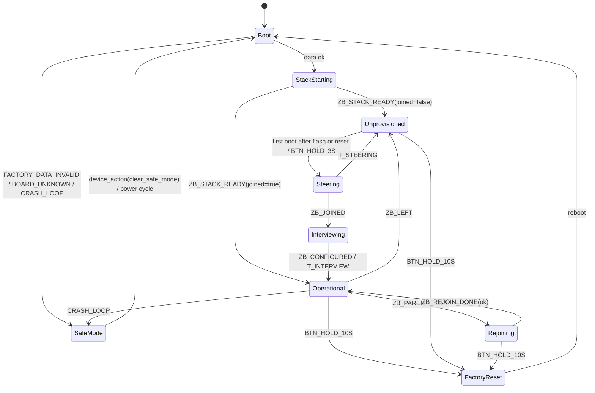
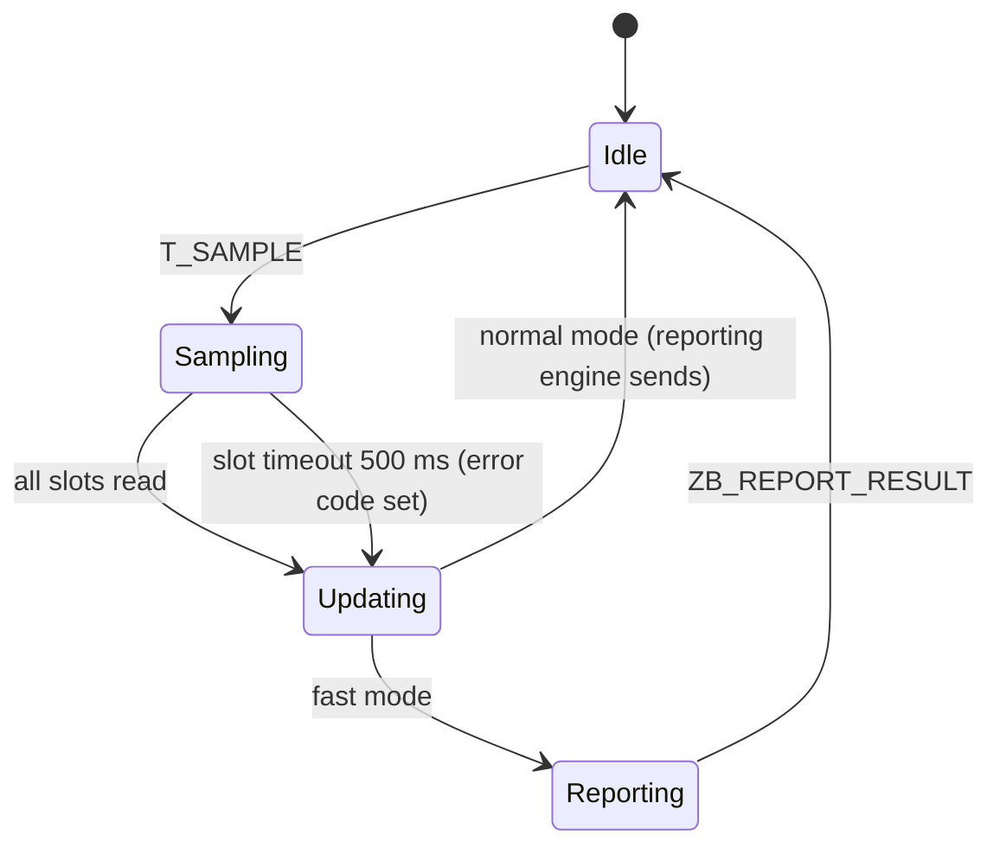
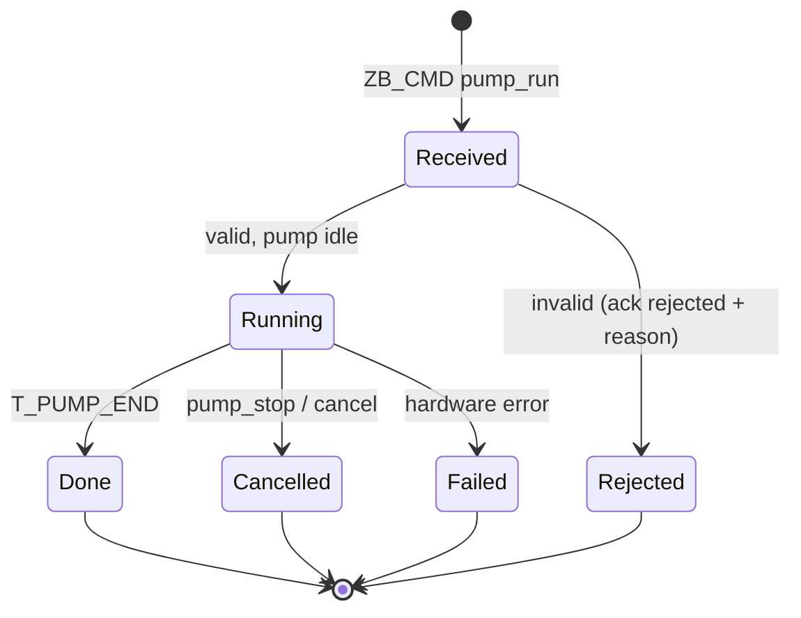
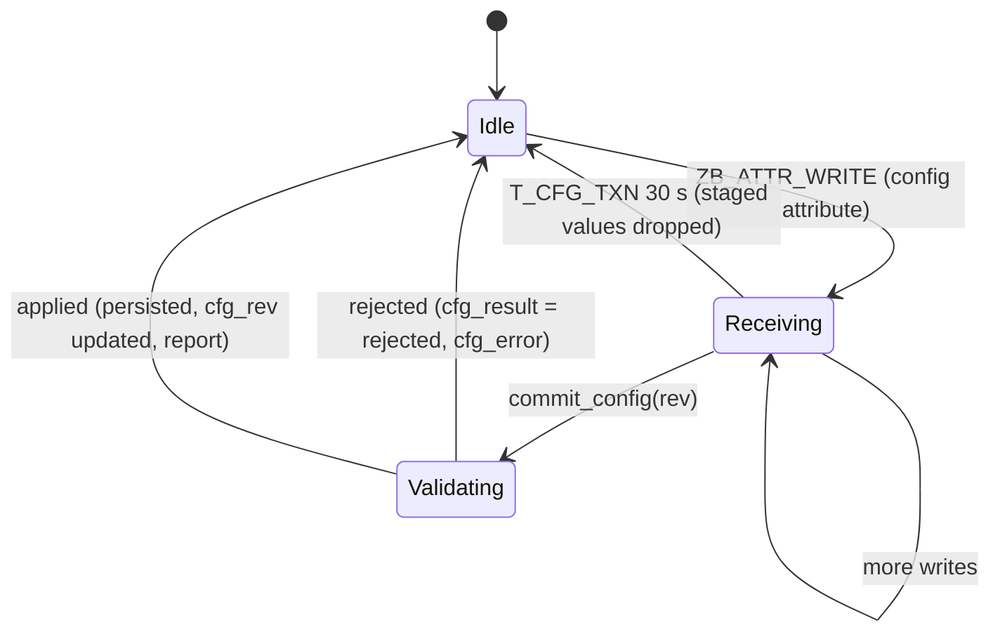

# PlantModule — Specification

The PlantModule is the plant device: an **ESP32-C6 running as an always-listening Zigbee end device** that measures soil moisture (and later other values) and waters on command. It is powered externally for now (USB or 5 V on the carrier's power connector); **low power and deep sleep come later** (Part A §18). This file is its single specification: **Part A** the firmware, **Part B** its Zigbee interface (the contract with the Gateway's Zigbee2MQTT converter; machine-readable in [`interface.yaml`](interface.yaml)), **Part C** the carrier board.

Where it fits: the module talks only to the Gateway's Zigbee coordinator; Zigbee2MQTT turns its Zigbee messages into MQTT messages for the hub and back (`Gateway/specs.md` "Message paths"). People never talk to it directly. System rules: [`PROJECT.md`](../PROJECT.md).

Folder: `firmware/` (ESP-IDF project), `hardware/` (KiCad carrier), `scripts/` (labels and provisioning, QR images), `interface.yaml` (the Zigbee interface definition). Build and test commands: [`readme.md`](readme.md).

---

# Part A — Firmware

## 1. Requirements

- Read a configurable set of sensors and drive a pump; which module sits on which port is **runtime configuration**, changed without reflashing.
- Report readings and health to the Gateway; execute commands (e.g. "run pump for N s") and apply configs sent by the Gateway.
- Enforce hard safety limits locally, whatever the Gateway sends.
- Join the Gateway's Zigbee network without any credentials typed into the device.
- Be written as **explicit state machines** (§7) so every behaviour, timeout and failure path is defined and testable on the host.
- Be easy to extend later: other PCB revisions (§2.1), more module types (§4), and low power (§18).

## 2. Hardware target

**ESP32-C6** (RISC-V, 2.4 GHz WiFi 6 / BLE 5 / 802.15.4). Only the 802.15.4 radio is used; WiFi and BLE stay off. Final hardware is the carrier board in Part C (Waveshare ESP32-C6-Zero module), whose first revision (`carrier-v1`) exists and is the first development target. An ESP32-C6-DevKitC-1 board description (`devkitc-1`) is kept for bench work.

| Aspect | Notes |
|---|---|
| ADC | Only ADC1 (GPIO0–6); there is no ADC2/WiFi conflict, sensors can be read at any time. |
| Strapping pins | GPIO8, 9, 15 and the USB pins are not used for modules. GPIO4 and GPIO5 are also strapping pins on the C6 (**verify** against the datasheet); on the carrier they carry port 4 and the battery sense. |
| Console | USB-Serial-JTAG. |
| Power | USB or 5 V on the carrier's power connector. The battery divider is read as information only. |

### 2.1 Board revisions and the board description

The carrier board will change between revisions, so no pin number is hard-coded in the application. Everything that depends on the PCB is in a **board description**, one JSON file per revision (`firmware/boards/<name>.json`, for example `carrier-v1`, `devkitc-1`):

| Field | Meaning |
|---|---|
| `schema`, `name`, `hw_version` | Description schema version, board name (`carrier-v1`) and numeric hardware version, reported to the Gateway |
| `ports` | Logical ports `P1…Pn`: GPIO, ADC channel, supported roles (analog sensor, digital in, digital out/pump) |
| `i2c` | SDA/SCL GPIOs and whether the pull-ups can be switched |
| `battery` | Sense GPIO, ADC channel, divider ratio (carrier v1: 2.0) |
| `led`, `button` | GPIO and polarity |
| `sensor_power` | Optional switched sensor supply: GPIO, polarity, settle time (absent on carrier v1; used with low power, §18) |
| `low_power` | Capabilities needed once sleep is added: which ports can hold an output through deep sleep, whether the button can wake the chip (carrier v1: no) |
| `reserved` | Pins the application must not use (strapping, console, flash) |
| `allow_raw_gpio` | Whether slots may name raw GPIOs (true on dev kits, false on the carrier) |

- **One source:** the JSON files are the single source. The firmware build turns them into a C table; the Gateway ships the same files and serves them as `GET /meta/boards/{board}`, so the slot editor offers only ports and roles that exist on that board. A schema check at build time rejects an invalid description.
- **Which board am I:** the board name is stored in the `factory` partition (§10), written at flashing time by the provisioning tool. One firmware image therefore supports every revision. If the partition has no board entry, the firmware falls back to a build-time default (`CONFIG_MC_DEFAULT_BOARD`) in development builds only; a production build treats it as invalid factory data (safe mode, §11). From a later PCB revision on, an ID resistor on a spare GPIO can be read as a second source and checked against the partition.
- **Reporting:** the module reports the board name and hardware version (Basic cluster `HWVersion` and the custom `board` attribute); the Gateway looks up the matching description.
- **Unknown board:** a name the firmware does not know puts the device in safe mode with reason `board_unknown`; no output is driven.

## 3. Software stack

- **ESP-IDF** (the latest stable release that supports the C6 Zigbee SDK, pinned at the first install and recorded here and in the project) with **`esp-zigbee-sdk`** as a Zigbee 3.0 **end device that keeps its receiver on** (`rx_on_when_idle`). **Verify** that the pinned release supports this role on the C6.
- FreeRTOS tasks: the Zigbee stack task, and one application task that owns the state machines and all hardware access. The Zigbee task never calls application code directly; it only posts events (§7.1).
- Non-volatile storage: NVS (configuration, counters), the Zigbee stack's own storage partitions (network state), a raw `factory` partition (§10), and two `ota` slots reserved in the partition table so Zigbee OTA can be added later.
- Time: a monotonic timer only. The module has no wall clock; commands carry a `ttl_s` (§8).

## 4. Module slots

A fixed table of slots (6) is the single source of truth for what is connected where. Each slot: `{module type, port, options}`. A slot refers to a **logical port** of the board (`P1…Pn`, I2C), never to a raw GPIO number, so a stored configuration keeps working when a new PCB revision wires the port to a different pin. Boards with `allow_raw_gpio` (dev kits) also accept raw GPIOs.

- At runtime the firmware resolves each slot's port through the board description and configures GPIO and ADC; nothing is bound to a pin at compile time.
- Each module type is a small driver registered in a static table: `probe`, `init`, `read` (sensors), `write` (actuators such as the pump).
- Validation of a desired config (port exists on this board and supports the module's role, duplicates, limits) runs on the device as the final authority. The Python mirror (`mc_core.pins`) lets the Gateway reject bad configs earlier.

**Drivers.** To build first: `moisture_*` (analog, capacitive/resistive) and the GPIO pump (an implementation for the previous firmware is in git history, see §15). Later: DS18B20, SHT3x, `water_level_float`; until they exist those modules report `not_found` plus one `sensor_fault` event. I2C/1-Wire auto-detect is a later feature (pumps are always configured manually).

**Configuration path.** The slot table lives in NVS and survives reboot. The Gateway sends a new configuration as attribute writes plus a commit command (Part B §4 and §5); the device validates (§7.6), applies atomically, persists and reports the revision it runs.

## 5. Moisture calibration

Moisture slots map raw ADC counts to 0–100 % with a two-point calibration in the slot config, `cal: {dry, wet}` (raw counts at 0 % and at 100 %).

- **Polarity follows the two points.** `dry > wet`: small counts are wetter (typical capacitive sensor); `dry < wet`: the scale is reversed. Results clamp to 0–100 %. A raw value more than 15 % of the span outside either point is `out_of_range`; counts at the ADC limits are `no_signal`.
- **Calibration is config, not device state.** The Gateway owns it; the device persists it and never changes it itself. A re-calibration is a normal new config revision.
- **Default** when absent: `dry` 3000 / `wet` 1200 (placeholders; the ADC range of the C6 is rechecked on the board).
- **Validation today:** `dry == wet` is rejected. **Planned:** both values within the ADC range and `|dry − wet| ≥ 300`, on both sides.
- **Raw values are always reported** next to the percentage, so the hub can recompute history after a re-calibration.
- **Planned: capture command** `sensor_sample` (Part B §5): reads the slot's ADC `samples` times (default 16, max 64) and answers with median, min and max, without touching the stored config. An empty or actuator slot is rejected with `slot_not_sensor`; a floating input fails with `hw_error`. The calibration wizard in the app is built on it.

## 6. Run loop

The module is always awake. In the operational state it repeats:

1. Every **`report_interval_s`** (default 300 s, 10–3600 s) it **samples** all sensor slots, converts them (§5), increments `seq`, updates the telemetry attributes (readings, battery, diagnostics).
2. The Zigbee reporting engine sends the updated attributes to the coordinator according to the reporting configuration that Zigbee2MQTT set during the join (§8): on change beyond the reportable change, and at the latest at the max interval as a heartbeat.
3. **Fast reporting during watering:** while any pump runs, and for **`fast_report_hold_s`** (default 120 s) after the last run ended, the module samples every **`fast_report_interval_s`** (default 30 s) and **sends an explicit report after every sample**, so the moisture response to watering is seen. After the hold time it returns to the normal interval.
4. Commands and configuration writes are handled whenever they arrive (§7.5, §7.6); acknowledgements and events are sent at once.

**Pump runs.**
- A run is always **time-bounded locally**: `seconds` of the command, capped by the slot's `max_run_s` and a firmware ceiling (`MC_PUMP_HARD_MAX_S`, 300 s). The run is a timer inside the pump state machine; nothing depends on the radio while it runs.
- **Link loss during a run:** the run finishes as planned, then the pump stays off. The result is reported when the link is back (pending acknowledgements and events are kept in RAM, up to 8). A `pump_stop` or `cancel` received later is still honoured.
- `pump_stop` and `cancel` are never refused for lack of time information: stopping a pump must always work.
- A `cancel` in the same delivery wins over its target; a cancel for a command not seen yet leaves a tombstone (kept 10 minutes) so the command is answered `cancelled` when it arrives.
- After a run a **minimum pause** (`min_pause_s`) applies before the same pump may run again.
- Outputs come up **off** after any reset.

**Power.** Supplied externally. The battery divider and `batt_low_mv` are reported as information; the `low_battery` event is raised when a connected cell falls below the threshold, with no change in behaviour yet (§18).

## 7. State machines

### 7.1 Principles

- **Event-driven, run-to-completion.** All behaviour is a set of finite state machines in the portable core (`mc_core`). The application task waits on one event queue and passes each event to the machines; a handler never blocks.
- **Pure core, effects through an interface.** The core exposes `step(machine, state, event) → (new state, actions)` as a function of its inputs, with no hardware access. The application task executes the returned **actions** through a small I/O interface (`drive_pump`, `read_adc`, `zb_report`, `zb_send_cmd_ack`, `nvs_write`, `set_led`, `arm_timer`, `reboot`, …). On the host the same core runs with a fake clock and fake I/O (§16).
- **One writer per resource.** Only the pump state machine of a port drives that port; only the configuration machine writes the configuration; only the lifecycle machine starts or stops the Zigbee stack.
- **Events come from four sources:** the Zigbee task (stack callbacks translated into events), timers (all armed through `arm_timer` and delivered as events), GPIO (button) and ADC completions, and the watchdog/system. Every event has a defined source (table 7.2).
- **Every state has a time budget.** A state that waits for something has a timeout event or is covered by the watchdog (7.7). There are no states without a way out.
- **Hierarchy:** the lifecycle machine (7.3) contains the other machines (7.4–7.6) as long as it is in `Operational`; leaving `Operational` stops them in a defined way (pumps off).

### 7.2 Events and actions

| Source | Events |
|---|---|
| System | `BOOT`, `FACTORY_DATA_OK/INVALID`, `BOARD_KNOWN/UNKNOWN`, `CRASH_LOOP`, `WATCHDOG` |
| Zigbee task | `ZB_STACK_READY(joined)`, `ZB_STEERING_DONE(ok)`, `ZB_JOINED`, `ZB_CONFIGURED` (bindings and reporting config received), `ZB_PARENT_LOST`, `ZB_REJOIN_DONE(ok)`, `ZB_LEFT` (told to leave), `ZB_ATTR_WRITE(id, value)`, `ZB_CMD(command, payload)`, `ZB_REPORT_RESULT(ok)` |
| Timers | `T_SAMPLE`, `T_FAST_HOLD`, `T_STEERING`, `T_INTERVIEW`, `T_REJOIN`, `T_PUMP_END(port)`, `T_PUMP_PAUSE(port)`, `T_CMD_TTL(id)`, `T_CFG_TXN`, `T_STABLE` (5 min uptime) |
| Hardware | `ADC_DONE(slot)`, `BTN_SHORT`, `BTN_HOLD_3S`, `BTN_HOLD_10S`, `BATT_SAMPLE` |

Actions: `start_zigbee`, `start_steering`, `rejoin`, `leave_network`, `report_attributes`, `send_cmd_ack`, `send_event`, `drive_pump(port, on)`, `read_slot(slot)`, `persist_config`, `set_led(pattern)`, `arm_timer`, `cancel_timer`, `reboot`, `factory_reset`.

### 7.3 Device lifecycle machine



| State | What happens | Time budget / exit |
|---|---|---|
| `Boot` | Load and verify the factory data (§10) and the board description; load the configuration (§12); read the reset reason and update the crash counter; force all outputs off | ms; invalid data → `SafeMode` |
| `StackStarting` | Start the Zigbee stack from stored network state | stack answers within 10 s, else reboot |
| `Unprovisioned` | Not on a network; LED slow blink; no sensing reports; waits for a button hold. The very first boot after flashing or factory reset goes straight to `Steering` | until a 3 s hold |
| `Steering` | Scan for an open network and join (with the install code when the provisioning data has one, §10) | `T_STEERING` 180 s, then back to `Unprovisioned` |
| `Interviewing` | Joined; the stack answers Zigbee2MQTT's reads and applies the bindings and reporting configuration; sensing runs, commands are rejected `busy` | until `ZB_CONFIGURED` or `T_INTERVIEW` 120 s |
| `Operational` | Normal operation: sensing/report loop (7.4), command machines (7.5), configuration machine (7.6) | until a lifecycle event |
| `Rejoining` | Parent lost: retry rejoin with back-off 5, 10, 20, 40 s … capped at 5 min, forever. Sampling continues, pump runs finish, only the radio is down; the latest values are reported once the link is back | until `ZB_REJOIN_DONE` or reset |
| `FactoryReset` | Leave the network, erase network state and configuration (the `factory` partition stays), reboot | seconds |
| `SafeMode` | See §11 | until cleared |

A told-to-leave (`ZB_LEFT`, for example the device was removed in Zigbee2MQTT) erases the network state and the configuration, forces outputs off and returns to `Unprovisioned`.

**Buttons** (§9): a short press blinks the LED to identify the module and triggers a report; a 3 s hold starts steering when not on a network (and does nothing but the LED cue when on one); a 10 s hold is the factory reset.

### 7.4 Sensing/report machine (inside `Operational`)



- `Idle` waits for `T_SAMPLE`; the interval is `report_interval_s` normally, `fast_report_interval_s` in fast mode.
- `Sampling` reads the sensor slots one after another (`read_slot`, `ADC_DONE`), at most 500 ms per slot and 2 s in total; a slot that does not answer gets error `hw_error` for this sample.
- `Updating` converts, writes the telemetry attributes, increments `seq`, raises `sensor_fault`/`sensor_ok` events (a slot error on 3 consecutive samples raises the event once; the first good sample clears it).
- `Reporting` exists only in fast mode: an explicit report of the changed attributes; a failed report is not repeated (the next sample follows within `fast_report_interval_s`).
- **Fast mode** is entered by any pump run starting and left `fast_report_hold_s` after the last run ended (`T_FAST_HOLD`).

### 7.5 Command machines (inside `Operational`)

One **pump actuator machine per pump port** and one **command record per `cmd_id`**.



Validation on `Received`, in this order (first failure wins, the reason goes into the ack): module not in `Operational` or in safe mode → `busy`; `ttl_s` already expired → `expired`; slot not configured as a pump → `slot_not_actuator`; `seconds` > min(`max_run_s`, firmware ceiling) → `limit`; pump in its minimum pause → `min_pause`; pump already running → `busy`. A command id seen before is **not executed twice**: the stored result is acknowledged again.

Actuator machine per port: `Off` → `On` (timer `T_PUMP_END`) → `Pause` (timer `T_PUMP_PAUSE`, `min_pause_s`) → `Off`. A stop in `On` goes to `Pause` at once. The actuator machine is the only code that drives the pin; a reset or `ZB_LEFT` or entering safe mode forces `Off`.

Acknowledgements: `running` is sent when the pump starts (with `ends_in_s`), then `done`, `failed` or `cancelled` at the end. They are queued (up to 8) while the link is down and sent in order when it is back.

### 7.6 Configuration machine (inside `Operational`)



- Attribute writes only **stage** values in RAM; nothing becomes active before `commit_config`.
- Validation covers the slot table (ports, roles, duplicates, calibration, limits) and the scalar fields (`report_interval_s` 10–3600, `fast_report_interval_s` 10–300, `fast_report_hold_s` 0–1800). An invalid configuration is rejected as a whole with the first error and the slot it belongs to; the running configuration is untouched.
- A commit that changes a slot whose pump is running is rejected with `busy`; the Gateway retries later.
- Applying is atomic (§12): write the inactive configuration slot, verify it, switch the active pointer, then apply to the running machines; a power loss at any point leaves either the old or the new configuration.
- Re-sending the same revision with identical content answers `ok` again; an older revision is rejected `stale_rev`.

### 7.7 Time budgets and watchdog

- The application task feeds a task watchdog (30 s); a missed feed resets the device (`WATCHDOG` is also an unexpected reset for the crash counter, §11).
- The Zigbee task is observed with its own heartbeat event every 10 s; if it stops, the application reboots.
- State time budgets are in the tables above; any state without an external trigger has a timer event.

## 8. Zigbee behaviour

- **Role:** end device with the receiver on (`rx_on_when_idle`), one parent (the coordinator or a router). Commands from the coordinator reach it directly.
- **Joining:** steering (7.3) on the very first boot after flash or factory reset and on a 3 s hold when not on a network. With an install code in the factory data (§10) the module joins using that code; development builds without an install code use the default link key (§10). All channels 11–26 are scanned.
- **Identity** (Basic cluster, endpoint 1): manufacturer `MoistureController`, model `MC-PLANT`, software build (semantic version), hardware version, plus the custom `board` attribute. Zigbee2MQTT recognises the module by this model.
- **Interview and configure:** after the join Zigbee2MQTT reads the descriptors and Basic attributes, matches the converter, then runs the converter's **configure** step: it binds the clusters to the coordinator and sets the attribute reporting configuration (min/max interval, reportable change). The module only has to answer; the Gateway retries a failed configure twice (`Gateway/specs.md`). The reporting configuration is persisted by the Zigbee stack (**verify**).
- **Reporting configuration** set by the converter: moisture value per slot min 5 s, max 300 s, change 0.5 %; battery voltage min 60 s, max 600 s, change 50 mV; status and diagnostics min 10 s, max 600 s; the minimum is deliberately ≤ 10 s so fast reporting (§6) can send at 30 s. The maximum acts as a heartbeat and does not depend on `report_interval_s`: if a value was not sampled again, the repeated report carries the same `seq`, which the hub treats as "no new reading".
- **Rejoin:** after losing its parent (for example the coordinator was replaced) the module rejoins with the stored network key and back-off (7.3). If the coordinator has a new network, the module needs a factory reset and a new join.
- **Leave:** a leave request from the coordinator erases the module's configuration and network state (7.3).
- **Time to live:** commands carry `ttl_s`, counted from the moment the module receives them. The module answers `rejected` with reason `expired` if it cannot start the command in time.
- **OTA** (later): Zigbee OTA Upgrade cluster, images served through Zigbee2MQTT.

## 9. Buttons and LED

BOOT/user button (on the carrier: SW1, GPIO21 on v1, see Part C):

- **Short press:** identify (LED blinks for 10 s) and send a report at once.
- **3 s hold:** start steering when not on a network (otherwise only the LED cue).
- **10 s hold:** factory reset: leave the network, clear configuration and joined state; the factory data stays.

LED (GPIO20 on v1): solid when operational and connected, slow blink when unprovisioned, fast blink while steering or interviewing, double blink when rejoining, triple blink in safe mode, fast blink as the "keep holding" cue between 3 s and 10 s.

## 10. Factory data, install code and provisioning

**Factory partition** (raw 4 KB, outside the settings, never erased by factory reset), little endian: `magic "MCF2"` (4) · `version` (1) · `board` (16, NUL padded) · `serial` (12, ASCII) · `install_code` (18: 16-byte Zigbee install code + CRC16) · `flags` (1: bit 0 = install code required) · reserved · `crc32` (4, IEEE over everything before it); the rest is 0xFF. Invalid magic, version or CRC means invalid factory data (§11).

**Install code:** the Zigbee install code is registered by the Gateway with Zigbee2MQTT before the join window opens (`Gateway/specs.md`); the coordinator then accepts only a module that knows it, which keeps a neighbour from joining while the network is open. A **deployed module requires its install code** (flag set by the provisioning tool); a **development build** (`CONFIG_MC_DEV_JOIN`) may join with the default link key when the factory data has none.

**Label:** a QR code of the form `MCIC1:<model>:<serial>:<install-code-hex>` plus the text; the app or the hub UI accepts the code when a device is added.

**Provisioning tool** (`scripts/make_label.py`), one command per device:
- `new --board carrier-v1 --port <serial port>`: generates serial and install code, builds the factory partition image (board, serial, code, flags, CRC), writes it with `esptool` at the `factory` partition offset (from `partitions.csv`), records the device in `scripts/factory/devices.csv` (git-ignored, holds the secrets) and prints the label.
- `flash`, `list`, `qr <serial>`: write a recorded device's image again, list what was made, redraw a label.
- The firmware itself is flashed separately with the normal build.

## 11. Safety and safe mode

- Hard limits per pump (`max_run_s`, `min_pause_s`, and a firmware ceiling) are enforced on the device. The Gateway checks commands again before sending, but the device is the final authority.
- Commands past their time to live are dropped.
- Outputs come up off after any restart.
- Sensor errors (`no_signal`, `out_of_range`, `not_found`, `hw_error`) are reported, never turned into a value.

**Safe mode** is entered on invalid factory data (`factory_invalid`), an unknown board (`board_unknown`), or a crash loop (`crash_loop`): **3 consecutive unexpected resets** (panic, watchdog, brownout), each after less than 5 minutes of uptime. In safe mode: all outputs are off, no configuration is applied, no pump command is accepted, the module stays on the network if it can, and it reports `status = safe_mode` with the reason code and the last reset reason, so the hub can raise an alert. It leaves safe mode only by the hub's `device_action clear_safe_mode`, a power cycle, or a factory reset. A power-on reset clears the crash counter; the counter is also cleared after 5 minutes of stable uptime (`T_STABLE`).

## 12. Persistence and recovery

| Data | Where | Notes |
|---|---|---|
| Configuration | NVS, two blob slots `cfg_a`/`cfg_b` plus `cfg_active`; each blob has schema version, revision and CRC | Atomic apply (7.6); a corrupt active slot falls back to the other, then to the safe default (all slots empty, outputs off) |
| Counters (boots, unexpected resets, rejoins, last error) | NVS namespace `mc_diag` | Written at boot and on change, rate-limited |
| Zigbee network state | Stack partitions | Erased by factory reset and by `ZB_LEFT` |
| Factory data | `factory` partition | Read-only at run time |

Recovery rules: a corrupt or unknown-version configuration is ignored with an event and the safe default is used; a new device (no configuration) has all slots empty, no output is ever driven without a valid configuration.

## 13. Diagnostics

Reported as telemetry attributes (Part B §3), shown in the device detail screen of the app: `uptime_s`, `boot_reason`, `reset_count`, `rejoin_count`, `last_error` (small code table kept in the firmware), `free_heap`, firmware version (Basic `swBuildId`), `interface_version` and `config_schema`. Logs go to the console (levels error/warn/info/debug, info by default); there is no remote log.

## 14. Versioning

| What | How |
|---|---|
| Firmware | Semantic version in Basic `swBuildId` |
| Zigbee interface | `interface_version` (major.minor in one `uint16`, `interface.yaml`); the hub accepts the same major and tolerates a different minor |
| Configuration schema | `config_schema` (uint8); a device with an older schema is migrated on boot |
| Board description | `schema` field in the JSON |
| Factory data | `version` byte of the partition |

## 15. Code layout (target)

```
firmware/
├── CMakeLists.txt · sdkconfig.defaults · partitions.csv
├── main/                  app_main: starts the application task and the Zigbee task
├── components/
│   ├── mc_core/           portable core: state machines, config + pin rules, commands, moisture conversion (pure C, no hardware)
│   ├── mc_hal/            ESP32-C6: ADC, GPIO, NVS, LED, button, battery, timers, watchdog, factory data
│   ├── mc_zigbee/         esp-zigbee-sdk: network, endpoint and clusters, reports, commands → events
│   └── mc_drivers/        module drivers (moisture, pump, later more)
├── boards/                board descriptions (JSON): carrier-v1, devkitc-1
└── test/                  host tests of mc_core
interface.yaml             Zigbee interface definition (source for the C header, the converter and the hub models)
scripts/                   make_label.py (factory image + label), qr_png.swift
hardware/                  carrier board (Part C)
```

- The previous firmware (Zephyr, WiFi + MQTT, BLE pairing) was removed; it is in git history at `eb97b07`. Its portable core (`PlantModule/firmware/src/core`: `mc_config`, `mc_cmd`, `mc_cycle`, `mc_sensor`, `mc_pins`, `mc_rtc` and their ztest suites) is a reference for `mc_core`; its hardware layer a reference for `mc_hal`. The state machines of §7 replace the old wake cycle.

## 16. Testing

| Level | What |
|---|---|
| Host unit tests | `mc_core` built for the ESP-IDF `linux` target and tested with **Unity**. Table-driven tests per state machine: for every transition row an event sequence with a fake clock and fake I/O, asserting new state and returned actions; plus tests for validation, calibration and the factory data parser. Run in CI and locally without hardware. |
| Converter tests | The Zigbee2MQTT converter definition is tested against recorded Zigbee frames (Gateway side). |
| Interface check | A check that `interface.yaml`, the generated C header, the converter and the hub models agree (once generators exist). |
| On hardware | The prototype checklist (17.1) and a command round trip test with Zigbee2MQTT. |

## 17. Status, prototype plan and open points

Status: this specification, `interface.yaml` and the **carrier board v1** (built, in hand, untested) exist. No firmware is in the repository yet.

### 17.1 Prototype 1 (on carrier v1, with the coordinator and Zigbee2MQTT)

Goal: answer the open Zigbee questions on the real board before the real firmware is written. The module is always awake.

1. Minimal ESP-IDF + `esp-zigbee-sdk` image (end device, receiver on, board `carrier-v1` hard-coded): steering, join with and without an install code, Basic cluster identity.
2. Interview and configure by Zigbee2MQTT with a minimal converter: bindings and reporting configuration accepted; reports arrive at the configured intervals; behaviour after a module reset (is the reporting configuration kept?).
3. Command round trip: Zigbee2MQTT `set` → attribute writes + commit → `cmd_ack`; latency, several writes in a row, lost-frame behaviour.
4. Fast reporting: explicit reports every 30 s while an output is on.
5. ADC: read a real moisture sensor and the battery divider; fix the divider ratio and sensor ranges. Pump output: switch a port with an external driver, run timing.
6. Button: GPIO21 behaviour (short, 3 s, 10 s); LED patterns.
7. Rejoin: switch the coordinator off and on, move the module out of range; measure rejoin time.
8. Range: join and report through a wall; check the antenna placement on the carrier.
9. Record the results here and fix the Part B IDs in `interface.yaml`.

### 17.2 Open points

- Does `esp-zigbee-sdk` on the C6 support an end device with the receiver on, and does the stack keep the reporting configuration across a reset? Do custom-cluster attributes accept a reporting configuration?
- Whether the first moisture slot can also appear as the standard soil-moisture cluster.
- Final cluster layout (Part B) and the Zigbee2MQTT converter; manufacturer code.
- Strapping behaviour of GPIO4/GPIO5 with sensors attached.
- Pinned ESP-IDF and `esp-zigbee-sdk` versions (set at the first install).
- I2C/1-Wire auto-detect and more drivers; Zigbee OTA.

## 18. Low power (later)

Parked on purpose; none of this is part of the first firmware. The state machines have named extension points (a `Sleep` state in the lifecycle machine, wake events in the event table, a `PrepareSleep` step in the run loop).

- **Sleepy end device** instead of receiver-always-on: Zigbee poll interval, parent timeout, fast rejoin after deep sleep, awake window after each report; the role stays "end device", so switching is configuration, not a new join (to be verified).
- **Deep sleep cycle:** wake interval (`wake_interval_s`), `awake_s`, `next_wake_s`, wake reason, commissioning window after a join, sleeping between samples, reports after waking, the hub's check-in sender (`Gateway/specs.md` "Low power").
- **Pump across sleep:** pin hold through deep sleep on low-power pins, a wake at the end of a run.
- **Buffering across sleep:** RTC reading ring buffer, `pend[]` acknowledgements.
- **Sensor power switching:** power on, settle, read, power off around every read (board description `sensor_power`).
- **Wake sources:** button on a low-power pin (GPIO0 on a later carrier revision).
- **Battery:** low-battery behaviour (longer intervals), battery thresholds, charging.
- **Power budget:** sleep current, energy per wake, awake window length, expected battery life, a measurement template, results table.

---

# Part B — Zigbee interface (device ↔ Gateway)

The contract between the PlantModule firmware and the Gateway's Zigbee2MQTT external converter. It carries the normalized messages of `Gateway/specs.md`. The **machine-readable definition is [`interface.yaml`](interface.yaml)**; the tables below are its readable view. Generators for the C header, the converter definition and the hub models are future work, and the file stays the single source: spec and code follow it.

**Status:** design proposal, to be fixed on the prototype. Cluster and attribute IDs are provisional. One Zigbee message carries at most about 80 bytes of payload without fragmentation, so every item is kept small.

## 1. Device model

| Item | Value |
|---|---|
| Device type | Zigbee 3.0 end device, receiver on, one endpoint (1), profile Home Automation, custom device ID |
| Identity (Basic) | manufacturer `MoistureController`, model `MC-PLANT`, `swBuildId`, `hwVersion` |
| Standard clusters | Basic (0x0000), Power Configuration (0x0001), Identify (0x0003) |
| Custom cluster | `0xFC11`, manufacturer-specific (development uses Espressif's manufacturer code `0x131B`; a production code is decided later) |
| Identity of a device | The IEEE address |
| Interface version | `interface_version` attribute, major.minor in one `uint16` (currently 1.0) |

## 2. Encoding rules

- Integers are little endian as in ZCL. Strings and blobs are ZCL octet strings (length byte first, ≤ 32 bytes here).
- Percent values use fixed point (value × 100, signed 16-bit); unknown/error is `0x8000`.
- Commands carry a 32-bit `cmd_id` chosen by the Gateway (it keeps the mapping to its own ID) and a `ttl_s`. Acknowledgements and events carry a module-assigned 16-bit counter `n` so the hub can tell a repeated publication from a new one.

## 3. Telemetry attributes (device → Gateway, read-only, reportable)

| ID | Name | Type | Meaning |
|---|---|---|---|
| 0x0100 | `seq` | uint16 | Sample counter, increments per sample (wraps); a repeated value means "no new reading" |
| 0x0101 | `boot_id` | uint16 | Boot counter |
| 0x0110 + n | `slot_n` (n = 0…5) | octet string (8) | `type` uint8 · `error` uint8 (0 ok, 1 no_signal, 2 out_of_range, 3 not_found, 4 hw_error) · `value` int16 (×100) · `raw` uint16 · `cfg_rev` uint16 |
| 0x0120 | `status` | uint8 | 0 operational, 1 interviewing, 2 safe_mode |
| 0x0121 | `fast_mode` | uint8 | 1 while fast reporting is active |
| 0x0122 | `safe_reason` | uint8 | 0 none, 1 factory_invalid, 2 board_unknown, 3 crash_loop |
| 0x0130 | `uptime_s` | uint32 | |
| 0x0131 | `boot_reason` | uint8 | 0 power_on, 1 software, 2 panic, 3 watchdog, 4 brownout, 5 other |
| 0x0132 | `reset_count` | uint16 | Unexpected resets since the last power-on |
| 0x0133 | `rejoin_count` | uint16 | |
| 0x0134 | `last_error` | uint16 | Firmware error code table |
| 0x0135 | `free_heap` | uint32 | |
| 0x0136 | `interface_version` | uint16 | |
| 0x0137 | `config_schema` | uint8 | |
| 0x0140 | `board` | char string (16) | Board name, e.g. `carrier-v1` |

Standard clusters carry battery voltage (0x0001/0x0020, 100 mV units; informational while externally powered).

## 4. Configuration (Gateway → device)

Attributes are written with Write Attributes; nothing becomes active until the commit command (Part A §7.6).

| ID | Name | Type | Meaning |
|---|---|---|---|
| 0x0001 | `report_interval_s` | uint16 | 10–3600, default 300 |
| 0x0002 | `fast_report_interval_s` | uint16 | 10–300, default 30 |
| 0x0003 | `fast_report_hold_s` | uint16 | 0–1800, default 120 |
| 0x0004 | `batt_low_mv` | uint16 | Low-battery threshold |
| 0x0010 + n | `slot_cfg_n` (n = 0…5) | octet string (≤ 24) | `module` uint8 (0 empty, 1 moisture, 2 pump, …) · `port` uint8 (0 = P1 … 5 = P6; `0x80 + n` = raw GPIO n on boards that allow it) · `flags` uint8 · parameters by module: moisture `cal_dry` uint16, `cal_wet` uint16, `samples` uint8; pump `max_run_s` uint16, `min_pause_s` uint16 (bit 0 of `flags`: active high) |

Reported back (read-only):

| ID | Name | Type | Meaning |
|---|---|---|---|
| 0x0030 | `cfg_rev` | uint16 | Revision the device runs |
| 0x0031 | `cfg_result` | uint8 | 0 ok, 1 rejected |
| 0x0032 | `cfg_error` | uint16 | High byte: error code (`port_invalid`, `port_conflict`, `out_of_range`, `busy`, `stale_rev`, …), low byte: the slot it applies to |

## 5. Cluster commands

Client → device (sent by the Gateway):

| ID | Command | Payload | Meaning |
|---|---|---|---|
| 0x00 | `commit_config` | `rev` uint16 | Validate the staged attributes as revision `rev`, apply atomically, persist, report `cfg_*` |
| 0x01 | `pump_run` | `cmd_id` uint32 · `slot` uint8 · `seconds` uint16 · `ttl_s` uint16 | Run the pump of that slot |
| 0x02 | `pump_stop` | `cmd_id` uint32 · `slot` uint8 | Stop at once |
| 0x03 | `cancel` | `cmd_id` uint32 · `target` uint32 | Cancel a not yet started command |
| 0x04 | `device_action` | `cmd_id` uint32 · `action` uint8 (1 identify, 2 reboot, 3 clear_safe_mode) · `arg` uint16 | Identify blink, reboot, leave safe mode |
| 0x05 | `sensor_sample` *(planned)* | `cmd_id` uint32 · `slot` uint8 · `samples` uint8 | Capture raw values for calibration |

Device → client (generated by the device):

| ID | Command | Payload | Meaning |
|---|---|---|---|
| 0x00 | `cmd_ack` | `n` uint16 · `cmd_id` uint32 · `state` uint8 (0 running, 1 done, 2 failed, 3 rejected, 4 cancelled) · `reason` uint8 · `ends_in_s` uint16 · `result` (for `sensor_sample`: median, min, max uint16) | Result of a command; `running` is sent when the pump starts, `done` when it has stopped |
| 0x01 | `event` | `n` uint16 · `code` uint8 · `slot` uint8 · `arg` uint16 | `low_battery`, `sensor_fault`, `sensor_ok`, `safety_stop`, `boot`, `safe_mode`, `config_rejected` |

Reason codes: `expired`, `busy`, `limit`, `min_pause`, `slot_not_actuator`, `slot_not_sensor`, `hw_error`, as small integers (table in `interface.yaml`).

## 6. Reporting configuration (set by Zigbee2MQTT during configure)

| Attributes | Min | Max | Change |
|---|---|---|---|
| `slot_n` (readings) | 5 s | 300 s | any change of `value` ≥ 0.5 % or an error change |
| battery voltage | 60 s | 600 s | 50 mV |
| `status`, `fast_mode`, `safe_reason`, `cfg_*` | 1 s | 600 s | any change |
| diagnostics | 10 s | 600 s | any change |

## 7. Timing

- The module sends a report after every sample in fast mode and, in normal mode, whenever the reporting engine's rules fire; the maximum interval is a heartbeat.
- Commands are executed on receipt; the first `cmd_ack` arrives within a second under normal conditions (to be measured, 17.1).
- A command's `ttl_s` starts when the module receives it.
- The hub treats the module as `late` after 3 × `report_interval_s` without a report and `offline` when Zigbee2MQTT's availability check fails (`Gateway/specs.md`).

## 8. Zigbee2MQTT converter

The converter lives in `Gateway/firmware/zigbee2mqtt/` and implements this part from `interface.yaml`: `fromZigbee` for attribute reports and the device's cluster commands, `toZigbee` for the hub's `set` payloads (writes plus commit, commands), the `configure` function (bindings, reporting), and the `exposes` list. The MQTT key names and payload shapes are in `Gateway/specs.md` "Message paths".

**Status: written and tested against the real libraries** (not yet with a running Zigbee2MQTT and a real module). Files in `Gateway/firmware/zigbee2mqtt/external_converters/`: `mc-plant.mjs` (the definition: cluster, `fromZigbee`, `toZigbee`, `configure`, `exposes`), `mc-plant/codec.mjs` (slot readings, slot tables, `cfg_error`, pure functions) and `mc-plant/interface.mjs`, **generated** from `interface.yaml` by `Gateway/scripts/gen_converter.py` (a test fails while they differ). Choices: `cfg_error` is published as text (`port_conflict (slot 3)`), `fast_mode` as a boolean, `interface_version` as `1.0`; `config` writes the intervals and all six slot tables and then sends `commit_config(rev)`; custom attributes are reported whole (no change threshold). The tests (`scripts/test_converter.sh`, 24 tests) load the definition into `zigbee-herdsman-converters`, encode and parse real herdsman frames of the custom cluster, check the command byte layout and the reporting set-up, and share fixtures with the hub's tests (`hub/tests/test_converter_contract.py`), so converter and hub cannot drift apart.

---

# Part C — Carrier board (hardware)

A 70 × 58 mm two-layer carrier for the **Waveshare ESP32-C6-Zero** (the ESP32-C6 provides the 802.15.4 radio for Zigbee), soldered flat onto it through its castellated edge pads, USB-C end flush with the top edge. Source: `hardware/` (open `carrier.kicad_pro` in KiCad 10).

> **Firmware status:** the Zigbee firmware for this board is not built yet (Part A). While the module is always awake (Part A §6) the button on GPIO21 works as described in Part A §9. For low power later (Part A §18) it matters that GPIO21 is not a low-power pin, so it cannot wake the chip from deep sleep.

## What is on it

| Ref | What | Pins (pin 1 first) |
|---|---|---|
| J1–J4 | 3-pin JST-XH ports, sensor or pump signal | 3V3, SIG, GND |
| J5, J6 | 2× I2C, JST-XH 4-pin, one shared bus | 3V3, GND, SDA, SCL |
| J7 | power in, JST-XH 3-pin | VIN (5 V), GND, VBAT (raw cell, sense only) |
| JP1 | source select, 1×3 header with a shunt | VIN, COM, VBAT |
| J8 + JP4 | optional power switch (cut JP4 when J8 is used) | |
| D1 | B5819W Schottky, COM → module 5 V pad | blocks USB back-feed and reverse polarity |
| R3/R4/C7 | battery divider, 330k/330k, 100 nF | firmware divider = 200 % |
| SW1 | user button, not on the BOOT line | |
| D2 + R6 | status LED, active high | |
| J9 | optional UART0 header | GND, TX, RX |
| TP1 | spare GPIO0 test pad (low-power pin) | |
| JP2, JP3 | I2C pull-up solder jumpers, closed by default | cut to disable |

Ports J1–J4 take pin 1 from the module's always-on 3V3. For a pump use SIG and GND only and power the pump separately.

## Pin map (ESP32-C6)

| Function | GPIO |
|---|---|
| Ports 1–4 (ADC1, low-power pins) | 1, 2, 3, 4 |
| Battery sense (ADC1) | 5 |
| I2C SDA / SCL | 18 / 19 |
| Status LED | 20 |
| User button | 21 |
| UART0 TX / RX | 16 / 17 |
| Spare (test pad) | 0 |
| Not used, left open | 14, 15 (strapping), 22 |

GPIO21 is not a low-power pin, so the button cannot wake the chip from deep sleep (relevant only for low power, Part A §18). To get that, move the button to GPIO0 (TP1).

## Power

- `JP1` on 1–2: the board runs from VIN (5 V from a charger/boost board).
- `JP1` on 2–3: the raw cell feeds the module's 5 V pad through D1. The module's LDO needs about 3.5 V or more on the cell, so the last part of the capacity is unused.
- No charging on this board; use a charger/boost module on J7 (VIN, GND, VBAT).
- Revision A: never connect the module's USB-C and a charger at the same time.

## Files and regeneration

`hardware/design.py` is the single source (parts, nets, pin map) read by `gen_sch.py`, `gen_pcb.py`, `router.py` and `jlc_export.py`; the KiCad files are generated. `bom.csv` is the readable bill of materials, `lib/` holds the project's symbols and footprints, `carrier-backups/` KiCad's automatic snapshots.

Run from `PlantModule/hardware/`:

```
python3 gen_sch.py
/Applications/KiCad/KiCad.app/Contents/Frameworks/Python.framework/Versions/Current/bin/python3 gen_pcb.py   # needs pcbnew; places and routes
kicad-cli pcb drc --refill-zones --save-board carrier.kicad_pcb                                          # fills the GND pours
```

## Ordering

`python3 jlc_export.py` (KiCad closed or saved) writes `jlcpcb/`: `carrier_gerber.zip`, `bom_jlcpcb.csv` (LCSC numbers, which live in `jlc_export.py`), `cpl_jlcpcb.csv` (SMD placement) and `parts_overview.csv` (everything, including what to buy elsewhere). `jlcpcb/` is generated output; re-run after every board change.

- JLCPCB assembles the SMD parts (top side); check the part rotations in their preview.
- Hand-solder the ESP32-C6-Zero (bought without headers), the pin headers and the XH headers unless the quote offers through-hole assembly.
- Bastelgarage: the module (Waveshare, "ohne Headers") and JST-XH pigtail cables for the mating side.

## Status

- Schematic: no ERC violations, netlist matches `design.py`.
- PCB: no DRC errors or unconnected nets, passes schematic parity. Silkscreen-over-copper notes remain on the solder jumpers and mounting holes.
- **The routing is an autorouted baseline**: tidy and review it in KiCad (long diagonals, vias, pour stitching) before ordering.
- The module footprint comes from the dimension drawing on Waveshare's wiki (18.00 × 23.50 mm, 2.54 mm pitch, first pad 1.59 mm from the USB end); compare against a real module or the 3D files before ordering. The pad length is a soldering choice.
- Revision **v1** is fabricated and in hand; it has not been tested yet (sensors, connectors, ADC readings, sleep current, range).

## Known limitations of v1 and wishlist for the next revision

| Topic | v1 | Next revision |
|---|---|---|
| Sensor supply | Pin 1 of every port is the always-on 3V3, so sensors draw current permanently; irrelevant while the module is externally powered, but it limits battery life once low power is added | A switched sensor rail (load switch on a GPIO) so sensors are powered only around a read; the board description then gains a `sensor_power` entry |
| Button | On GPIO21, which cannot wake the chip from deep sleep | On GPIO0 (low-power pin) so it can wake the chip from deep sleep |
| Board ID | None; the board name is stored in the factory partition by the label tool | An ID resistor divider on a spare GPIO read at boot |
| Battery divider | 330k/330k permanently connected (about 5 µA at 3.7 V) | Optional switch or higher resistance |
| Strapping pins | Port 4 (GPIO4) and the battery sense (GPIO5) are strapping pins on the C6 (**verify**) | Move to non-strapping low-power pins if the check shows a problem |
| Pump | Ports carry SIG and GND only; an external driver module is needed | Optional on-board MOSFET driver for one port |
| Battery connector | Raw cell and charger come in through J7 | Dedicated battery connector and charger/protection |
| Antenna | Keep-out around the module's antenna not verified | Verified in the range test (prototype step 7) |
