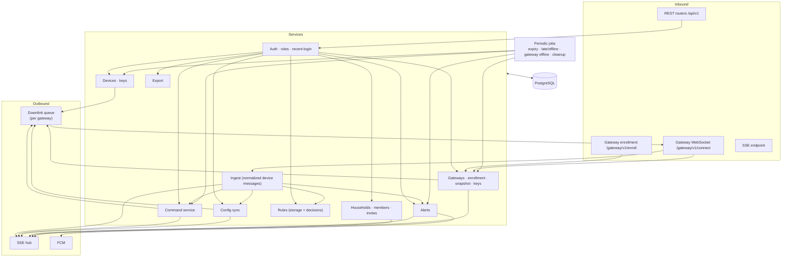
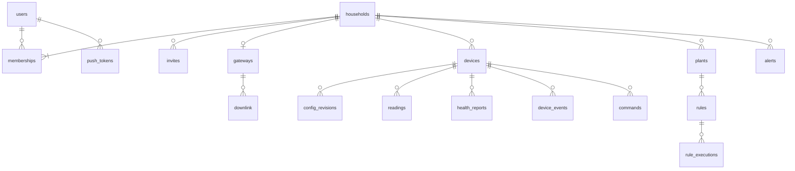
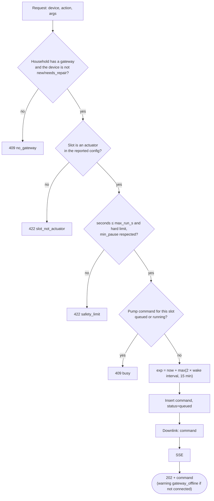
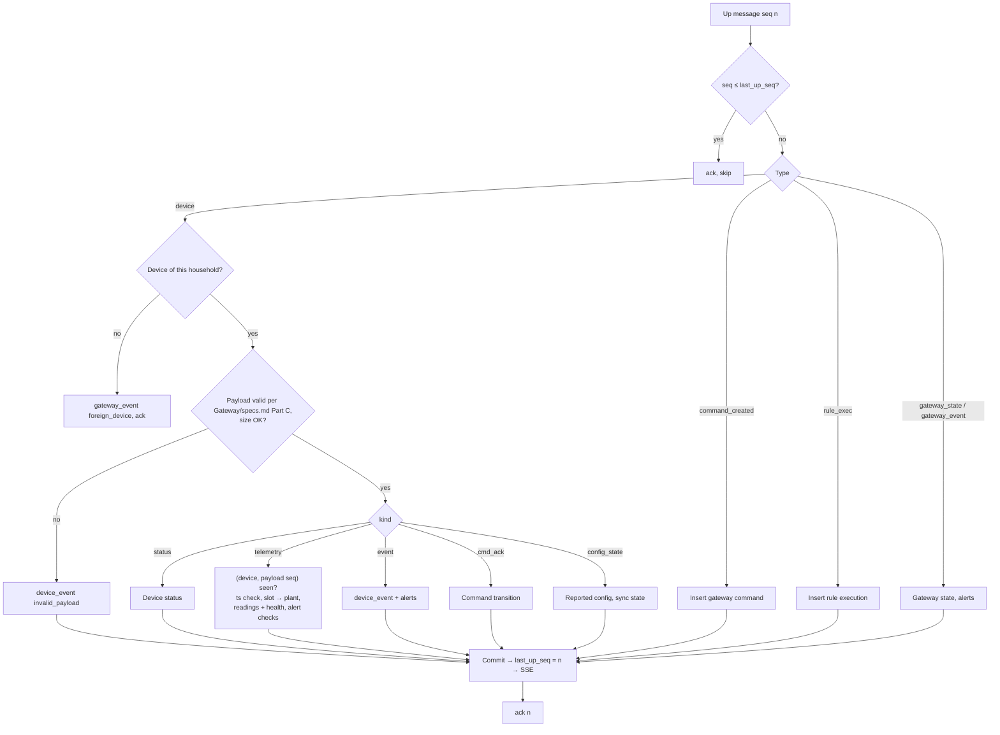
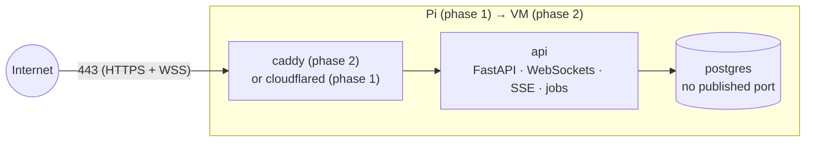
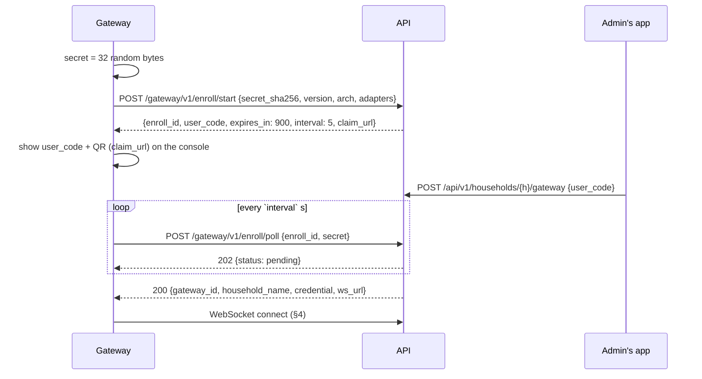
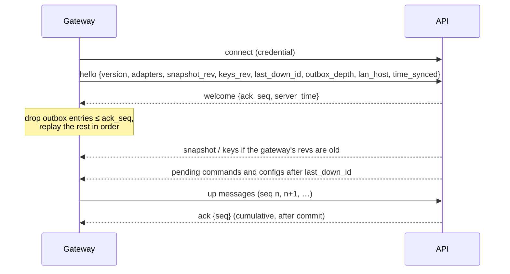

# Server — Specification

> **Superseded.** The redesign removes the separate Server: its API, data model, commands, rules and alerts move into the hub described in [`Gateway/specs.md`](../Gateway/specs.md). This file stays only until the code is migrated (its Part C is still read by the contract tests) and is then deleted.

The Server is the **central** part of the system: the one place with households, memberships and roles, the history of all devices, and the app's API. It is the only component that talks to both users (apps) and gateways, and the **only** client of the database. We operate one instance for everyone. Responsibilities in the system: [`PROJECT.md`](../PROJECT.md) §4.3.

This file has three parts: **Part A** the API server (FastAPI + PostgreSQL), **Part B** the Firebase project (login, push, hosting), **Part C** the gateway ↔ server interface (a contract, implemented by the Server and by the [Gateway](../Gateway/specs.md)). The app-facing API is described in §6 here; the app is specified in [`App/specs.md`](../App/specs.md).

Folder: `src/mc_api/` (service), `tests/`, `firebase/` (config), `scripts/` (`make-secrets.sh`, `advertise_mdns.py`), `Dockerfile`, `docker-compose.yml`, `alembic.ini`, `pyproject.toml`, `.env.example`. Run and test commands: [`readme.md`](readme.md).

---

# Part A — API server

## 1. Scope

In scope:

- Firebase ID token verification, households, memberships, roles, invites, sensitive-action checks.
- REST API and Server-Sent Events for the Flutter app.
- **Gateway endpoint**: enrollment, the WebSocket per gateway, acknowledgements, downlink queue.
- Ingest of normalized device messages from gateways; history.
- Device registry and device keys; gateway registry and credentials; snapshots for gateways.
- Command queue and lifecycle (commands from the app and commands reported by gateways).
- Config sync (desired vs. reported).
- Rule storage and validation, and recording of rule decisions made by gateways. **Rules are not evaluated here.**
- Alerts and push notifications (FCM).
- Owner data export.

Out of scope: login UI and identity (Firebase), the web app (Firebase Hosting), device communication and rule evaluation (Gateway), device firmware (PlantModule).

## 2. Technology

| Concern | Choice | Notes |
|---|---|---|
| Language / runtime | Python 3.13 | Same as the gateway |
| Web framework | FastAPI + Uvicorn | OpenAPI generated from code; native WebSocket support for gateways |
| Shared code | `Shared/core` (`mc_core`) | Contract models (Gateway/specs.md Part C, Part C below), command checks, pin rules, rule *validation* |
| Validation | Pydantic v2 | |
| Database | PostgreSQL 16 via SQLAlchemy 2 async + `asyncpg`, Alembic migrations | Only the Server connects. TimescaleDB optional later for readings. |
| SSE | `sse-starlette` | |
| Auth | `firebase-admin` (`verify_id_token`, `check_revoked` for sensitive actions) | The service account lives only here. A `dev` auth mode accepts unsigned `dev:<uid>` tokens for local development. |
| Push | `firebase-admin` messaging (FCM) | |
| Key encryption at rest | `cryptography` (AES-256-GCM) | Device PSKs |
| Credential hashing | SHA-256 of 256-bit random gateway credentials | High-entropy secrets, no slow hash needed |
| IDs | ULID; `mc-…` devices, `gw-…` gateways | |
| Tests | pytest, pytest-asyncio, httpx | Scripted fake gateway; see §14 |

**Process model:** one Uvicorn process with one worker hosts the API, all gateway WebSockets, the SSE hub and the periodic jobs. Scaling out later needs a shared bus for SSE and gateway routing, and job ownership (§17).

## 3. Internal architecture



- **Routers are thin**: parse, auth dependency, one service call, serialize. **Services own logic and transactions.**
- **Every write the app should see live emits an SSE event** after commit.
- **Everything for a gateway goes through the downlink queue** (a table), written in the same transaction as the change and sent when the gateway is connected (§9.3).

## 4. Data model

IDs are ULIDs unless noted; timestamps UTC. Every table with household data has `household_id`, and every query filters by it (§5.4).



| Table | Key columns | Notes |
|---|---|---|
| `users` | `uid` (Firebase UID, PK), `email` (verified only), `display_name`, `first_seen_at` | Upserted from token claims |
| `households` | `id`, `name`, `timezone`, `battery_low_mv`, `snapshot_rev`, `keys_rev`, `created_at` | `*_rev` counters for the gateway (§9.4) |
| `memberships` | (`household_id`, `user_uid`) PK, `role`, `created_at` | Exactly one `owner` per household (partial unique index) |
| `invites` | `id`, `household_id`, `code_hash`, `role`, `created_by`, `expires_at`, `used_by`, `used_at`, `revoked_at` | SHA-256 of the code only |
| `gateways` | `id` (`gw-…`), `household_id` (unique), `credential_hash`, `status` (`enrolling`/`online`/`offline`/`removed`), `connected_at`, `disconnected_at`, `last_outage_s`, `last_state` (JSON of `gateway_state`), `lan_host_override`, `adapters`, `version`, `snapshot_rev_applied`, `keys_rev_applied`, `last_up_seq`, `created_at` | One per household |
| `gateway_enrollments` | `id`, `secret_sha256`, `user_code_hash`, `expires_at`, `claimed_household_id`, `claimed_by`, `gateway_id`, `consumed_at`, `last_poll_at`, `ip`, `version`, `arch`, `adapters` | Cleaned up after 24 h |
| `downlink` | `id` (ULID = message `id`), `gateway_id`, `type`, `body`, `created_at`, `sent_at`, `acked_at`, `result`, `error` | §9.3 |
| `devices` | `id` (`mc-…`), `household_id`, `adapter`, `name`, `psk_enc`, `hw_mac`, `fw`, `board`, `status`, `last_seen_at`, `next_expected_at`, `wake_interval_s`, `batt_mv`, `rssi`, `last_seq`, `last_boot`, `desired_rev`, `desired_config`, `reported_rev`, `reported_config`, `rejected_rev`, `config_error`, `sensor_error_streak`, `created_at`, `deleted_at` | `status` ∈ `new`, `online`, `sleeping`, `late`, `offline`, `service`; `needs_repair` after a gateway replacement |
| `config_revisions` | `device_id`, `rev`, `kind`, `body`, `result`, `error`, `created_at`, `created_by` | Full history |
| `plants` | `id`, `household_id`, `name`, `notes`, `sensor_device_id`, `sensor_slot`, `pump_device_id`, `pump_slot`, `archived_at` | |
| `readings` | `id` (bigint), `device_id`, `slot`, `plant_id`, `type`, `value`, `raw`, `error`, `ts`, `ts_source`, `seq` | Indexes (`plant_id`, `ts`), (`device_id`, `slot`, `ts`); partitioned by month once volume grows |
| `health_reports`, `device_events` | per wake / per event | Battery, RSSI, wake reason; device events such as `low_battery`, `sensor_fault` |
| `commands` | `id`, `household_id`, `device_id`, `plant_id`, `action`, `args`, `status`, `reason`, `source` (`manual`/`rule`/`local`), `origin` (`api`/`gateway`), `created_by`, `rule_id`, `created_at`, `exp`, `sent_at`, `delivered_at`, `finished_at`, `ends_at`, `cancel_of` | `sent_at` = handed to the gateway |
| `rules` | `id`, `household_id`, `plant_id`, `enabled`, `threshold`, `water_s`, `cooldown_s`, `max_per_day`, `quiet_from`, `quiet_to`, `created_by`, `updated_at` | |
| `rule_executions` | `id`, `household_id`, `rule_id`, `plant_id`, `ts`, `reading_ref`, `decision`, `skip_reason`, `command_id` | Reported by the gateway (`rule_exec`) |
| `alerts` | `id`, `household_id`, `kind`, `subject_type`, `subject_id`, `subject_name`, `severity`, `opened_at`, `resolved_at`, `acked_by`, `acked_at`, `detail` | One open alert per (`kind`, `subject`) |
| `push_tokens` | `token` PK, `user_uid`, `platform`, `updated_at` | |
| `audit_log` | `id`, `household_id`, `actor`, `action`, `detail`, `ts`, `ip` | Role changes, invites, devices, gateway add/remove, export, deletes |

**Keys at rest:** device PSKs are stored encrypted (`psk_enc`, AES-256-GCM with `MC_KEY_ENCRYPTION_KEY`) and decrypted only to build pairing bundles and the `keys` message for the household's gateway. Gateway credentials are stored only as hashes.

## 5. Authentication and authorization

### 5.1 Firebase ID tokens

Every app request carries `Authorization: Bearer <Firebase ID token>`. The Server verifies it with `firebase_admin.auth.verify_id_token`, takes `uid` and upserts the `users` row (`email` only if verified). Accounts with e-mail/password need a verified e-mail before creating or joining households. In `MC_AUTH_MODE=dev` the token is `dev:<uid>` and unsigned; never use it on a public instance.

### 5.2 Roles

The role matrix is in [`PROJECT.md`](../PROJECT.md) §3.2. One FastAPI dependency per minimum role. Not a member → **404**; role too low → **403**. Admins may invite and assign up to `member` and remove `member`/`viewer`; only the owner changes admins, transfers ownership, renames or deletes the household and exports. The owner cannot leave.

### 5.3 Sensitive actions

Delete household, transfer ownership, promote or demote an admin, export, claim or remove the gateway, delete a device. The token's `auth_time` must be ≤ 5 min old, otherwise **401 `reauth_required`**; the token is verified with `check_revoked=True`.

### 5.4 Tenant isolation

- App data lives under `/api/v1/households/{household_id}/…`; resources are always loaded by household **and** ID.
- Gateway messages are accepted only for devices whose `household_id` equals the gateway's household.
- Tests call every household route as a non-member (404) and with each lower role (403), and send gateway messages for foreign devices (dropped).

### 5.5 Gateway authentication

`Authorization: Gateway <gateway_id>:<credential>` on the WebSocket upgrade; constant-time comparison of SHA-256(credential) with `credential_hash`; `status = removed` → rejected.

### 5.6 Public exposure

| Measure | Status |
|---|---|
| Headers: `X-Content-Type-Options: nosniff`, `Content-Security-Policy: default-src 'none'` on API responses, HSTS when served over HTTPS | built |
| App version gate: `X-MC-App: <platform>/<version>`; below `MC_MIN_APP_VERSION` → **426** | built |
| Rate limits: invite accept, enrollment poll interval (429) | built |
| CORS limited to the official web-app origin (`MC_CORS_ORIGINS`); `/docs` and `/openapi.json` off in production (`MC_DOCS`) | built |
| Database: no published port, container network only | built (compose) |
| General rate limits and limits per IP, user and gateway (proposal: unauthenticated 30/min/IP, authenticated 300/min/user, water 30/min/household, invites 20/day/household, gateway claim 10/h/user, enrollment start 10/h/IP, failed gateway auth 20/5 min/IP, gateway messages 50/s with burst 500); request size limits (JSON ≤ 64 KB, WebSocket frame ≤ 256 KB) | **planned** |

## 6. REST API

Base `/api/v1`, JSON, ISO 8601 UTC timestamps, errors as RFC 9457 problem+json with stable `type`s.

### 6.1 Endpoints

**Me**

| Method | Path | Purpose |
|---|---|---|
| GET / DELETE | `/me` | Profile / delete account data (409 `sole_owner` while owning a shared household) |
| GET | `/me/households` | Households with my role and gateway state: the household switcher |
| PUT / DELETE | `/me/push-tokens/{token}` | Register / remove an FCM token |
| POST | `/events/ticket` | Short-lived SSE ticket (§6.2) |
| GET | `/meta/boards/{board}` | Board description from `mc_core.pins` |

**Households, members, invites**

| Method | Path | Min. role |
|---|---|---|
| POST | `/households` | logged in (verified) |
| GET / PATCH / DELETE | `/households/{h}` | viewer / owner / owner* |
| POST | `/households/{h}/transfer-ownership` | owner* |
| GET | `/households/{h}/members` | viewer |
| PATCH / DELETE | `/households/{h}/members/{uid}` | admin, owner* for admins |
| GET / POST | `/households/{h}/invites` | admin |
| DELETE | `/households/{h}/invites/{id}` | admin |
| GET | `/invites/{code}` | logged in |
| POST | `/invites/{code}/accept` | logged in (verified) |
| GET | `/households/{h}/audit` | admin |

**Gateway**

| Method | Path | Min. role | Purpose |
|---|---|---|---|
| GET | `/households/{h}/gateway` | viewer | State: online / offline since, version (+ update notice), adapters, in sync, outbox depth, clock, LAN address |
| POST | `/households/{h}/gateway` | admin* | `{user_code}`: claim an enrolling gateway |
| PATCH | `/households/{h}/gateway` | admin | `{lan_host_override}` |
| DELETE | `/households/{h}/gateway` | admin* | Remove (§9.6) |

**Devices, config, plants, readings, commands, rules, alerts, live, export**

| Method | Path | Min. role |
|---|---|---|
| GET / POST | `/households/{h}/devices` | viewer / admin; POST `{name, adapter}` returns the pairing bundle once (§8.1) |
| GET / PATCH / DELETE | `/households/{h}/devices/{d}` | viewer / admin / admin* |
| POST | `/households/{h}/devices/{d}/rekey` | admin |
| GET / PUT | `/households/{h}/devices/{d}/config` | viewer / admin |
| GET | `/households/{h}/devices/{d}/health`, `…/events` | viewer |
| POST | `/households/{h}/devices/{d}/actions` | member (identify) / admin |
| GET / POST | `/households/{h}/plants` | viewer / member |
| GET / PATCH / DELETE | `/households/{h}/plants/{p}` | viewer / member |
| GET | `/households/{h}/plants/{p}/readings?from&to&bucket` | viewer |
| POST | `/households/{h}/plants/{p}/water` | member |
| GET | `/households/{h}/plants/{p}/commands` | viewer |
| GET / POST / PATCH / DELETE | `/households/{h}/plants/{p}/rules[/{r}]` | viewer / member |
| GET | `/households/{h}/plants/{p}/rules/{r}/executions` | viewer |
| GET / POST | `/households/{h}/commands[/{c}]`, `…/{c}/cancel` | viewer / member |
| GET / POST | `/households/{h}/alerts`, `…/{a}/ack` | viewer / member |
| GET | `/households/{h}/stream?ticket=` | viewer; SSE |
| POST | `/households/{h}/export` | owner* |

\* = sensitive action (§5.3)

**Unauthenticated:** `GET /healthz` (§13.4). **Gateway endpoints** (no user auth, Part C): `POST /gateway/v1/enroll/start`, `POST /gateway/v1/enroll/poll`, `GET /gateway/v1/connect` (WebSocket).

### 6.2 Live updates (SSE)

1. `POST /events/ticket` → random ticket, 60 s, single use, bound to the user.
2. `GET /households/{h}/stream?ticket=…` → ticket and membership are checked, then the stream starts.
3. `Last-Event-ID` replay from a ring buffer (200 events per household); too old or from a previous process → `resync`.
4. `ping` every 25 s. Streams of removed members are closed.

Events: `reading`, `device`, `command`, `config`, `plant`, `rule`, `alert`, `gateway`, `household`, `resync`.

### 6.3 OpenAPI

The OpenAPI document is generated from the code (`mc-api openapi`). Committing it as `api.yaml` with a CI drift check, and generating the Dart client from it, is **planned**; until then the app uses a hand-written Dio client.

## 7. Commands

### 7.1 Creating a command (app)



The checks come from `Shared/core` (`mc_core.commands`) and are the same ones the gateway runs again before publishing. The device remains the final authority.

Actions today: `pump.run`, `pump.stop`, `cmd.cancel`, `device.identify`, `device.service`, `device.reboot`.

> **Planned:** the `sensor.sample` action for calibration (`Gateway/specs.md` Part C §5.1), the `slot_not_sensor` error, `POST /devices/{id}/slots/{n}/calibration/sample`, `PUT …/calibration` and a `calibrated_at` column.

### 7.2 Lifecycle and acks

| Incoming | From state | → New state |
|---|---|---|
| `down_ack` `applied` for the command | queued | queued, `sent_at` set (handed to the device's session) |
| `down_ack` `rejected` (gateway check failed) | queued | `failed`, reason = check code |
| `command_created` from the gateway (rule/CLI) | — | insert with `origin = gateway`, `queued` (idempotent by ID) |
| device `cmd_ack` `running` (with `ends_at`) | queued | `delivered` |
| device `cmd_ack` `done` | queued / delivered / cancelling | `done` |
| device `cmd_ack` `rejected`, reason `expired` | queued | `expired` |
| device `cmd_ack` `rejected` / `failed` (other) | queued / delivered | `failed` (+ `command_failed` alert for pump runs) |
| device `cmd_ack` `cancelled` | queued / cancelling | `cancelled` |
| job: `now > exp + 2 × wake interval`, no ack | queued / cancelling | `expired` |
| job: `now > ends_at + 2 × wake interval` | delivered | `failed`, `no_final_ack` |

The expiry job **pauses for a household while its gateway is offline** (acks may be buffered in its outbox) and resumes with a grace period of one wake interval after reconnect. An ack for an unknown command ID is held 10 min waiting for the matching `command_created` (both come through the ordered outbox, so this only happens after data loss).

### 7.3 Cancel

On a `queued` command: status `cancelling`, downlink `command` with `cmd.cancel`/`target`; the final state comes from the device's acks. On a `delivered` long run: `pump.stop`. If the original command was never handed to the gateway (`sent_at` null), the downlink entry is withdrawn and the command becomes `cancelled` immediately.

## 8. Devices, keys and config

### 8.1 Adding a device

1. The admin scans the device's PoP label; the app calls `POST /households/{h}/devices {name, adapter: "esp32-mqtt"}`.
2. The household must have a gateway that is **online** and supports the adapter (409 `gateway_offline` / 422 `adapter_unsupported`).
3. The Server generates the device ID (`mc-` + 16 Crockford base32) and a 32-byte PSK, stores the key encrypted, increments `keys_rev` and queues the complete `keys` set for the gateway; it waits (≤ 30 s) for the gateway's `down_ack`.
4. It returns the **pairing bundle** once: `{device_id, mqtt: {host, port, psk}}`, with `host`/`port` = the gateway's `lan_host` (or the admin's override) and `lan_port`.
5. The app pairs over BLE (`PlantModule/specs.md` Part B). Devices still `new` after 24 h are deleted with their keys.
6. The Server queues the initial `config_desired` (rev 1).

**Removing a device:** downlink `device_removed` and a new `keys` set, open commands cancelled, history kept.

**Replacing the gateway** (removed, new one claimed): all devices get `needs_repair`; `rekey` issues a new key through the new gateway and a new bundle for BLE re-pairing.

### 8.2 Config sync

- `PUT …/config` with `base_rev` (409 on mismatch); validation by `mc_core.pins` → 422 with the contract's codes.
- Valid → `rev + 1`, stored, downlink `config_desired`.
- The reported `config_state` (a device message) is stored; `sync_state` is `in_sync`, `pending` or `rejected` (+ alert).
- Changes to actuator limits or the wake interval in the **reported** config bump the household's `snapshot_rev` (§9.4).

### 8.3 Device status

> **Not yet handled:** `wake_interval_s = 0` ("never sleep", the firmware's factory default) and `awake_s` exist in `Gateway/specs.md` Part C and the firmware, but `PUT …/config` still requires `wake_interval_s ≥ 60` and has no `awake_s`. The late/offline jobs use `wake_interval_s` directly, so a device reporting 0 would be marked late at once. Planned: treat 0 as a 60 s expected period (Part C §6.1 of the MQTT contract) and accept `awake_s`.

| Trigger | Status | Side effects |
|---|---|---|
| `status` online / sleeping / service | as reported | `last_seen_at`, `next_expected_at` |
| `status` offline (LWT) | `offline` | `device_crashed` alert |
| job: `> next_expected + 1 interval` | `late` | — |
| job: `> next_expected + 3 intervals` | `offline` | `device_offline` alert |

These jobs are **suspended while the household's gateway is offline**: the app shows "gateway offline" instead, and a single `gateway_offline` alert is raised after 15 min.

## 9. Gateways

### 9.1 Enrollment

Implements Part C §3: `enroll/start` stores the secret hash and the hashed user code; the claim (admin, recent login, no existing gateway) creates the `gateways` row and queues the initial `snapshot` and `keys`; `enroll/poll` with the right secret returns gateway ID and credential **once**. Claim and removal are audit-logged.

### 9.2 WebSocket sessions

- On connect: authenticate (§5.5), close an older connection of the same gateway, mark `online`, record the outage duration, send `welcome {ack_seq: last_up_seq}`.
- Up messages are processed strictly in `seq` order, each in its own transaction (§9.5); after commit `last_up_seq` is updated and cumulative `ack`s are sent.
- On disconnect: mark `offline` with `disconnected_at`; `gateway_offline` alert after 15 min.

### 9.3 Downlink queue

- Every message for a gateway (`snapshot`, `keys`, `command`, `config_desired`, `device_removed`, `rotate_credential`, `removed`) is inserted into `downlink` in the same transaction as the change that caused it.
- A sender per connected gateway sends unsent rows in order and marks `sent_at`; `down_ack` sets `acked_at` and `result`. Rows without ack are re-sent after reconnect unless `id` ≤ the `last_down_id` from `hello`.
- Superseded rows are skipped: only the newest `snapshot` and `keys` are sent; commands that expired while waiting are marked `expired` instead of being sent.

### 9.4 Snapshot and keys

- **Snapshot** (Part C §6.1): rebuilt and queued whenever plants, rules, reported actuator limits, wake intervals, timezone or battery threshold change (`snapshot_rev + 1`). `rule_state` comes from the commands table (last rule command per plant, count today in the household timezone).
- **Keys** (Part C §6.2): the full set of the household's device keys; `keys_rev + 1` on every device add, remove or rekey.
- `down_ack` updates `snapshot_rev_applied` / `keys_rev_applied`; the app shows "gateway in sync" when both match; `rejected` raises a `gateway_sync_failed` alert.

### 9.5 Ingest pipeline



- **Device sequence:** a lower payload `seq` with a lower `boot` means the device restarted, accept it; otherwise it is a duplicate, drop it.
- **Timestamps:** the device `ts` is accepted within [`received_at` − 2 h − gateway outage, `received_at` + 5 min]; otherwise `received_at` is used.

### 9.6 Removal

A sensitive action. Queue `removed`, close the socket, revoke the credential, set `status = removed`, mark all devices `needs_repair`, write the audit log. The household can then claim a new gateway.

## 10. Rules

- Rules are stored and validated by the Server (`mc_core.rules` validation: thresholds, quiet-hour format, water time ≤ pump limits); every change bumps the snapshot.
- They are evaluated **only on the gateway**. Every decision arrives as `rule_exec` and is shown in the app ("why did / didn't it water?").
- `rule_limit_reached` alert when a rule hits its daily limit on 2 consecutive days (from the reported executions).

## 11. Alerts

| `kind` | Opened when | Resolved when |
|---|---|---|
| `device_offline` | Status job → offline (not while the gateway is offline) | Device online |
| `device_crashed` | LWT | Next online |
| `battery_low` | `batt_mv` < threshold on 3 reports, or `low_battery` event | > threshold + 100 mV |
| `sensor_error` | Slot error on 3 consecutive cycles | Slot reports a value |
| `command_failed` | Command → failed | Acked |
| `config_rejected` | Device rejected desired config | In sync |
| `safety_stop` | `safety_stop` event | Acked |
| `rule_limit_reached` | Daily limit hit on 2 consecutive days | Acked |
| `gateway_offline` | Gateway disconnected > 15 min | Reconnected |
| `gateway_sync_failed` | Gateway rejected snapshot/keys | In sync |
| `gateway_buffer_overflow` | `gateway_event buffer_overflow` | Acked |

On opening, an FCM push goes to all members' tokens; invalid tokens are deleted; failures are retried 3×.

## 12. Export

`POST /households/{h}/export` (owner, sensitive): a ZIP with `manifest.json`, `household.json`, `members.json` (display names and roles), `devices.json` (no keys), `plants.json`, `rules.json`, `readings.ndjson.gz`, `health.ndjson.gz`, `events.ndjson.gz`, `commands.ndjson.gz`, `rule_executions.ndjson.gz`. There is no import.

## 13. Configuration and deployment

### 13.1 Environment variables

| Variable | Meaning |
|---|---|
| `MC_PUBLIC_API_URL` | e.g. `https://api.example.com` (also the base of `ws_url` for gateways) |
| `MC_APP_URL` | e.g. `https://app.example.com` (invite and claim links) |
| `MC_DATABASE_URL` | PostgreSQL DSN (`{password}` placeholder + `MC_DATABASE_PASSWORD_FILE`) |
| `MC_KEY_ENCRYPTION_KEY` | 32 bytes, encrypts device PSKs. Secret file, never in the repo; it must move with the database. |
| `MC_FIREBASE_CREDENTIALS` | Service account JSON (token verification + FCM). Secret file. |
| `MC_FIREBASE_PROJECT_ID` | Firebase project id used to verify ID tokens |
| `MC_AUTH_MODE` | `firebase` (default) or `dev` (unsigned `dev:<uid>` tokens, local development only) |
| `MC_CORS_ORIGINS` | Official web-app origin |
| `MC_MAX_HOUSEHOLDS_PER_USER` | Quota (default 10) |
| `MC_LATEST_GATEWAY_VERSION` | Update notices |
| `MC_MIN_APP_VERSION` | Oldest app version still accepted (a minimum gateway version is not enforced) |
| `MC_DOCS` | `1` serves the OpenAPI docs (default: on with `MC_AUTH_MODE=dev`, off otherwise) |
| `MC_INSTANCE_ID` | Stable id of this installation (default `mc-local`); reported by `/healthz` and mDNS |
| `MC_API_BIND` | Compose only: host `address:port` the `api` container is published on (default `127.0.0.1:8000`). `.env.dev` sets `0.0.0.0:8000` so a phone on the same WiFi can reach the API; with dev auth, anyone on that network can then act as any user. |
| `MC_API_PORT` | Compose only: port the `lan` mDNS advertiser announces (default 8000) |

### 13.2 Docker Compose (central instance)



- Compose profiles: `caddy` (phase 2 edge), `tunnel` (Cloudflare Tunnel, phase 1) and `lan` (mDNS advertiser on the host network, §13.4).
- Only 443 (+80 for ACME in phase 2) is reachable; Postgres only on the container network. There is no public MQTT port.
- Images are multi-arch (arm64 + amd64). Alembic migrations run on start. Planned: nightly `pg_dump` to a second disk or object storage, 30 days retention, restore tested regularly.
- Phase 1 runs on a Raspberry Pi at home with `api.<domain>` through a Cloudflare Tunnel (WebSockets supported); phase 2 on a cloud VM with Caddy and Let's Encrypt. The move is backup/restore plus a DNS change; gateways and apps only know `api.<domain>`.

### 13.3 Code layout

```
Server/
├── pyproject.toml            # depends on mc-core (Shared/core)
├── Dockerfile · docker-compose.yml · alembic.ini · .env.example · .env.dev
├── scripts/                  # make-secrets.sh, advertise_mdns.py (§13.4)
├── src/mc_api/
│   ├── main.py · config.py · cli.py · context.py · crypto.py · errors.py · dev_seed.py
│   ├── db/ · migrations/ · auth/
│   ├── api/                  # REST routers (me, households, plants, devices, activity, export), schemas.py, gateway.py
│   ├── services/             # alerts, commands, common, devices, gateways, households, ingest, plants
│   ├── realtime/             # bus.py (SSE), gateways.py (gateway sessions, downlink)
│   └── notify/ · jobs/
├── tests/                    # test_access.py, test_flows.py, test_gateway_ws.py
└── firebase/                 # Part B
```

### 13.4 LAN discovery (mDNS)

For the app's `local` flavor (`App/specs.md` §6.4) a stack on the home network advertises itself, so the app needs no fixed IP.

- **`GET /healthz`** (unauthenticated, outside `/api/v1`): `{"ok": true, "service": "moisture-api", "id": "<MC_INSTANCE_ID>", "auth": "dev" | "firebase"}`. The app probes it to verify a discovered or remembered address.
- **Advertisement:** DNS-SD service `_moisture-api._tcp`, instance `Moisture API (<hostname>)`, the API's port, TXT `v=1`, `api=/api/v1`, `auth=<dev|firebase>`, `id=<MC_INSTANCE_ID>`.
- **Who advertises:** `scripts/advertise_mdns.py` (python `zeroconf`). Multicast does not leave a Docker bridge network, so it runs on the host or as the compose profile `lan` (`network_mode: host`). The API itself knows nothing about mDNS.
- **Scope:** development and the Raspberry Pi phase on the LAN. A public `api.<domain>` deployment does not advertise; the `dev`/`prod` app flavors never discover.

## 14. Testing

| Level | What |
|---|---|
| Unit | Command state machine, config validation, seq/timestamp handling, role checks, snapshot and rule_state building, downlink supersession, ack/replay bookkeeping. |
| Contract | Every JSON example in `Gateway/specs.md` Part C and in Part C below parses with the `mc_core.contract` models (`Shared/core/tests/test_contract_examples.py`). |
| API (exists) | `tests/test_access.py` (tenant isolation, roles), `tests/test_flows.py` (flows through the API with a scripted gateway), `tests/test_gateway_ws.py` (WebSocket session, replay from ack). |
| Integration (manual) | `scripts/dev-start.sh`: a real Server stack, a real gateway stack, the device simulator and the app. An automated version (enrollment, watering a sleeping device, gateway offline with buffered data, duplicate replays, Server restart mid-stream) is planned. |

## 15. Security summary

- People: Firebase ID tokens verified only here; roles on every request; recent login and revocation checks for sensitive actions.
- Gateways: 256-bit credentials (hashed at rest), one household each, outbound WSS only.
- Devices: per-device 256-bit PSKs, encrypted at rest, delivered only via BLE pairing and to the household's own gateway.
- Database: no network exposure beyond the API container.
- Secrets (Firebase service account, key encryption key, DB password) only as secret files on the host.

## 16. Status

Built: everything in §§3–12 except the items marked planned. Firebase login is not wired up in the app yet; the stack runs with dev auth.

## 17. Open points

- Planned items above: general rate limits, committed `api.yaml`, calibration endpoints, `wake_interval_s = 0` / `awake_s`, backups.
- Hosting provider for phase 2 (candidates: Oracle Cloud Always Free in Frankfurt, Hetzner at about €4–5/month).
- Data retention: raw readings forever, or downsample after N months.
- Scaling beyond one process: a shared bus (Redis) for SSE and for routing downlink to the process holding a gateway's WebSocket; TimescaleDB or partitioning for readings.
- Account deletion for accounts deleted directly in Firebase.
- Notification preferences per user, household and alert kind.

---

# Part B — Firebase project

Firebase is used only for **managed services**: login and user accounts, push delivery and hosting the official web app. There is no own code in Firebase (no Cloud Functions, no Firestore). Households, memberships, roles and invites live in the Server's database; the Server is the only component that receives users' Firebase ID tokens. Gateways and devices never talk to Firebase.

**Status:** not wired up yet. The app and the Server run with dev tokens (`main_local.dart`, `MC_AUTH_MODE=dev`). `firebase/` currently holds no config.

## 1. Services used

| Service | Used for | Plan |
|---|---|---|
| **Authentication** | Login and accounts (sign-up, e-mail verification, password reset, social logins, MFA) | Spark: free up to 50 000 monthly active users |
| **Cloud Messaging (FCM)** | Push notifications, sent by the Server | Free |
| **Hosting** | Official web app, `/join` and `/gateway` deep links, app-link files | Spark: 10 GB storage, 360 MB/day transfer |
| App Check (optional) | Makes scripted abuse of the login harder | Free |

Not used: Cloud Functions, Firestore, Realtime Database, Storage. The project stays on the free **Spark** plan. Region: `europe-west3` (Frankfurt) where a region applies.

## 2. Authentication

- **Providers:** e-mail/password (**verified e-mail required** before creating or joining a household, enforced by the Server), Google, Apple (required on iOS when Google is offered). Anonymous auth is disabled.
- **Authorized domains:** only `app.<our-domain>` (+ `localhost` for development); `authDomain` is the same custom domain.
- **Sessions:** standard Firebase ID tokens (1 h, refreshed by the SDK). The Server checks `auth_time` for sensitive actions and uses the Admin SDK's revocation check (Part A §5.3).
- **Account security:** password policy (min. 10 characters), e-mail enumeration protection, optional TOTP multi-factor auth in the app settings.
- **Split of responsibility:** Firebase owns the *account* (credentials, e-mail, verification, MFA, disabling). The Server's database owns *access* (which households, which role). No custom claims.
- **Account deletion:** the app calls `DELETE /me` first (leave or transfer households), then deletes the Firebase account.

## 3. Cloud Messaging

- The **Server** is the only sender; it holds the service account (`MC_FIREBASE_CREDENTIALS`).
- The app registers its token with `PUT /api/v1/me/push-tokens/{token}` and removes it on logout.
- Web push uses FCM web with a service worker on the official origin; iOS Safari only for installed web apps.

## 4. Hosting

- The Flutter web build is served **only** from `https://app.<our-domain>`, the only web origin where users sign in.
- Deep links:
  - `https://app.<our-domain>/join#c=<code>` accepts an invite.
  - `https://app.<our-domain>/gateway#u=<user-code>` adds a gateway; this is what the gateway's console QR code contains (Part C §3.1).
  - The part after `#` is never sent to any server.
- Mobile: the same URLs open the installed app via Android App Links and iOS Universal Links (`/.well-known/assetlinks.json`, `/.well-known/apple-app-site-association`).
- Headers: strict `Content-Security-Policy` (scripts only from the own origin and Google sign-in; `connect-src` only the API origin and Firebase endpoints), HSTS, `nosniff`, `Referrer-Policy: no-referrer`.

## 5. Layout and deployment

```
Server/firebase/
├── firebase.json     # hosting: public dir = App/build/web, rewrites, headers
└── .firebaserc       # project aliases: dev, prod
```

Both files are still to be created. Deploy: `firebase deploy --only hosting` from CI after the Flutter web build. Auth settings are configured in the console and documented here.

## 6. Open points

- Separate Firebase projects for **dev** and **prod**, one per Server environment (recommended).

---

# Part C — Gateway interface (gateway ↔ server)

<!-- contract:gateway_api -->
# Gateway interface contract — gateway ↔ server

**Version:** v1. Gateway side `Gateway/firmware/src/mc_gateway/uplink.py`, Server side `src/mc_api/realtime/gateways.py` and `src/mc_api/api/gateway.py`; covered by `tests/test_gateway_ws.py`.

Everything between a household's **gateway** and the central **Server**: enrollment over HTTPS, the WebSocket, acknowledgements and replay, the normalized device messages, and what the API sends down. The gateway and the API server both implement this document; if code and contract disagree, the code is wrong.

Context: [`PROJECT.md`](../PROJECT.md) §2 and §3.5, [`Gateway/specs.md`](../Gateway/specs.md) Part A (the gateway side), Part A above (the Server side). Device-side payloads of ESP32 devices: [`Gateway/specs.md`](../Gateway/specs.md) Part C.

---

## 1. Principles

1. **Outbound only.** The gateway opens every connection (HTTPS for enrollment, one WebSocket afterwards). The API never connects to a gateway.
2. **One gateway = one household.** The API accepts messages from a gateway only for devices of its own household.
3. **Nothing is lost while offline.** Every message from the gateway gets a sequence number, is stored in the gateway's outbox first, and is deleted only after the API acknowledged it. After a reconnect the gateway replays everything unacknowledged, in order.
4. **Everything is idempotent.** Messages carry sequence numbers or IDs; the API deduplicates uploads, the gateway deduplicates downloads.
5. **Protocol-independent.** The API never sees MQTT, Zigbee or LoRaWAN. It sees **normalized device messages** (§5). For ESP32 devices their payloads are the [`Gateway/specs.md` Part C](../Gateway/specs.md) payloads, unchanged.
6. **The API owns intent.** Plants, rules, device configs and device keys come down as complete, versioned sets; the gateway never edits them — it only reports what it did.

---

## 2. Identifiers and credentials

| Item | Value |
|---|---|
| Gateway ID | `gw-` + 16 lowercase Crockford-base32 chars (80 random bits), assigned by the API at enrollment |
| Gateway credential | 32 random bytes (base64url, 43 chars), generated by the API at enrollment, delivered once in the poll response, stored **hashed** (SHA-256) in the database and in `/data/secrets/credential` (mode 600) on the gateway |
| Rotation | `rotate_credential` message (§6.6); the old credential stays valid until the gateway confirms the new one |
| Transport | HTTPS / WSS only, TLS 1.2+, certificate validated against the system's trust store (`api.<our-domain>` has a public certificate) |

---

## 3. Enrollment (HTTPS)

Device-code flow. Base URL: `https://api.<our-domain>`. No authentication on the gateway side — possession of the enrollment secret proves it is the same gateway.



### 3.1 `POST /gateway/v1/enroll/start`

Request:
```json
{ "secret_sha256": "9f2c…64 hex…", "version": "0.2.0", "arch": "arm64", "adapters": ["esp32-mqtt"] }
```
Response `201`:
```json
{ "enroll_id": "01J9ENR0000000000000000000", "user_code": "K7QM-2XPA", "expires_in": 900, "interval": 5,
  "claim_url": "https://app.example.com/gateway#u=K7QM-2XPA" }
```

- `user_code`: 8 Crockford base32 characters (40 bits), shown with a dash; valid 15 min, single use.
- `secret_sha256`: SHA-256 over the **raw 32 bytes** of the secret, hex.
- Rate limit: 10 starts / hour / IP.

### 3.2 Claim (app side, for reference)

`POST /api/v1/households/{h}/gateway {user_code}` — admin role, recent login; the household must not have a gateway yet (replacing one: remove the old one first, then re-pair devices). 10 attempts / hour / user.

### 3.3 `POST /gateway/v1/enroll/poll`

Request: `{ "enroll_id": "…", "secret": "<64 hex chars of the raw secret>" }`

| Response | Meaning |
|---|---|
| `202 {status: "pending"}` | Not claimed yet; poll again after `interval`. |
| `200` (below) | Claimed. Returned **once**; the enrollment is consumed. |
| `410` | Expired or consumed → start a new enrollment. |
| `429` | Polling too fast. |

```json
{ "gateway_id": "gw-4k9m2x7q1v8w3h5t", "household_name": "Alice's flat",
  "credential": "q2Yx…43 chars…", "ws_url": "wss://api.example.com/gateway/v1/connect" }
```

---

## 4. WebSocket

- URL: `wss://api.<our-domain>/gateway/v1/connect`, header `Authorization: Gateway <gateway_id>:<credential>`. The gateway derives it from its configured API URL (`https://` → `wss://`); the `ws_url` in the enrollment response is informational. Wrong or revoked credential → HTTP 403 before the upgrade; the gateway then retries with backoff and, after 3 × 403 (or 401) in a row, treats itself as **removed** (`Gateway/specs.md` Part A §3).
- One connection per gateway; a second connection with the same credential closes the first (code 4000).
- Messages are JSON text frames: `{"t": "<type>", …}`. Max 256 KB per frame (snapshots), 16 KB otherwise.
- Keep-alive: WebSocket ping every 30 s from the gateway; the API marks the gateway offline after 90 s without traffic.
- Reconnect: exponential backoff 1 s → 60 s with jitter.

### 4.1 Session start



### 4.2 Up (gateway → API): sequencing

Every up message except `hello` and `down_ack` carries `seq`: a 64-bit counter, strictly increasing per gateway, never reused (persisted with the outbox). The API:

- processes messages in `seq` order, commits, then sends `{"t": "ack", "seq": n}` meaning "everything ≤ n is stored" (at least every 100 messages or 1 s);
- ignores messages with `seq` ≤ the last committed one (replays after a lost ack);
- answers a message it can't process (invalid payload, unknown device) with an ack as well — the reason is recorded server-side (`gateway_event invalid_message`) so the outbox never blocks.

### 4.3 Down (API → gateway): IDs

Every down message except `welcome`, `ack` and `ping` carries `id` (ULID). The gateway applies it idempotently and confirms with `{"t": "down_ack", "id": "…", "result": "applied" | "rejected", "error": "…"}`. Unconfirmed down messages are re-sent after reconnect (`last_down_id` in `hello` lets the API skip what was already applied).

---

## 5. Up messages

### 5.1 `device` — normalized device message

```json
{ "t": "device", "seq": 18422, "device": "mc-8f3kq2v7xw1m9hzt", "adapter": "esp32-mqtt",
  "kind": "telemetry", "received_at": 1790412306,
  "payload": { "seq": 311, "ts": 1790412305, "cfg_rev": 8,
               "readings": [ { "slot": 0, "type": "soil_moisture", "value": 41.5, "unit": "%", "raw": 2143 } ],
               "health": { "batt_mv": 3910, "rssi": -67, "wake": "timer" } } }
```

| Field | Meaning |
|---|---|
| `device` | Device ID (assigned by the API) |
| `adapter` | Adapter that received it (`esp32-mqtt`, later `zigbee`, …) |
| `kind` | `status` · `telemetry` · `event` · `cmd_ack` · `config_state` |
| `received_at` | Gateway receive time (Unix s) — the API uses it when the payload has no trustworthy `ts` |
| `payload` | The device payload in the canonical shape of [`Gateway/specs.md` Part C](../Gateway/specs.md) §4–§6 (status, telemetry, event, cmd/ack, config/state). ESP32 payloads pass through unchanged; other adapters map into the same shapes (new `module`/`type` values are added to Gateway/specs.md Part C §8 first). |

### 5.2 `command_created` — command made by the gateway (rules or CLI)

Sent **before** the command is published to the device, so the API has the record when the device's ack arrives.

```json
{ "t": "command_created", "seq": 18423, "id": "01J9C0000000000000000000CM", "device": "mc-8f3kq2v7xw1m9hzt",
  "action": "pump.run", "args": { "slot": 2, "seconds": 10 }, "exp": 1790414100,
  "source": "rule", "rule_id": "01J8R000000000000000000RUL", "created_at": 1790412305 }
```

`source` ∈ `rule`, `local` (CLI).

### 5.3 `rule_exec` — rule decision

```json
{ "t": "rule_exec", "seq": 18424, "id": "01J9E000000000000000000EXC", "rule_id": "01J8R000000000000000000RUL",
  "plant_id": "01J8P000000000000000000PLT", "ts": 1790412305,
  "reading": { "device": "mc-8f3kq2v7xw1m9hzt", "slot": 0, "seq": 311, "value": 27.5 },
  "decision": "water", "skip_reason": null, "command_id": "01J9C0000000000000000000CM" }
```

`decision` ∈ `water`, `skip`; `skip_reason` ∈ `sensor_error`, `no_pump`, `quiet_hours`, `cooldown`, `daily_limit`, `pending_command`, `clock_not_synced`.

### 5.4 `gateway_state`

On connect (after `hello`), after applying a snapshot or key set, and every 10 minutes.

```json
{ "t": "gateway_state", "seq": 18425, "version": "0.2.0", "arch": "arm64", "uptime_s": 86400,
  "adapters": { "esp32-mqtt": { "ok": true, "clients": 3 } },
  "snapshot_rev": 42, "keys_rev": 7, "lan_host": "192.168.1.20", "lan_port": 8883,
  "outbox_depth": 0, "outbox_oldest_s": 0, "disk_free_mb": 18234, "time_synced": true }
```

`lan_host`/`lan_port` are what the API puts into ESP32 pairing bundles (the admin can override the host in the app).

### 5.5 `gateway_event`

`{ "t": "gateway_event", "seq": …, "kind": "buffer_overflow" | "adapter_error" | "clock_jump" | "restarted", "detail": "…", "ts": … }` — e.g. when the outbox limit forced dropping the oldest readings (`Gateway/specs.md` Part A §6).

### 5.6 Control messages

`hello` (§4.1) and `down_ack` (§4.3) have no `seq` and are not stored in the outbox.

---

## 6. Down messages

### 6.1 `snapshot` — everything the gateway needs to run rules

```json
{ "t": "snapshot", "id": "01J9S000000000000000000SNP", "rev": 42,
  "household_id": "01J8H000000000000000000HSH", "timezone": "Europe/Berlin",
  "settings": { "battery_low_mv": 3500 },
  "devices": [ { "id": "mc-8f3kq2v7xw1m9hzt", "adapter": "esp32-mqtt", "wake_interval_s": 600,
                 "actuators": [ { "slot": 2, "max_run_s": 60, "min_pause_s": 600 } ],
                 "limits": { "max_run_s_hard": 300 } } ],
  "plants": [ { "id": "01J8P000000000000000000PLT", "sensor": { "device": "mc-8f3kq2v7xw1m9hzt", "slot": 0 },
                "pump": { "device": "mc-8f3kq2v7xw1m9hzt", "slot": 2 } } ],
  "rules": [ { "id": "01J8R000000000000000000RUL", "plant_id": "01J8P000000000000000000PLT", "enabled": true,
               "threshold": 30.0, "water_s": 10, "cooldown_s": 21600, "max_per_day": 2,
               "quiet_from": "22:00", "quiet_to": "07:00" } ],
  "rule_state": [ { "plant_id": "01J8P000000000000000000PLT", "last_rule_cmd_at": 1790400000, "rule_cmds_today": 1 } ],
  "latest_gateway_version": "0.2.1" }
```

- Complete, not a diff. Sent when any part changes (`rev + 1`) and on connect if the gateway's `snapshot_rev` is older.
- The gateway ignores snapshots with `rev` ≤ its current one; an invalid snapshot is rejected (`down_ack` `rejected`) and the previous one stays active.
- `rule_state` lets a new or restored gateway respect cooldowns and daily limits; the gateway uses `max(snapshot, local history)`.
- **No user data** (no members, names of people, e-mails).

### 6.2 `keys` — device credentials per adapter

```json
{ "t": "keys", "id": "01J9K000000000000000000KEY", "rev": 7,
  "devices": [ { "id": "mc-8f3kq2v7xw1m9hzt", "adapter": "esp32-mqtt", "psk": "<64 hex chars>" } ] }
```

The complete set for the household. A device missing from the list is removed from its adapter (e.g. the broker's PSK file). Full set instead of add/remove → self-healing after any lost message.

### 6.3 `command`

```json
{ "t": "command", "id": "01J9D000000000000000000DWN", "device": "mc-8f3kq2v7xw1m9hzt",
  "command": { "id": "01J8ZQ6H7K2M4N5P6Q7R8S9T0V", "action": "pump.run", "exp": 1790414100,
               "args": { "slot": 2, "seconds": 10 } } }
```

`command` has the [`Gateway/specs.md` Part C](../Gateway/specs.md) §5.1 shape. The gateway runs the same checks as the API (`core/commands.py`) and rejects (`down_ack rejected`, `error` = check code) instead of publishing if a check fails — the API then marks the command failed. Otherwise it hands it to the adapter (ESP32: publish on `mc/v1/<dev>/cmd`, QoS 1) and tracks it for busy/cooldown checks.

### 6.4 `config_desired`

`{ "t": "config_desired", "id": "…", "device": "mc-…", "config": { …Gateway/specs.md Part C §6.1… } }` — the gateway passes it to the adapter (ESP32: retained `config/desired`). The device's `config_state` comes back as a `device` message.

### 6.5 `device_removed`

`{ "t": "device_removed", "id": "…", "device": "mc-…" }` — clear the device's retained data and pending commands in its adapter (the key disappears with the next `keys`).

### 6.6 `rotate_credential`, `removed`

- `{ "t": "rotate_credential", "id": "…", "credential": "…" }` — store the new credential, reconnect with it, then `down_ack`; the API revokes the old one after the first successful connect with the new one.
- `{ "t": "removed", "id": "…" }` — the gateway was removed in the app: the API closes the socket; the gateway deletes its credential, keys and snapshot, keeps its outbox for inspection, and returns to enrollment (`Gateway/specs.md` Part A §3).

### 6.7 Control messages

`welcome {ack_seq, server_time}`, `ack {seq}`, `ping`.

---

## 7. Errors and limits

| Situation | Behaviour |
|---|---|
| Up message for a device of another household | Acked, dropped, `gateway_event` recorded server-side, alert to the household owner after repeated occurrences |
| Invalid JSON / schema | Acked, `invalid_message` recorded; the gateway logs the ack reason if given |
| Frame too large | Connection closed with 1009; the gateway drops that message from the outbox with a log entry |
| Outbox full on the gateway | Oldest `telemetry` entries dropped first, never `command_created`, `rule_exec`, `cmd_ack`; `buffer_overflow` reported |
| Clock not synced on the gateway | No rule commands (`rule_exec` skip `clock_not_synced`); `received_at` still sent |
| API overload | The API may delay acks; the gateway keeps at most 1 000 unacknowledged messages in flight |

---

## 8. Versioning

`/gateway/v1/…` is the contract version. Receivers ignore unknown JSON fields and unknown message types (logged). Breaking changes → `/gateway/v2`, and the API serves both during a gateway rollout. `latest_gateway_version` in the snapshot drives the update notice in the app.
<!-- /contract:gateway_api -->
